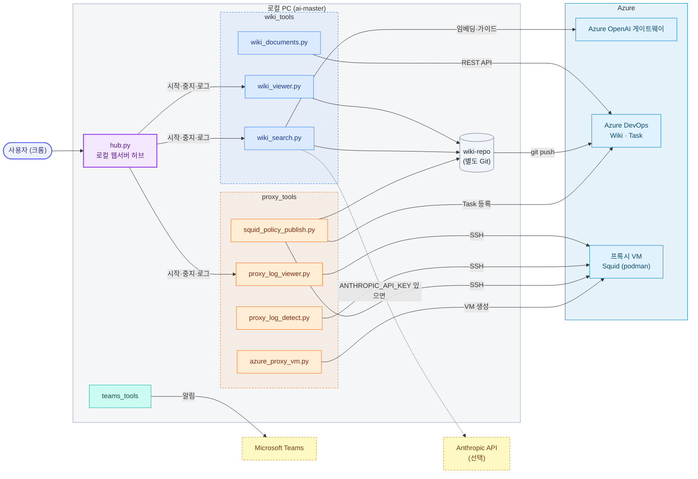
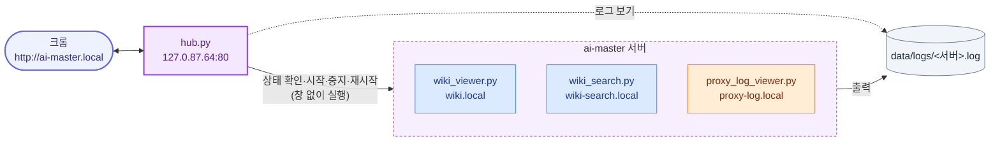
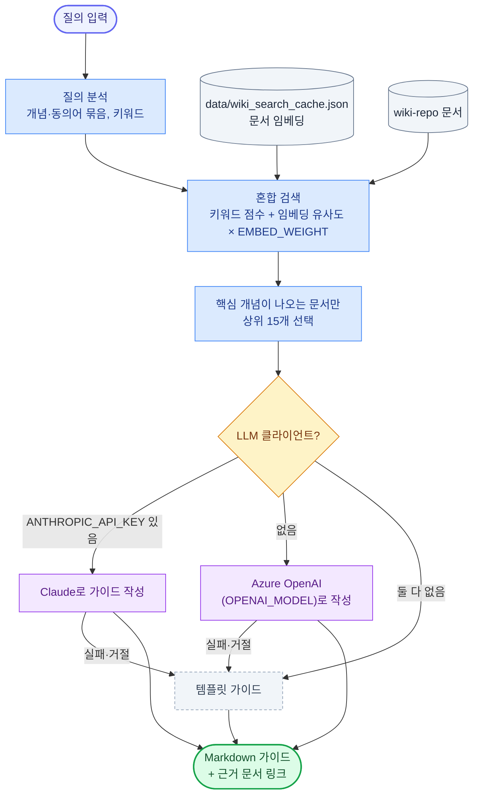
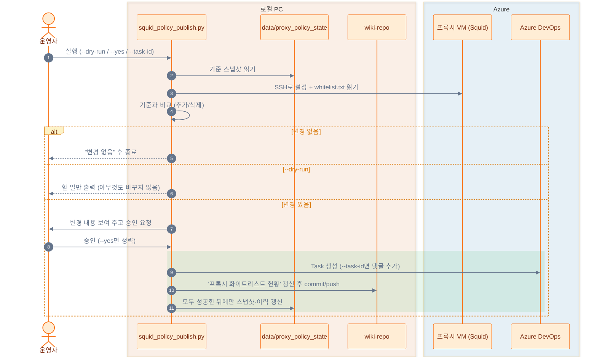

# AI Master

Azure DevOps Wiki를 관리하고, 사내 Azure OpenAI 게이트웨이와 Azure 프록시 VM을 운영하기 위한 도구 모음입니다.

## 구성

```
ai-master/
├─ hub.py          로컬 웹서버 허브: 한 화면에서 서버 시작·중지·재시작, 로그 보기
├─ common/         공통 모듈: 프로젝트 경로(paths.py), 로컬 웹서버·크롬 열기(server.py)
├─ wiki_tools/     Wiki 검색·가이드 생성, 로컬 뷰어, Azure DevOps Wiki 문서 관리
├─ proxy_tools/    프록시 VM 생성, 로그 뷰어, 이상 탐지, Squid 정책 변경 감지·Task/Wiki 반영
├─ teams_tools/    Microsoft Teams 알림
├─ data/           실행 중 생기는 파일 (Git 제외): 검색 캐시, 가상 로그, 정책 스냅샷, Teams 토큰
├─ test/           Azure OpenAI 채팅, 임베딩, 스트리밍 테스트
└─ wiki-repo/      Azure DevOps Wiki 저장소 (별도 Git)
```



모든 도구는 프로젝트 루트의 `.env` 하나를 함께 읽고, 실행 중 생기는 파일은 `data/`에 남깁니다.

| 폴더 | 파일 | 용도 | 주소 (hosts 미등록 시) |
|---|---|---|---|
| (루트) | `hub.py` | 로컬 웹서버 허브 | http://ai-master.local (8764) |
| wiki_tools | `wiki_search.py` | Wiki 의미 검색·가이드 생성 | http://wiki-search.local (8766) |
| | `wiki_viewer.py` | Wiki 로컬 읽기 전용 뷰어 (Azure DevOps 문법 렌더링) | http://wiki.local (8765) |
| | `wiki_documents.py` | Azure DevOps Wiki 문서 목록·생성·삭제 (REST API) | - |
| proxy_tools | `azure_proxy_vm.py` | 저가 Linux 프록시 VM 생성 (Squid/HAProxy/nginx, podman) | - |
| | `proxy_log_viewer.py` | 프록시 접속 로그·허용 목록·탐지 결과 화면 | http://proxy-log.local (8768) |
| | `proxy_log_detect.py` | 가상 에러 로그 생성, 로그 이상 탐지 | - |
| | `proxy_fault_inject.py` | 장애 대응 테스트용: proxy-config 저장소에 잘못된 설정 커밋을 넣음 | - |
| | `squid_policy_monitor.py` | Squid 정책 변경 감지 (읽기 전용) | - |
| | `squid_policy_publish.py` | 정책 변경 → 승인 → Task 등록 + Wiki 현황 갱신 | - |
| teams_tools | `teams_notify.py`, `teams_graph.py` | Teams 알림 (Workflows 웹후크 / Graph API) | - |

## 설정

`.env.sample`을 복사해 `.env`를 만들고 실제 인증정보를 입력합니다. `.env`는 프로젝트 루트에 하나만 두고 모든 도구가 함께 씁니다.

```powershell
Copy-Item .env.sample .env
```

`.env`에는 API 키와 PAT가 포함될 수 있으므로 Git에 커밋하지 않습니다. `.env.sample`에는 민감한 값 대신 placeholder를 사용합니다.

### 주요 설정 값

| 변수 | 기본값 | 설명 |
|---|---|---|
| `OPENAI_MODEL` | `gpt-5.4` | 가이드 작성 LLM. 2026-10-19 후보 5개 비교에서 완성도와 속도가 가장 균형이 좋았다 |
| `OPENAI_EMBED_MODEL` | `text-embedding-3-large` | 검색 임베딩. 정답 16문항 비교에서 small·ada-002보다 정확했다 |
| `EMBED_WEIGHT` | `8` | 혼합 검색에서 임베딩 유사도 가중치. 낮으면 키워드 점수가 의미 점수를 덮는다 |
| `ANTHROPIC_API_KEY` | (비움) | 넣으면 가이드 작성에 Claude(`ANTHROPIC_MODEL`)를 먼저 쓴다 |
| `SQUID_HOST` | - | 정책 감지 대상 프록시 VM의 공용 IP |
| `SQUID_CONTAINER` / `SQUID_RUNTIME` | `squid` / `podman` | VM에서 Squid가 도는 컨테이너 이름과 런타임 |
| `TEAMS_*` | (비움) | 회사·학교 Microsoft 365 계정이 있을 때만 사용 |

임베딩 모델을 바꾸면 처음 실행할 때 문서 전체 임베딩을 다시 계산한다(약 2분). 결과는 `data/wiki_search_cache.json`에 캐시된다.

### data 폴더

| 파일 | 만드는 도구 |
|---|---|
| `wiki_search_cache.json` | wiki_search.py (문서 임베딩 캐시) |
| `sim_access.log` | proxy_log_detect.py simulate (가상 프록시 로그) |
| `proxy_policy_state/` | squid_policy_publish.py (정책 기준 스냅샷, 변경 이력) |
| `teams_token_cache.json` | teams_graph.py (Graph 로그인 토큰, 공유 금지) |
| `logs/<서버>.log` | hub.py (허브에서 시작한 서버의 출력, 2MB 넘으면 `.old.log`로 교체) |

## 로컬 웹서버

### 포트 없는 주소 (hosts)

hosts 파일은 포트를 정할 수 없으므로 서버마다 다른 루프백 IP의 80 포트를 씁니다. 서버는 시작할 때 hosts를 읽어 자기 이름에 적힌 IP로 뜹니다(`common/server.py`).

| hosts에 적힌 값 | 서버가 뜨는 곳 | 주소 |
|---|---|---|
| 없음 | 127.0.0.1:포트 | `http://127.0.0.1:8765` |
| `127.0.0.1 wiki.local` | 127.0.0.1:포트 | `http://wiki.local:8765` |
| `127.0.87.65 wiki.local` | 127.0.87.65:80 | `http://wiki.local` |


관리자 PowerShell에서 `C:\Windows\System32\drivers\etc\hosts`에 아래를 추가하고 `ipconfig /flushdns`를 실행합니다.

```
127.0.87.64 ai-master.local
127.0.87.65 wiki.local
127.0.87.66 wiki-search.local
127.0.87.68 proxy-log.local
```

hosts를 바꾼 뒤에는 서버를 다시 시작해야 새 주소로 뜹니다. 127.0.87.67·69·70은 ai-monitor(사용량·비용 모니터와 그 허브)가 같은 규칙으로 씁니다.

### 허브 (hub.py)

http://ai-master.local 한 화면에서 ai-master 서버 3개(Wiki 뷰어, Wiki 검색, 프록시 로그 뷰어)의 상태를 보고 시작·중지·재시작하고, 로그와 화면을 봅니다. 사용량·비용 모니터는 ai-monitor의 허브(http://ai-monitor.local)에서 관리합니다.

```powershell
python hub.py                # 허브를 켜고 크롬으로 연다
python hub.py --start-all    # 꺼져 있는 서버를 모두 시작
python hub.py --restart-all  # 모두 다시 시작 (중복 실행·예전 주소로 뜬 서버 정리)
python hub.py --no-browser   # 크롬을 열지 않음 (다른 옵션과 함께 사용)
```



- 서버는 창 없이 뜨고 출력은 `data/logs/<서버>.log`에 남습니다. 허브를 꺼도(Ctrl+C) 서버는 계속 돕니다.
- 실행 여부는 프로세스 명령줄의 스크립트 이름으로 찾으므로 직접 띄운 서버도 허브에 보이고 끌 수 있습니다(로그는 허브에서 시작한 서버만 남음).
- 허브 콘솔에는 시각과 함께 시작 설정, 시작·중지 요청, 생성·종료한 PID, 상태 변화(직접 끄거나 서버가 죽은 경우 포함), 거부된 요청, 오류가 찍힙니다. 서버가 시작하자마자 죽으면 그 서버 출력의 마지막 줄도 함께 찍힙니다.

허브가 이미 떠 있으면 다시 실행할 때 "이미 사용 중"과 함께 PID가 나옵니다. 떠 있는 허브는 브라우저로 열면 되고, 끄려면 다음을 실행합니다.

```powershell
Get-NetTCPConnection -LocalAddress 127.0.87.64 -LocalPort 80 -State Listen | ForEach-Object { taskkill /PID $_.OwningProcess /T /F }
```

## 주요 흐름

### Wiki 검색·가이드 생성 (wiki_search.py)



### Squid 정책 변경 → Task·Wiki 반영 (squid_policy_publish.py)



처음 실행(기준 스냅샷 없음)이면 Task 없이 기준만 저장하고 Wiki 현황 문서를 만듭니다. 중간에 실패하면 스냅샷이 그대로라서 다음 실행 때 같은 변경을 다시 처리합니다.

### 프록시 로그 이상 탐지 (proxy_log_detect.py)


## 실행 예시

프로젝트 루트에서 실행합니다. 다른 폴더에서 실행해도 `.env`·`wiki-repo`·`data`는 프로젝트 루트 기준으로 찾습니다.

```powershell
python wiki_tools\wiki_search.py
python wiki_tools\wiki_viewer.py
python wiki_tools\wiki_documents.py list
python proxy_tools\proxy_log_viewer.py
python proxy_tools\proxy_log_detect.py detect --host 72.155.73.113
python proxy_tools\squid_policy_publish.py --dry-run
python proxy_tools\azure_proxy_vm.py --proxy squid --install podman --dry-run
```

## 주의사항

- `AZURE_OPENAI_API_KEY`, `AZURE_DEVOPS_PAT`, `OPENAI_API_KEY`, `ANTHROPIC_API_KEY`를 소스에 직접 작성하지 마세요.
- 이미 노출된 인증정보는 폐기하고 재발급하세요.
- `wiki-repo`, `wiki-backup`, `wiki/AI-Master.wiki`는 별도 Git 저장소를 포함합니다.
- 같은 주소로 서버를 두 번 띄우면 두 번째 실행은 "이미 사용 중" 메시지로 끝납니다. 코드를 바꾼 뒤에는 기존 서버를 끄고 다시 실행하세요(허브의 재시작 버튼).
