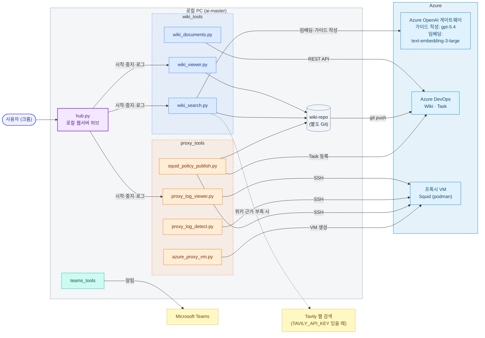
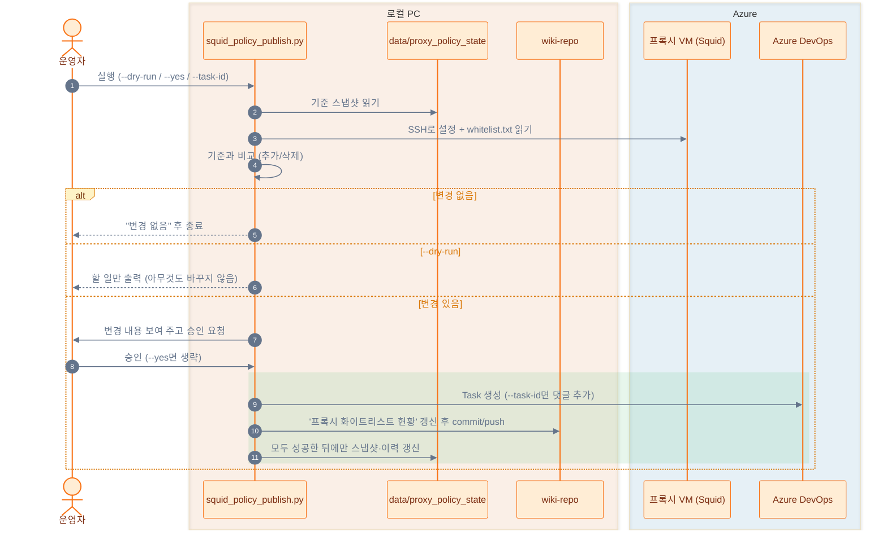
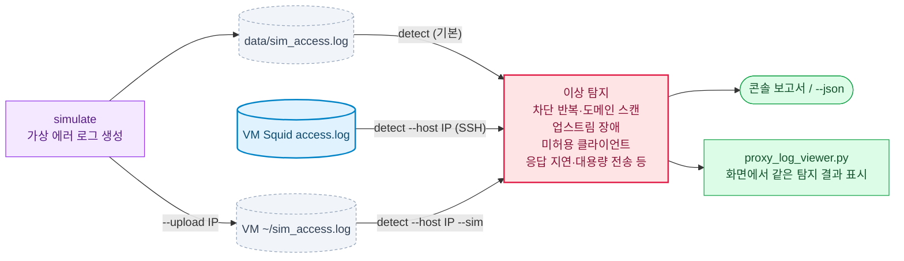
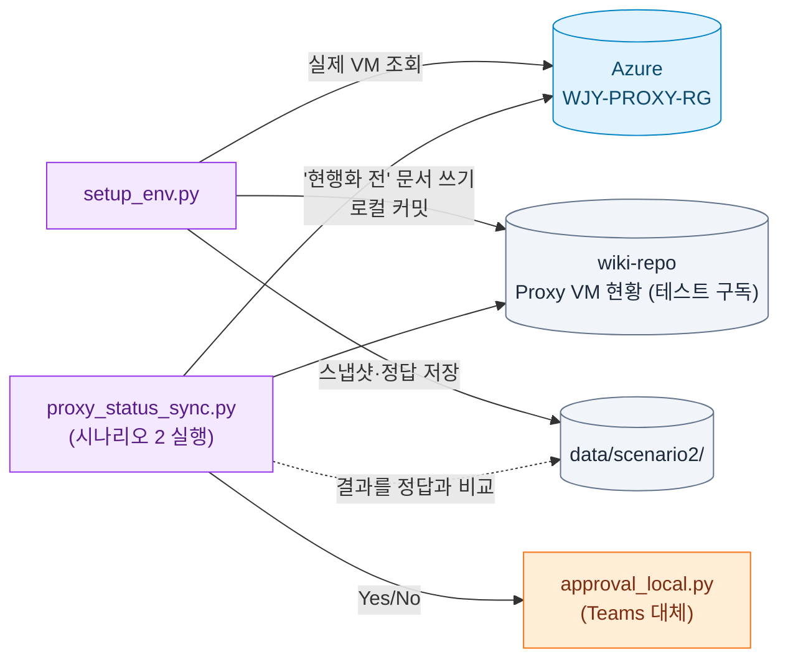

# AI Master

Azure DevOps Wiki를 관리하고, 사내 Azure OpenAI 게이트웨이와 Azure 프록시 VM을 운영하기 위한 도구 모음입니다.

## 구성

```
ai-master/
├─ hub.py          로컬 웹서버 허브: 한 화면에서 서버 시작·중지·재시작, 로그 보기
├─ common/         공통 모듈: 프로젝트 경로(paths.py), 로컬 웹서버·크롬 열기(server.py), 노드별 트레이싱(trace.py)
├─ wiki_tools/     Wiki 검색·가이드 생성, 로컬 뷰어, Azure DevOps Wiki 문서 관리
├─ proxy_tools/    프록시 VM 생성, 로그 뷰어, 이상 탐지, Squid 정책 변경 감지·Task/Wiki 반영
├─ teams_tools/    Microsoft Teams 알림, 로컬 승인 화면(Teams 대체)
├─ data/           실행 중 생기는 파일 (Git 제외): 검색 캐시, 트레이스, 가상 로그, 정책 스냅샷, Teams 토큰
├─ test/           Azure OpenAI 채팅·임베딩·스트리밍 테스트, 시나리오 2 테스트 환경(scenario2/)
└─ wiki-repo/      Azure DevOps Wiki 저장소 (별도 Git, ai-master 에서는 추적하지 않음)
```



모든 도구는 프로젝트 루트의 `.env` 하나를 함께 읽고, 실행 중 생기는 파일은 `data/`에 남깁니다.

| 폴더 | 파일 | 용도 | 주소 (hosts 미등록 시) |
|---|---|---|---|
| (루트) | `hub.py` | 로컬 웹서버 허브 | http://ai-master.local (8764) |
| wiki_tools | `wiki_search.py` | Wiki 의미 검색·가이드 생성 (오타 교정, 웹 검색 보완, 노드별 트레이스) | http://wiki-search.local (8766) |
| | `wiki_viewer.py` | Wiki 로컬 읽기 전용 뷰어 (Azure DevOps 문법 렌더링) | http://wiki.local (8765) |
| | `wiki_documents.py` | Azure DevOps Wiki 문서 목록·생성·삭제 (REST API) | - |
| proxy_tools | `azure_proxy_vm.py` | 저가 Linux 프록시 VM 생성 (Squid/HAProxy/nginx, podman·docker). Squid 로그는 VM 디스크 `/var/log/proxy`에 남김 | - |
| | `proxy_log_viewer.py` | 프록시 접속 로그·허용 목록·탐지 결과 화면 (Squid 로그 파일, nginx는 journald) | http://proxy-log.local (8768) |
| | `proxy_log_detect.py` | 가상 에러 로그 생성, 로그 이상 탐지 | - |
| | `proxy_fault_inject.py` | 장애 대응 테스트용: proxy-config 저장소에 잘못된 설정 커밋을 넣음 | - |
| | `squid_policy_monitor.py` | Squid 정책 변경 감지 (읽기 전용) | - |
| | `squid_policy_publish.py` | 정책 변경 → 승인 → Task 등록 + Wiki 현황 갱신 | - |
| | `proxy_status_sync.py` | 시나리오 2: Wiki Proxy 현황 ↔ Azure VM 비교 → Teams 승인 → Task → Wiki 현행화 → 완료 보고 | - |
| teams_tools | `teams_notify.py`, `teams_graph.py` | Teams 알림 (Workflows 웹후크 / Graph API) | - |
| | `approval_local.py` | Teams 승인 카드 대체: 로컬 화면에서 Yes/No 승인 | http://127.0.0.1:8771 (요청 중에만) |
| test | `teams_test.py` | Teams 연동 테스트: 웹후크·Graph 를 차례로 시험하고 실패 원인을 안내 (`.env`의 `TEAMS_*`) | - |
| | `scenario2/setup_env.py` | 시나리오 2(Proxy 현황 Wiki 현행화) 테스트 환경 점검·초기화 | - |

## 설정

`.env.sample`을 복사해 `.env`를 만들고 실제 인증정보를 입력합니다. `.env`는 프로젝트 루트에 하나만 두고 모든 도구가 함께 씁니다.

```powershell
Copy-Item .env.sample .env
```

`.env`에는 API 키와 PAT가 포함될 수 있으므로 Git에 커밋하지 않습니다. `.env.sample`에는 민감한 값 대신 placeholder를 사용합니다.

### 주요 설정 값

| 변수 | 기본값 | 설명 |
|---|---|---|
| `OPENAI_MODEL` | `gpt-5.4` | 가이드 작성 LLM. 2026-10-19 후보 5개 비교에서 완성도와 속도가 가장 균형이 좋았다 |
| `OPENAI_EMBED_MODEL` | `text-embedding-3-large` | 검색 임베딩. 정답 16문항 비교에서 small·ada-002보다 정확했다 |
| `EMBED_WEIGHT` | `8` | 혼합 검색에서 임베딩 유사도 가중치. 낮으면 키워드 점수가 의미 점수를 덮는다 |
| `TAVILY_API_KEY` | (비움) | 넣으면 위키 근거가 약할 때 Tavily 웹 검색 결과를 가이드 근거에 보탠다. 비우면 웹 검색 안 함 |
| `WEB_SEARCH_MIN_SIM` | `0.5` | 위키 최고 임베딩 유사도가 이보다 낮으면 웹 검색. 2026-10-20 측정에서 위키에 있는 질의는 0.59 이상, 없는 질의는 0.46 이하였다 |
| `WEB_SEARCH_MIN_VARIANT_SIM` | `0.45` | 유형(포워드/리버스 등)을 골랐을 때 유형 이름의 위키 최고 유사도가 이보다 낮으면 웹 검색. 2026-10-23 측정: 포워드 프록시 0.499, 리버스 프록시 0.41 |
| `WEB_SEARCH_MAX` | `5` | 웹 검색 결과를 몇 건까지 가져올지 |
| `TRACE_KEEP_DAYS` | `14` | `data/traces/`의 요청별 트레이스 보관 일수 |
| `SQUID_HOST` | - | 정책 감지 대상 프록시 VM의 공용 IP |
| `PROXY_ALLOWED_CLIENTS` | `203.0.113.10/32` | 프록시를 쓸 수 있는 클라이언트 CIDR(쉼표 구분). 로그 탐지·장애 주입이 이 값을 쓴다. 실제 IP는 `.env`에만 둔다 |
| `SQUID_CONTAINER` / `SQUID_RUNTIME` | `squid` / `podman` | VM에서 Squid가 도는 컨테이너 이름과 런타임 |
| `TEAMS_*` | (비움) | 회사·학교 Microsoft 365 계정이 있을 때만 사용 |

임베딩 모델을 바꾸면 처음 실행할 때 문서 전체 임베딩을 다시 계산한다(약 2분). 결과는 `data/wiki_search_cache.json`에 캐시된다.

서버는 시작할 때만 `.env`를 읽는다. 값을 바꾸면 허브에서 해당 서버를 재시작해야 적용된다.

### data 폴더

| 파일 | 만드는 도구 |
|---|---|
| `wiki_search_cache.json` | wiki_search.py (문서 임베딩 캐시) |
| `sim_access.log` | proxy_log_detect.py simulate (가상 프록시 로그) |
| `proxy_policy_state/` | squid_policy_publish.py (정책 기준 스냅샷, 변경 이력) |
| `teams_token_cache.json` | teams_graph.py (Graph 로그인 토큰, 공유 금지) |
| `logs/<서버>.log` | hub.py (허브에서 시작한 서버의 출력, 2MB 넘으면 `.old.log`로 교체) |
| `traces/<서비스>-YYYYMMDD.jsonl` | wiki_search.py (요청별 노드 트레이스, `TRACE_KEEP_DAYS`(기본 14)일 지나면 삭제) |
| `scenario2/` | test/scenario2/setup_env.py (Azure VM 스냅샷, '현행화 전' Wiki 표, 정답 차이 목록) |

## 로컬 웹서버

### 포트 없는 주소 (hosts)

hosts 파일은 포트를 정할 수 없으므로 서버마다 다른 루프백 IP의 80 포트를 씁니다. 서버는 시작할 때 hosts를 읽어 자기 이름에 적힌 IP로 뜹니다(`common/server.py`).

| hosts에 적힌 값 | 서버가 뜨는 곳 | 주소 |
|---|---|---|
| 없음 | 127.0.0.1:포트 | `http://127.0.0.1:8765` |
| `127.0.0.1 wiki.local` | 127.0.0.1:포트 | `http://wiki.local:8765` |
| `127.0.87.65 wiki.local` | 127.0.87.65:80 | `http://wiki.local` |


관리자 PowerShell에서 `C:\Windows\System32\drivers\etc\hosts`에 아래를 추가하고 `ipconfig /flushdns`를 실행합니다.

```
127.0.87.64 ai-master.local
127.0.87.65 wiki.local
127.0.87.66 wiki-search.local
127.0.87.68 proxy-log.local
```

hosts의 주석(`#` 뒤)은 영문(ASCII)으로만 씁니다. Windows는 hosts를 UTF-8로 읽지 않아 한글 주석이 있으면 이름 해석이 깨집니다(2026-10-21 확인).
hosts를 바꾼 뒤에는 서버를 다시 시작해야 새 주소로 뜹니다. 127.0.87.67·69·70은 ai-monitor(사용량·비용 모니터와 그 허브)가 같은 규칙으로 씁니다.

### 허브 (hub.py)

http://ai-master.local 한 화면에서 ai-master 서버 3개(Wiki 뷰어, Wiki 검색, 프록시 로그 뷰어)의 상태를 보고 시작·중지·재시작하고, 로그와 화면을 봅니다. 사용량·비용 모니터는 ai-monitor의 허브(http://ai-monitor.local)에서 관리합니다.

```powershell
python hub.py                # 허브를 켜고 크롬으로 연다
python hub.py --start-all    # 꺼져 있는 서버를 모두 시작
python hub.py --restart-all  # 모두 다시 시작 (중복 실행·예전 주소로 뜬 서버 정리)
python hub.py --no-browser   # 크롬을 열지 않음 (다른 옵션과 함께 사용)
```


- 서버는 창 없이 뜨고 출력은 `data/logs/<서버>.log`에 남습니다. 허브를 꺼도(Ctrl+C) 서버는 계속 돕니다.
- 실행 여부는 프로세스 명령줄의 스크립트 이름으로 찾으므로 직접 띄운 서버도 허브에 보이고 끌 수 있습니다(로그는 허브에서 시작한 서버만 남음).
- 허브 콘솔에는 시각과 함께 시작 설정, 시작·중지 요청, 생성·종료한 PID, 상태 변화(직접 끄거나 서버가 죽은 경우 포함), 거부된 요청, 오류가 찍힙니다. 서버가 시작하자마자 죽으면 그 서버 출력의 마지막 줄도 함께 찍힙니다.

허브가 이미 떠 있으면 다시 실행할 때 "이미 사용 중"과 함께 PID가 나옵니다. 떠 있는 허브는 브라우저로 열면 되고, 끄려면 다음을 실행합니다.

```powershell
Get-NetTCPConnection -LocalAddress 127.0.87.64 -LocalPort 80 -State Listen | ForEach-Object { taskkill /PID $_.OwningProcess /T /F }
```

## 주요 흐름

### Wiki 검색·가이드 생성 (wiki_search.py)


#### 검색어 해석

| 기능 | 방식 | AI 여부 |
|---|---|---|
| 동의어 묶기 (프록시 = proxy = 프락시) | 개념 사전 `CONCEPTS` | 규칙 기반 |
| 오타 교정 (프록실·프롤시 → 프록시, porxy → proxy) | 한글 자모 분해 + 편집 거리(Damerau–Levenshtein) + 개념 사전 매칭 | 규칙 기반 |
| 의미가 비슷한 문서 찾기 | 임베딩 `text-embedding-3-large` 유사도 | AI (머신러닝) |
| 가이드 작성 | LLM `gpt-5.4` | AI (LLM) |

- 오타 교정은 한글 3음절 이상·영문 5글자 이상만 고칩니다. 2음절은 `설정`↔`결정`처럼 다른 실제 단어와 거리가 1이라 고치지 않습니다.
- 고친 단어는 화면 해석 칩(`오타 교정: 프록실 → 프록시`)과 트레이스 `analyze` 줄(`typo_fixes=`)에 나옵니다. 검색은 고친 질의로 하므로 결과가 정상 질의와 같습니다.

#### 웹 검색 (TAVILY_API_KEY 있을 때)

- 조건: 위키 최고 유사도 < `WEB_SEARCH_MIN_SIM`(0.5), 핵심 개념이 나오는 위키 문서 0건, 또는 고른 유형(예: 리버스 프록시)의 이름 유사도 < `WEB_SEARCH_MIN_VARIANT_SIM`(0.45). 주제(프록시)는 위키에 많아도 그 유형은 없을 수 있기 때문입니다.
- 검색어는 질의 문장이 아니라 핵심 한글어로 만듭니다(예: `리버스 프록시 설정`). 말투·영문 동의어·`가이드` 같은 일반어를 섞으면 게임·주식·코인 기사가 걸렸습니다.
- 결과에 핵심 개념(유형이면 `리버스 프록시`·`reverse proxy` 같은 붙은 문구)이 없으면 버립니다.
- 가이드는 위키를 우선 근거로 하고, 웹에서 가져온 문장 끝에 `(웹: URL)`을 붙이며, 끝에 "웹 참고 링크"와 "사내 기준이 아님" 주의 문구가 들어갑니다.

#### 화면

- 가이드 위에 생성 방식 배지(`LLM 작성 · gpt-5.4 · 소요 N초` 또는 `문서 조합 템플릿`)가 나옵니다.
- 가이드는 스트리밍(`/api/guide/stream`)으로 받도록 되어 있지만, 사내 게이트웨이가 응답을 모았다가 한꺼번에 보내서 실제로는 끝날 때 한 번에 나타납니다(트레이스 `first_line_ms`가 전체 시간과 거의 같음). 게이트웨이 버퍼링이 꺼지면 코드 수정 없이 글이 흘러나옵니다.

#### 트레이스

요청마다 노드별 소요 시간과 결과가 허브 로그(`data/logs/wiki-search.log`)와 `data/traces/`에 남습니다(`common/trace.py`).

```text
10:41:14 [2d15573c] ▶ guide/stream  q=프록시 설정 가이드 알려줘 key=proxy variant=forward
10:41:14 [2d15573c]     04 embed_query          354ms  model=text-embedding-3-large best_sim=0.601 …
10:41:14 [2d15573c]   03 hybrid_search        366ms  docs=1026 results=20 top=6.37 top_doc=…
10:41:14 [2d15573c]   05 select_sources         4ms  sources=15 statements=35 top3=…
10:41:14 [2d15573c]   06 web_decision           0ms  result=꺼짐 (TAVILY_API_KEY 없음)
10:41:52 [2d15573c]   07 llm_generate      37,917ms  model=gpt-5.4 prompt_tokens=8364 completion_tokens=5692 first_line_ms=36749 …
10:41:52 [2d15573c] ■ guide/stream ok 38.6s | llm_generate 37.9s · hybrid_search 0.4s … | mode=llm model=gpt-5.4
```

- 노드: `refresh_index` → `analyze`(오타 교정 포함) → `hybrid_search`(안에 `embed_query`) → `select_sources` → `web_decision` → `web_search`(검색어·결과·버린 수) → `llm_generate`(토큰·첫 줄 시각) 또는 `template`.
- 줄 앞 표시: `✗` 실패(이유는 `error=`), `…` 연결이 끊겨 중단(cancelled). 번호는 시작 순서이고, 안쪽 노드가 먼저 끝나 먼저 찍힌다.
- JSONL에는 같은 내용이 요청당 한 줄(노드별 시작 오프셋·소요 시간·속성)로 들어갑니다. 질의 원문이 들어가므로 `data/`(Git 제외)에만 둡니다.

### Squid 정책 변경 → Task·Wiki 반영 (squid_policy_publish.py)



처음 실행(기준 스냅샷 없음)이면 Task 없이 기준만 저장하고 Wiki 현황 문서를 만듭니다. 중간에 실패하면 스냅샷이 그대로라서 다음 실행 때 같은 변경을 다시 처리합니다.

### 프록시 로그 이상 탐지 (proxy_log_detect.py)



## 프록시 VM 운영

리소스 그룹 `WJY-PROXY-RG`에 VM 3대가 있고, 모두 podman Quadlet(`/etc/containers/systemd/<이름>.container`)으로 컨테이너를 띄웁니다. 인바운드는 SSH와 프록시 포트를 허용 클라이언트 IP 한 곳에만 엽니다.

| VM | 종류 | 접속 로그 위치 | 재시작·VM 중지 후 |
|---|---|---|---|
| wjy-proxy01, wjy-proxy02 | Squid 포워드 프록시 (3128) | VM 디스크 `/var/log/proxy/access.log` (컨테이너 `/var/log/squid`에 연결) | 남음 |
| wjy-proxy03 | nginx 리버스 프록시 (80) | journald (`journalctl CONTAINER_NAME=nginx`) | 남음 |

- 컨테이너는 `--rm`이라 재시작할 때마다 새로 만들어집니다. 그래서 Squid 로그는 VM 디스크 폴더에 연결하고(2026-10-21 적용, `azure_proxy_vm.py`도 같이 만듦), nginx 로그는 `podman logs`(지금 컨테이너만) 대신 journald에서 읽습니다.
- 매일 01:00(KST)에 자동 종료(`shutdown-computevm-*`)됩니다. 꺼져 있는 동안 보낸 요청은 기록되지 않습니다.
- Squid 로그는 정리(logrotate) 없이 쌓입니다. 디스크 여유는 약 25GB입니다.

시험 요청 보내기 (허용 클라이언트 IP에서):

```powershell
curl.exe -x http://<VM_IP>:3128 https://www.data.go.kr/        # 포워드 프록시: 허용 도메인 → 200
curl.exe -x http://<VM_IP>:3128 https://www.google.com/         # 허용 목록 밖 → 터널 거부(403)
curl.exe -H "Host: law.wjy.test" http://<VM_IP>/LSW/main.html   # 리버스 프록시: Host 머리글로 가상 도메인 선택
```

리버스 프록시의 `data.wjy.test`·`law.wjy.test`는 nginx 설정(`server_name`)에만 있는 이름입니다. 요청은 IP로 보내고 이름은 `Host` 머리글에만 실으므로 hosts·DNS가 필요 없습니다.

로그 뷰어(http://proxy-log.local)는 새로고침하는 동안 상단 진행 막대·회전 아이콘·흐린 표를 보여 주고, 끝나면 `갱신 HH:MM:SS · 새 로그 N건`(또는 `변경 없음`)을 잠깐 강조합니다. 로그 소스가 "실제 로그"면 VM의 진짜 로그이고, "가상 로그"일 때만 만들어 낸 데이터입니다.

## 시나리오 2 테스트 환경

시나리오 2는 Wiki의 Proxy 현황 문서와 Azure의 실제 VM을 비교해, 차이가 있으면 승인을 받아 Task를 만들고 문서를 현행화합니다. 테스트 환경은 Azure를 바꾸지 않고 Wiki 쪽에 일부러 차이를 넣어 만듭니다.



`setup_env.py`는 리소스 그룹 `WJY-PROXY-RG`에서 이름이 proxy·prxy·pxy(+숫자)로 끝나는 VM을 읽어 아래 차이를 넣은 Wiki 문서를 만듭니다. 실제 값과 정답은 `data/scenario2/`에만 저장합니다(저장소 공개).

| VM | Wiki(현행화 전) | 비교 단계가 찾아야 할 차이 |
|---|---|---|
| 1번째 VM | 상태·SIZE를 실제와 다르게 | 상태 변경, 스펙 변경 |
| 2번째 VM | 사설 IP를 실제와 다르게 | IP 변경 |
| 3번째 VM | 표에서 뺌 | 신규 |
| 없는 VM(`*-prxy04`) | 표에 넣음 | 삭제 |

```powershell
python test\scenario2\setup_env.py            # 점검 + Wiki 문서를 '현행화 전'으로 초기화 (시나리오 실행 전마다)
python test\scenario2\setup_env.py --check    # 점검만
python test\scenario2\setup_env.py --reseed   # VM이 바뀌었을 때(시작·중지 포함) 표와 정답을 다시 만듦
python teams_tools\approval_local.py --title "Proxy 현황 변경 감지" "신규: wjy-proxy03"   # 승인 화면만 시험
```

- 점검 항목: az 로그인과 Proxy VM 3대 이상, 스냅샷과 실제 VM 일치, Azure DevOps PAT, 승인 화면 모듈.
- VM 전원 상태도 비교 대상이라 VM을 켜거나 끄면 정답이 틀어집니다. 이때 `--check`가 실패하므로 `--reseed`로 다시 만듭니다.
- Wiki 문서는 wiki-repo에 로컬 커밋만 하고 Azure DevOps Wiki로 push하지 않습니다.
- Teams 연동(Workflows 웹후크·승인 카드·Graph API)에는 회사·학교용 Microsoft 365 계정이 필요합니다(무료 개인 Teams 불가, 가장 싼 선택지는 Microsoft 365 Business Basic). Teams 카드의 응답을 이 PC 스크립트로 돌려받으려면 Power Automate 프리미엄(HTTP 액션)이 필요합니다.

### 시나리오 2 실행 (proxy_status_sync.py)

| 단계 | 하는 일 |
|---|---|
| 1. trigger | 직접 실행 또는 스케줄러(`--yes`면 승인 생략) |
| 2. wiki_read | Wiki 문서의 `## VM 목록` 표를 읽음 (머리글 이름으로 칸을 찾음) |
| 3. azure_read | 리소스 그룹에서 이름이 proxy·prxy·pxy(+숫자)로 끝나는 VM의 IP·상태·SIZE·리전 |
| 4. compare | 신규·삭제·변경(사설/공인 IP, 상태, SIZE, LOCATION, RESOURCE GROUP). 차이 없으면 종료. Proxy(용도) 칸은 사람이 관리하므로 비교하지 않음 |
| 5. approval | Teams 채널에 요약 카드와 **Yes · 현행화 / No · 기록만** 버튼을 보내고 이 PC의 승인 서버에서 답을 기다림(기본 15분). 웹후크가 없으면 승인 화면을 브라우저로 엶. No·시간 초과는 Teams에 알리고 종료 |
| 6. task_create | Azure DevOps Task(변경 내역, 담당자 = `SCENARIO2_ASSIGNEE` 또는 PAT 소유자, 태그 `proxy-status; scenario2`) |
| 7. wiki_update | 표를 Azure 값으로 고치고 `## 변경 이력`에 행 추가, 최종 수정일 갱신 → wiki-repo 커밋 (`--push`일 때만 push) |
| 8. report | Task를 완료 상태(프로세스의 Completed 범주, 예: Done)로 바꾸고 댓글, Teams에 결과 카드 |

```powershell
python proxy_tools\proxy_status_sync.py --dry-run --verify   # 1~4단계 + 테스트 정답 대조, 아무것도 바꾸지 않음
python proxy_tools\proxy_status_sync.py                      # Teams 승인 후 Task·Wiki 반영
python proxy_tools\proxy_status_sync.py --yes --push         # 승인 없이 진행하고 Azure DevOps Wiki로 push
```

- Teams 카드의 버튼은 `http://127.0.0.1:8771/decide?...&token=…`을 엽니다. **알림을 보낸 PC에서** 눌러야 하고, token은 요청마다 새로 만들어 다른 요청의 버튼으로는 결정되지 않습니다. Teams 안에서 응답을 받아 이 PC로 돌려주려면 Power Automate 프리미엄(HTTP 액션)이 필요해서 이 방식을 씁니다.
- 노드별 기록은 콘솔과 `data/traces/scenario2-YYYYMMDD.jsonl`에 남습니다(승인 결과 `decision=yes|no|timeout` 포함).
- 테스트를 다시 하려면 `python test\scenario2\setup_env.py`로 Wiki 문서를 '현행화 전'으로 되돌립니다.

## 실행 예시

프로젝트 루트에서 실행합니다. 다른 폴더에서 실행해도 `.env`·`wiki-repo`·`data`는 프로젝트 루트 기준으로 찾습니다.

```powershell
python wiki_tools\wiki_search.py
python wiki_tools\wiki_viewer.py
python wiki_tools\wiki_documents.py list
python proxy_tools\proxy_log_viewer.py
python proxy_tools\proxy_log_detect.py detect --host <VM_IP>
python proxy_tools\squid_policy_publish.py --dry-run
python proxy_tools\azure_proxy_vm.py --proxy squid --install podman --dry-run
```

## 주의사항

- `AZURE_OPENAI_API_KEY`, `AZURE_DEVOPS_PAT`, `OPENAI_API_KEY`, `TAVILY_API_KEY`를 소스에 직접 작성하지 마세요. `.env.sample`에도 실제 값을 넣지 않습니다(공개 저장소에 올라감).
- 이미 노출된 인증정보는 폐기하고 재발급하세요.
- 이 저장소는 공개입니다. 실제 VM IP, 허용 클라이언트 IP, 구독 ID, 사내 게이트웨이 주소는 소스·README에 쓰지 말고 `.env` 또는 `data/`(Git 제외)에만 둡니다. 예시에는 `<VM_IP>`나 문서용 IP(`203.0.113.x`)를 씁니다.
- `wiki-repo`는 별도 Git 저장소(Azure DevOps Wiki)이며 ai-master의 `.gitignore`에 들어 있습니다. Wiki 변경은 `wiki-repo` 안에서 따로 커밋·push합니다. Wiki 문서를 만들거나 고칠 때는 `WIKI_DOCUMENT_RULES.md`를 먼저 따릅니다.
- 같은 주소로 서버를 두 번 띄우면 두 번째 실행은 "이미 사용 중" 메시지로 끝납니다. 코드를 바꾼 뒤에는 기존 서버를 끄고 다시 실행하세요(허브의 재시작 버튼).
