# AI Master

**Azure DevOps 기반 AI 운영 자동화 시나리오** (2026. 10)

## 목차

**바로 가기:** [시나리오 1](#11-시나리오-1--프록시-설정-가이드-자동-생성) · [시나리오 2](#12-시나리오-2--프록시-현황-wiki-현행화) · [시나리오 3](#13-시나리오-3--장애-감지-및-자동-조치) · [사전 준비](#3-사전-준비) · [설정 값](#41-주요-설정-값) · [허브 실행](#52-허브-hubpy) · [시나리오 2 실행](#81-시나리오-2-실행-proxy_status_syncpy) · [주의사항](#10-주의사항)

- [1. 목적](#1-목적)
  - [1.1 시나리오 1 · 프록시 설정 가이드 자동 생성](#11-시나리오-1--프록시-설정-가이드-자동-생성)
  - [1.2 시나리오 2 · 프록시 현황 Wiki 현행화](#12-시나리오-2--프록시-현황-wiki-현행화)
  - [1.3 시나리오 3 · 장애 감지 및 자동 조치](#13-시나리오-3--장애-감지-및-자동-조치)
- [2. 구성](#2-구성)
- [3. 사전 준비](#3-사전-준비)
  - [3.1 PC 도구](#31-pc-도구)
  - [3.2 hosts 등록](#32-hosts-등록)
  - [3.3 Azure DevOps](#33-azure-devops)
  - [3.4 LLM 게이트웨이](#34-llm-게이트웨이)
  - [3.5 웹 검색 (Tavily)](#35-웹-검색-tavily)
  - [3.6 Azure 구독과 Proxy VM](#36-azure-구독과-proxy-vm)
  - [3.7 Microsoft Teams](#37-microsoft-teams)
- [4. 설정](#4-설정)
  - [4.1 주요 설정 값](#41-주요-설정-값)
  - [4.2 data 폴더](#42-data-폴더)
- [5. 로컬 웹서버](#5-로컬-웹서버)
  - [5.1 포트 없는 주소 (hosts)](#51-포트-없는-주소-hosts)
  - [5.2 허브 (hub.py)](#52-허브-hubpy)
- [6. 주요 흐름](#6-주요-흐름)
  - [6.1 Wiki 검색·가이드 생성 (wiki_search.py)](#61-wiki-검색가이드-생성-wiki_searchpy)
  - [6.2 Squid 정책 변경 → Task·Wiki 반영 (squid_policy_publish.py)](#62-squid-정책-변경--taskwiki-반영-squid_policy_publishpy)
  - [6.3 프록시 로그 이상 탐지 (proxy_log_detect.py)](#63-프록시-로그-이상-탐지-proxy_log_detectpy)
- [7. 프록시 VM 운영](#7-프록시-vm-운영)
- [8. 시나리오 2 테스트 환경](#8-시나리오-2-테스트-환경)
  - [8.1 시나리오 2 실행 (proxy_status_sync.py)](#81-시나리오-2-실행-proxy_status_syncpy)
- [9. 실행 예시](#9-실행-예시)
- [10. 주의사항](#10-주의사항)


## 1. 목적

Azure DevOps Wiki에 쌓인 운영 지식과 Azure의 실제 인프라를 LLM으로 연결해, 사람이 반복하던 운영 업무를 자동화합니다. 문서를 찾아 정리하고(시나리오 1), 문서와 실제 상태를 맞추고(시나리오 2), 장애 원인을 찾아 조치를 제안합니다(시나리오 3). 사람의 판단이 필요한 변경은 Teams에서 Yes/No 승인을 받은 뒤에만 반영합니다.

| | 시나리오 1 | 시나리오 2 | 시나리오 3 |
|---|---|---|---|
| 이름 | 프록시 설정 가이드 자동 생성 | 프록시 현황 Wiki 현행화 | 장애 감지 및 자동 조치 |
| 내용 | 명령어 한 줄로 기존 Wiki를 검색해 LLM이 통합 가이드 문서를 생성 | Wiki 현황과 Azure의 '*xy' VM을 비교하고 승인 후 반영 | LLM이 장애 로그·소스를 분석해 원인·수정안 도출 후 승인 요청 |
| 트리거 | 사용자 명령 | 직접 실행 | 직접 실행 / 스케줄러 |
| 승인 | 미리보기 확인 후 "Wiki에 등록" 버튼 | Teams Yes/No | Teams Yes/No |
| 결과물 | 가이드 Wiki 문서 (링크 제공) | Wiki 현황 갱신 + DevOps Task | 원인·수정안 (PR은 확장) |
| 구현 | `wiki_tools/wiki_search.py` | `proxy_tools/proxy_status_sync.py` | `proxy_tools/proxy_log_detect.py` 등 (일부) |

구현 상태 표시: ✅ 구현 · 🟡 일부 · ⬜ 미구현 · (확장) = 자료에서 Nice-to-have로 둔 범위  
다이어그램 색: 초록 = 구현 · 노랑 = 일부 · 회색 점선 = 미구현 · 주황 = 사용자 판단

### 1.1 시나리오 1 · 프록시 설정 가이드 자동 생성

명령어 한 줄로 기존 Azure DevOps Wiki를 검색하고, RAG(검색한 Wiki 문서를 근거로 LLM이 작성)로 통합 가이드 문서를 만듭니다. 사용자가 미리보기로 확인한 뒤 Wiki에 등록합니다. 승인 없이 자동 등록하면 LLM이 잘못 쓴 문서가 팀 Wiki에 쌓이므로, 화면의 버튼을 가벼운 승인으로 씁니다. 화면: http://wiki-search.local

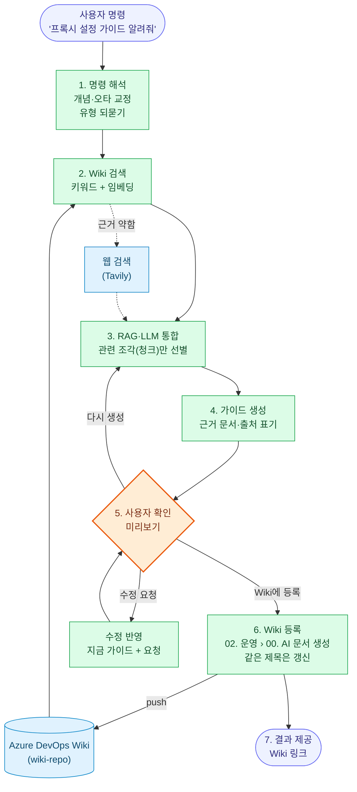

| 단계 | 내용 | 상태 | 지금 구현 |
|---|---|---|---|
| 1. 사용자 명령 입력 | "프록시 설정 가이드 알려줘", 주제·유형 인식, 모호하면 되묻기(포워드/리버스), 오타 교정 | ✅ | 개념 사전, 자모 분해 + 편집 거리 오타 교정, 유형 선택 |
| 2. Azure DevOps Wiki 검색 | 키워드 검색(proxy = 프록시 = 프락시), 의미 기반 검색(임베딩), 근거가 약하면 웹 검색 보완 | ✅ | BM25 + 문자 bigram + `text-embedding-3-large`, Tavily |
| 3. RAG·LLM 분석·통합 | 관련 문서 선별, 중복·상충 정리, 단계별 구성 | ✅ | 상위 15개 문서를 제목 단위 조각(청크)으로 나눠 질의와 가까운 조각 24개만 LLM에 전달(코드 블록·다이어그램은 자르지 않음, 같은·거의 같은 조각은 하나만). 입력 8,364 → 4,801토큰, 생성 57 → 34초(2026-10-24 측정). AI가 등록한 문서(00. AI 문서 생성)는 재료에서 제외 |
| 4. 가이드 문서 생성 | 설정 방법·예제·주의사항, 단계마다 근거 문서, 웹 출처 따로 표시, 원문 다이어그램 유지 | ✅ | `OPENAI_MODEL`(gpt-6.1-sol) |
| 5. 사용자 확인 | 미리보기, "Wiki에 등록" 또는 "다시 생성", Markdown 복사·다운로드 | ✅ | "Wiki에 등록"은 확인 창(팀원 공개·같은 제목 갱신 안내) 후 진행 |
| 6. Wiki 문서 등록 | `02. 운영 > 00. AI 문서 생성` 아래 `NN. 제목`으로 등록, 같은 제목이면 갱신(번호 유지, 이력은 git), Wiki 문서 규칙(채번·`.order`·인코딩·프록시 표기) 준수, 머리에 "AI 생성 · 모델 · 생성 일시 · 질의 · 근거 수" | ✅ | `wiki_tools/wiki_register.py`. 로컬 뷰어 링크를 Wiki 안 링크로 바꾸고 push |
| 7. 결과 제공 | Azure DevOps Wiki 링크, 추가 질문·수정 요청(확장) | ✅ | 등록 후 "Wiki에서 열기"·로컬 뷰어 링크. 가이드 아래 "수정 요청" 입력칸: 지금 가이드와 요청을 함께 보내 고친 판을 받음(요청과 관계없는 부분은 유지, 사용자가 적은 문구는 그대로 반영). 고친 판을 그대로 등록 가능 |

**실행 화면** (공인 IP는 `x.x.x.x`로 가림)

질의 → 유형 확인:

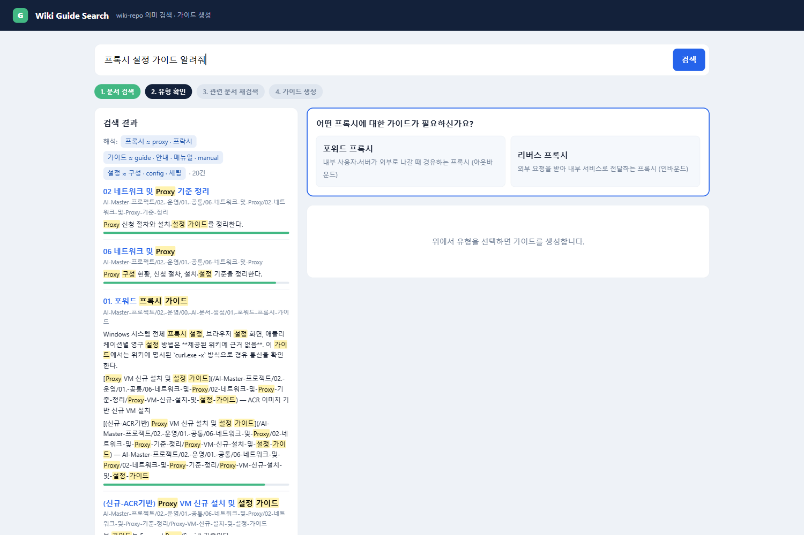

유형 선택 → 근거 문서 재검색 → LLM 가이드 생성:

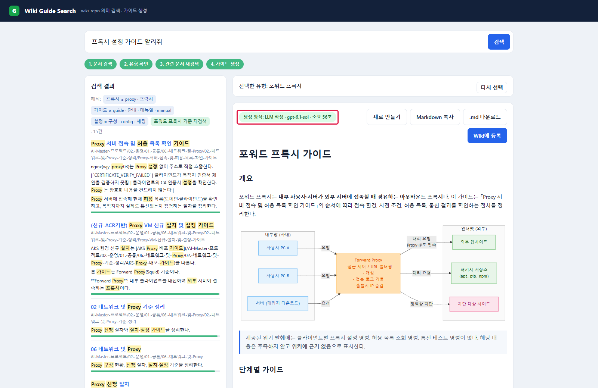

### 1.2 시나리오 2 · 프록시 현황 Wiki 현행화

Wiki의 프록시 현황을 Azure의 실제 VM과 비교하고, 차이가 있으면 Teams 승인을 받아 Task를 만들고 문서를 갱신합니다. 원칙은 **정확해야 하는 일(비교·대상 판별·표 갱신)은 규칙, 읽고 설명하는 일은 LLM**입니다. 실제 운영에서는 Proxy VM이 **항상 켜져 있다고 가정**하므로, 꺼진 VM은 문서 갱신과 별도로 이상 징후로 알립니다. 실행: `python proxy_tools\proxy_status_sync.py` (자세한 내용은 [시나리오 2 실행](#81-시나리오-2-실행-proxy_status_syncpy))

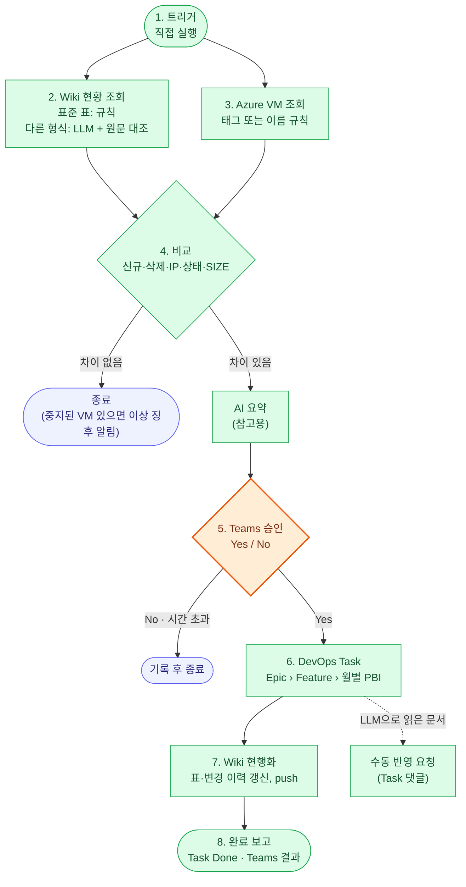

| 단계 | 내용 | 상태 | 지금 구현 |
|---|---|---|---|
| 1. 점검 트리거 | 직접 실행 | ✅ | 직접 실행. 스케줄러는 하지 않기로 함(2026-10-24). 허브 **시나리오 실행** 탭에서 실행하고 `data/logs/scenario2.log`를 봄 |
| 2. Wiki 현황 조회 | 표준 표는 규칙으로 파싱, 형식이 다른 문서는 LLM이 표준 형식으로 바꾸고 원문 대조로 검증 | ✅ | `wiki_parse_llm`: VM 이름이 원문에 없으면 버리고, IP·SIZE가 원문에 없으면 비움. 실제 문서 `Proxy VM 정리 ('26.09.17 기준)` 11행 확인. LLM으로 읽은 문서는 7단계에서 자동 수정하지 않고 Task에 수동 반영 요청 |
| 3. Azure VM 조회 | 이름 규칙(proxy·prxy·pxy)과 태그로 판별, IP·상태·SIZE·리전 수집 | ✅ | 태그 `SCENARIO2_TAG`(기본 `role=proxy`)가 있으면 이름과 상관없이 대상, 없으면 이름 규칙. 트레이스에 `by_tag`·`by_name` |
| 4. 비교 분석 | 신규·삭제·IP·상태·SIZE 변경 규칙 비교, 중지된 VM은 ⚠ 이상 징후, 차이 없으면 종료(꺼진 VM이 있으면 이상 징후만 알림) | ✅ | 테스트 문서면 정답(`data/scenario2/expected_diff.json`)과 자동 대조 |
| 5. Teams 알림·승인 요청 | 이상 징후 + AI 요약(참고용) + 변경 목록 + Wiki 문서 링크, "현행화할까요?" Yes/No, No·시간 초과는 기록 후 종료 | ✅ | Teams 웹후크 카드, 로컬 승인 서버, 진행 화면 |
| 6. DevOps Task 생성 | Epic → Feature → 월별 PBI 아래 Task, 변경 내역, 담당자 | ✅ | Feature·그 달 PBI가 없으면 만들고 `NN. …` Task에 변경 표를 적음. 담당자는 `SCENARIO2_ASSIGNEE`(비우면 PAT 소유자). 예: Task #2505 |
| 7. Wiki 현행화 | 표는 규칙으로 정확히 갱신, 변경 이력 추가, Azure DevOps Wiki 반영 | ✅ | wiki-repo에 커밋, `.env`의 `SCENARIO2_PUSH=1`이면 Azure DevOps Wiki로 push(기본 0: 로컬만) |
| 8. 완료 보고 | Task 완료 처리, Teams 결과 알림(문서·Task 링크) | ✅ | Task 상태를 Done으로 바꾸고 Teams 결과 카드 전송, 로컬 승인 진행 화면에도 완료와 링크 표시. No·시간 초과도 결과 카드로 알림 |

**실행 화면**

허브의 시나리오 실행 탭에서 실행하고 로그를 봅니다:

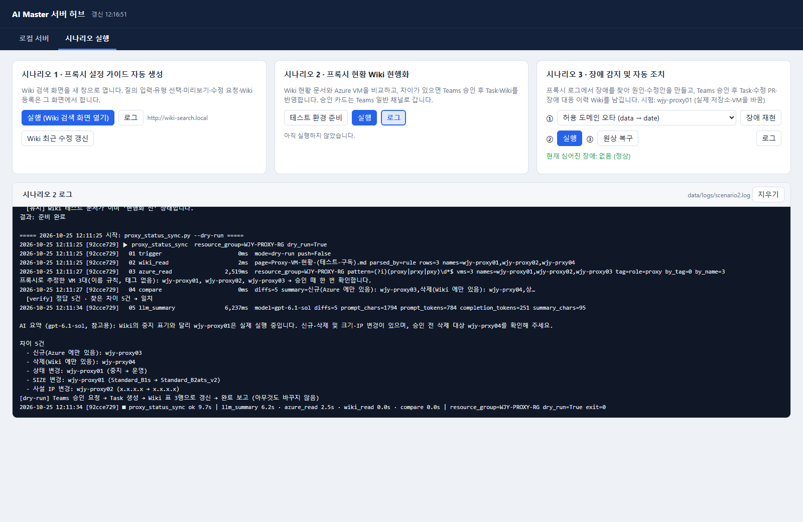

Teams 카드의 Yes/No 버튼이 여는 로컬 승인 화면과, 승인 뒤 진행 화면(예시 데이터):

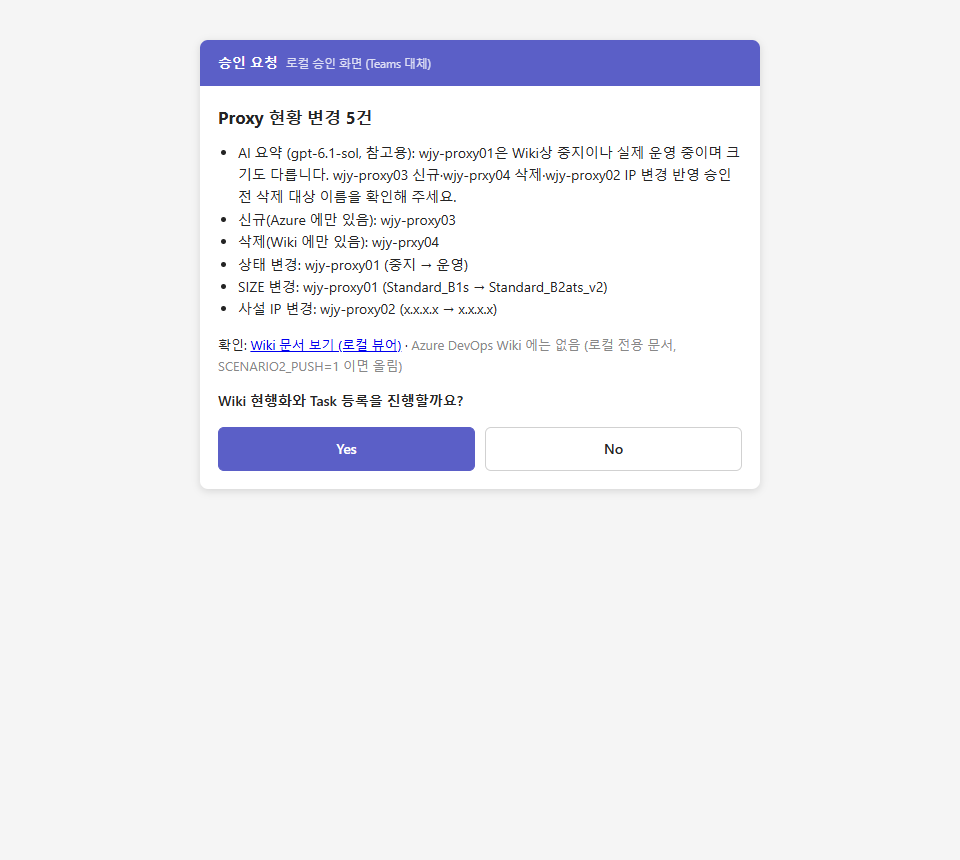

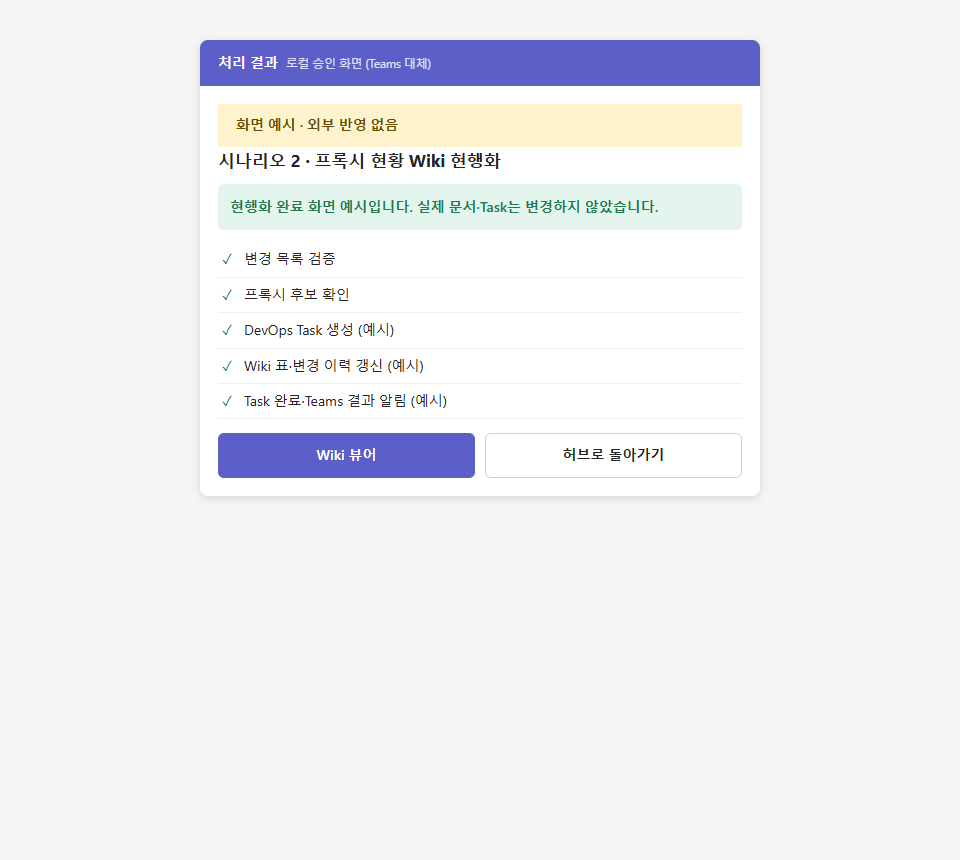

### 1.3 시나리오 3 · 장애 감지 및 자동 조치

LLM이 장애 로그를 Wiki·DevOps 소스로 분석해 원인과 수정안을 도출하고 Teams 승인을 요청합니다(6~8단계는 확장 범위). 지금은 규칙 기반 로그 탐지와 장애 재현 도구까지 있습니다.

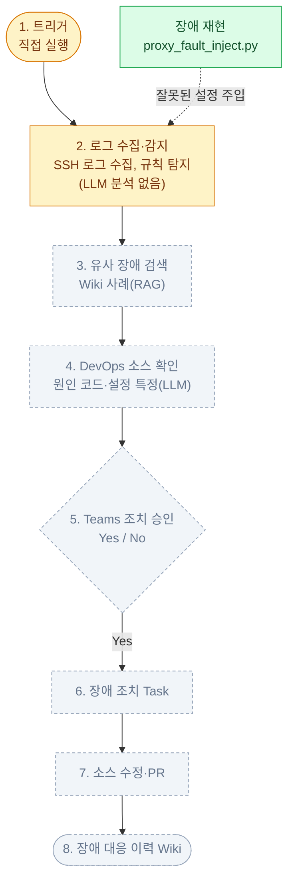

| 단계 | 내용 | 상태 | 지금 구현 |
|---|---|---|---|
| 1. 점검 트리거 | 직접 실행, 스케줄러(확장) | 🟡 | `proxy_log_detect.py detect` 직접 실행, 로그 뷰어 5초 자동 새로고침 |
| 2. 로그 수집·장애 감지 | 서버 로그 파싱(LLM), 오류 패턴 탐지, 원인 후보 도출(LLM) | 🟡 | SSH로 Squid·nginx 로그 수집, 규칙 탐지(차단 반복·도메인 스캔·업스트림 장애·미허용 클라이언트 등). LLM 분석 없음 |
| 3. 유사 장애 검색 | Wiki 장애 사례(RAG), 웹 검색(확장), 해결 방법 조회 | ⬜ | 시나리오 1의 검색 엔진을 쓸 수 있으나 연결 안 됨 |
| 4. DevOps 소스 확인 | Repos 관련 소스 탐색, 원인 코드·설정 특정(LLM), 수정안·영향도(LLM) | ⬜ | 장애 재현용 `proxy_fault_inject.py`(proxy-config 저장소에 잘못된 설정 커밋)만 있음 |
| 5. Teams 조치 승인 요청 | 원인·수정안 요약(LLM), "조치할까요?" Yes/No | ⬜ | 시나리오 2의 Teams 카드·승인 서버를 재사용할 수 있음 |
| 6. 장애 조치 Task 생성(확장) | 장애 내용·원인 기록, 담당자·우선순위 | ⬜ | (Squid 정책 변경 → Task 등록은 `squid_policy_publish.py`에 있음) |
| 7. 소스 수정 및 PR(확장) | 브랜치 생성·AI 코드 수정, Pull Request, Task와 PR 연결 | ⬜ | 미구현. 고칠 대상(잘못된 설정 커밋)은 `proxy_fault_inject.py`로 proxy-config 저장소에 만들 수 있음 |
| 8. 장애 대응 이력 Wiki(확장) | 대응 이력 문서(LLM), 원인·조치·PR 링크, Teams 결과 알림 | ⬜ | 미구현. Wiki 등록은 시나리오 1의 `wiki_register.py`, 결과 알림은 `teams_notify.py`를 재사용할 예정 |

**실행 화면** (공인 IP는 `x.x.x.x`로 가림)

프록시 로그 뷰어: 실제 Squid·nginx 접속 로그, 허용 목록, 탐지 결과:

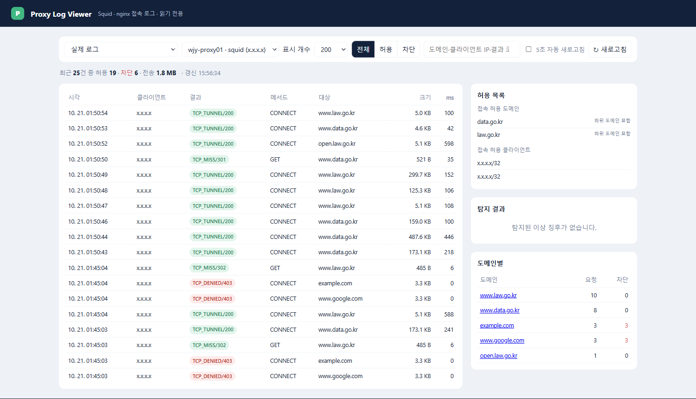

<sub>[↑ 목차로](#목차)</sub>

## 2. 구성

```
ai-master/
├─ hub.py          로컬 웹서버 허브: 로컬 서버 탭(시작·중지·재시작, 로그) + 시나리오 실행 탭
├─ common/         공통 모듈: 프로젝트 경로(paths.py), 로컬 웹서버·크롬 열기(server.py), 노드별 트레이싱(trace.py)
├─ wiki_tools/     Wiki 검색·가이드 생성, 로컬 뷰어, Azure DevOps Wiki 문서 관리
├─ proxy_tools/    프록시 VM 생성, 로그 뷰어, 이상 탐지, Squid 정책 변경 감지·Task/Wiki 반영
├─ teams_tools/    Microsoft Teams 알림, 로컬 승인 화면(Teams 대체)
├─ docs/images/    README 실행 화면 캡처 (공인 IP 등은 가린 상태)
├─ data/           실행 중 생기는 파일 (Git 제외): 검색 캐시, 트레이스, 가상 로그, 정책 스냅샷, Teams 토큰
├─ test/           Azure OpenAI 채팅·임베딩·스트리밍 테스트, 시나리오 2 테스트 환경(scenario2/)
└─ wiki-repo/      Azure DevOps Wiki 저장소 (별도 Git, ai-master 에서는 추적하지 않음)
```

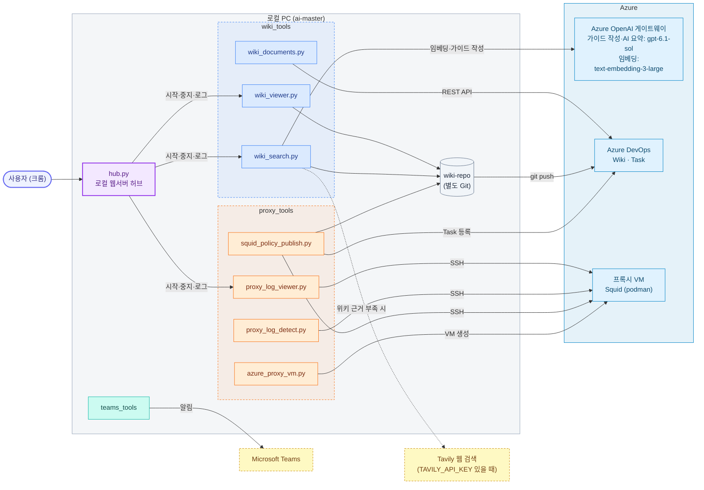

모든 도구는 프로젝트 루트의 `.env` 하나를 함께 읽고, 실행 중 생기는 파일은 `data/`에 남깁니다.

주소는 hosts에 등록했을 때의 주소이고, 괄호 안 숫자는 hosts에 등록하지 않았을 때 쓰는 포트입니다(예: `http://127.0.0.1:8764`). `-`는 웹 화면이 없는 스크립트입니다.

| 폴더 | 파일 | 용도 | 주소 (hosts 미등록 시 포트) |
|---|---|---|---|
| (루트) | `hub.py` | 로컬 웹서버 허브 | http://ai-master.local (8764) |
| wiki_tools | `wiki_search.py` | Wiki 의미 검색·가이드 생성 (오타 교정, 웹 검색 보완, 노드별 트레이스) | http://wiki-search.local (8766) |
| | `wiki_register.py` | 시나리오 1: 가이드를 `02. 운영 > 00. AI 문서 생성` 아래에 등록(같은 제목 갱신, 문서 규칙 준수, push) | - |
| | `wiki_viewer.py` | Wiki 로컬 읽기 전용 뷰어 (Azure DevOps 문법 렌더링, 코드 구문 강조, 첫 화면은 AI Master 프로젝트 문서) | http://wiki.local (8765) |
| | `wiki_documents.py` | Azure DevOps Wiki 문서 목록·생성·삭제 (REST API) | - |
| proxy_tools | `azure_proxy_vm.py` | 저가 Linux 프록시 VM 생성 (Squid/HAProxy/nginx, podman·docker). Squid 로그는 VM 디스크 `/var/log/proxy`에 남김 | - |
| | `proxy_log_viewer.py` | 프록시 접속 로그·허용 목록·탐지 결과 화면 (Squid 로그 파일, nginx는 journald) | http://proxy-log.local (8768) |
| | `proxy_log_detect.py` | 가상 에러 로그 생성, 로그 이상 탐지 | - |
| | `proxy_fault_inject.py` | 장애 대응 테스트용: proxy-config 저장소에 잘못된 설정 커밋을 넣음 | - |
| | `squid_policy_monitor.py` | Squid 정책 변경 감지 (읽기 전용) | - |
| | `squid_policy_publish.py` | 정책 변경 → 승인 → Task 등록 + Wiki 현황 갱신 | - |
| | `proxy_status_sync.py` | 시나리오 2: Wiki Proxy 현황 ↔ Azure VM 비교 → Teams 승인 → Task → Wiki 현행화 → 완료 보고 | - |
| teams_tools | `teams_notify.py`, `teams_graph.py` | Teams 알림 (Workflows 웹후크 / Graph API). `.env`의 `TEAMS_MENTION`(UPN)을 넣으면 카드마다 그 사람을 @멘션해 Teams 활동 피드에 알림이 뜸 | - |
| | `approval_local.py` | Teams 승인 카드 대체: 로컬 화면에서 Yes/No 승인 | http://127.0.0.1:8771 (요청 중에만) |
| test | `teams_test.py` | Teams 연동 테스트: 웹후크·Graph 를 차례로 시험하고 실패 원인을 안내 (`.env`의 `TEAMS_*`) | - |
| | `scenario2/setup_env.py` | 시나리오 2(Proxy 현황 Wiki 현행화) 테스트 환경 점검·초기화 | - |

**Wiki 뷰어** (wiki-repo를 Azure DevOps Wiki처럼 읽기 전용으로 보여 줌):

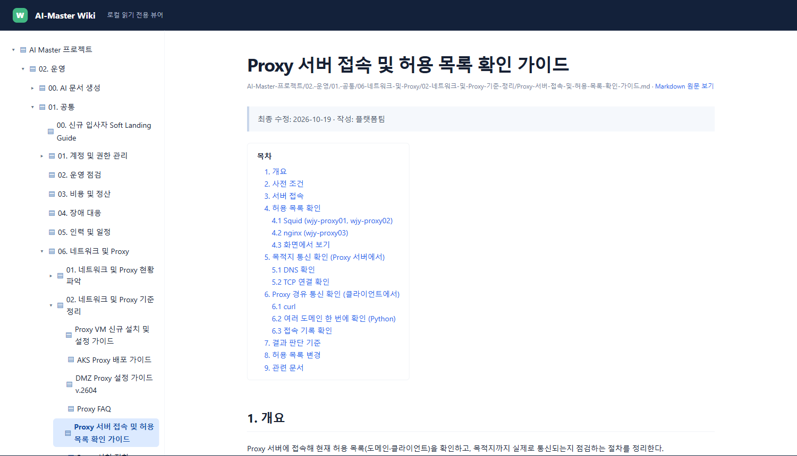

<sub>[↑ 목차로](#목차)</sub>

## 3. 사전 준비

처음 설치할 때 한 번 해 두는 작업입니다. 키·URL·IP 같은 실제 값은 모두 `.env`에만 넣고 커밋하지 않습니다.

| 준비 항목 | 필요한 시나리오 | 없으면 |
|---|---|---|
| PC 도구 (Python·Git·Azure CLI) | 전부 | 실행 불가 |
| hosts 등록 | 전부(허브·화면) | `127.0.0.1:포트` 주소로 뜸 |
| Azure DevOps (Wiki·PAT·백로그) | 1, 2 | 문서 검색·등록, Task 생성 불가 |
| LLM 게이트웨이 (Azure OpenAI 호환) | 1, 2 | 가이드 생성·검색 임베딩·AI 요약 불가(시나리오 2는 AI 요약만 빠지고 규칙 비교로 실행됨) |
| 웹 검색 (Tavily API 키) | 1 | 위키 근거가 약해도 웹 검색 없이 위키만 씀 |
| Azure 구독과 Proxy VM | 2, 3 | 비교할 실제 VM이 없음 |
| Microsoft Teams (회사·학교 계정, Workflows 웹후크) | 2 | 승인 요청·결과 알림 카드를 못 보냄 |

### 3.1 PC 도구

- Windows, Python 3.11 이상, Git, [Azure CLI](https://learn.microsoft.com/cli/azure/install-azure-cli-windows), Chrome(없으면 기본 브라우저).
- Python 패키지:

  ```powershell
  pip install python-dotenv openai
  pip install anthropic msal   # 선택: Anthropic 모델을 쓸 때, Teams Graph API를 시험할 때
  ```

- `.env.sample`을 `.env`로 복사합니다([설정](#4-설정) 참고).

### 3.2 hosts 등록

허브·Wiki 뷰어·Wiki 검색·프록시 로그 뷰어를 포트 없는 주소(`http://ai-master.local` 등)로 열기 위해 관리자 권한으로 `C:\Windows\System32\drivers\etc\hosts`에 줄을 추가합니다. 값은 [포트 없는 주소 (hosts)](#51-포트-없는-주소-hosts)에 있습니다. hosts 주석은 ASCII로만 씁니다(한글 주석이 있으면 이름 풀이가 깨짐).

### 3.3 Azure DevOps

1. 조직·프로젝트를 만들고 프로젝트 Wiki를 켭니다. 프로세스는 Epic → Feature → Product Backlog Item → Task를 쓰는 **Scrum**입니다.
2. **User settings › Personal access tokens**에서 PAT를 만듭니다. 범위: **Wiki (Read & write)**, **Work Items (Read & write)**, **Code (Read & write)**. `.env`의 `AZURE_DEVOPS_ORG`, `AZURE_DEVOPS_PROJECT`, `AZURE_DEVOPS_WIKI`, `AZURE_DEVOPS_PAT`에 넣습니다.
3. Wiki 저장소를 프로젝트 폴더 아래 `wiki-repo`로 받습니다(ai-master Git에서는 추적하지 않음).

   ```powershell
   git clone https://dev.azure.com/<조직>/<프로젝트>/_git/<프로젝트>.wiki wiki-repo
   ```

4. 시나리오 2의 Task가 달릴 Epic을 하나 만들고 번호를 `SCENARIO2_EPIC_ID`에 넣습니다. Feature(`SCENARIO2_FEATURE`)와 그 달 PBI(`SCENARIO2_PBI`)는 없으면 자동으로 만듭니다.

### 3.4 LLM 게이트웨이

- Azure OpenAI 호환 게이트웨이의 주소와 키를 `AZURE_OPENAI_ENDPOINT`, `AZURE_OPENAI_API_KEY`에 넣습니다.
- 모델 두 개가 필요합니다: 답변용 `OPENAI_MODEL`(기본 `gpt-6.1-sol`), 임베딩용 `OPENAI_EMBED_MODEL`(기본 `text-embedding-3-large`).

### 3.5 웹 검색 (Tavily)

1. https://tavily.com 에 가입하고 대시보드에서 API 키를 발급합니다(무료 플랜으로 시험 가능).
2. `.env`의 `TAVILY_API_KEY`에 넣고 Wiki 검색 서버를 재시작합니다.

위키 근거가 약할 때만 웹을 검색합니다(기준: `WEB_SEARCH_MIN_SIM`, `WEB_SEARCH_MIN_VARIANT_SIM`). 키를 비우면 웹 검색을 하지 않습니다.

### 3.6 Azure 구독과 Proxy VM

1. Azure 구독에 로그인합니다. 브라우저 로그인이 안 되면 `az login --use-device-code`를 씁니다.

   ```powershell
   az login
   az account set --subscription <구독 이름>
   ```

2. Proxy VM을 만듭니다. `azure_proxy_vm.py`가 가장 싼 B 시리즈 VM에 Squid(포워드)나 HAProxy를 podman으로 올리고, NSG는 이 PC의 공인 IP에만 열고, 매일 01:00 자동 종료를 겁니다. nginx 리버스 프록시(wjy-proxy03)는 같은 리소스 그룹에 따로 둡니다([프록시 VM 운영](#7-프록시-vm-운영)).

   ```powershell
   python proxy_tools\azure_proxy_vm.py --proxy squid --install podman --count 2
   ```

3. 시나리오 2가 VM을 찾는 기준: 리소스 그룹 `SCENARIO2_RESOURCE_GROUP`(기본 `WJY-PROXY-RG`) 안에서 태그 `SCENARIO2_TAG`(기본 `role=proxy`)가 있거나 이름이 `proxy`·`prxy`·`pxy`(+숫자)로 끝나는 VM.
4. 권한: 조회만 하려면 리소스 그룹 **Reader**, "테스트 환경 준비"에서 꺼진 VM을 켜려면 **Virtual Machine Contributor**가 필요합니다.
5. 시나리오 3: 프록시 로그 뷰어는 이 PC의 기본 SSH 키로 `azureuser@<VM 공용 IP>`에 접속해 로그를 읽습니다(VM을 만들 때 넣은 키, NSG에서 이 PC IP 허용). 허용 클라이언트 대역은 `PROXY_ALLOWED_CLIENTS`에 넣습니다. Squid 정책 변경 감지(`squid_policy_*.py`)를 쓰려면 `SQUID_HOST`, `SQUID_SSH_USER`, `SQUID_SSH_KEY`도 넣습니다.

### 3.7 Microsoft Teams

1. **회사·학교용 Microsoft 365 계정**이 필요합니다. 무료 개인 Teams에는 Workflows가 없습니다. Teams Essentials나 Microsoft 365 Business Basic이면 됩니다.
2. 알림을 받을 팀과 채널을 만듭니다(예: 기본 채널 `일반`).
3. 채널 이름 옆 **…** > **워크플로**에서 **채널에 웹후크 경고 보내기**(Send webhook alerts to a channel) 템플릿으로 흐름을 만들고, 발급된 URL 전체를 `.env`의 `TEAMS_WEBHOOK_URL`에 넣습니다. **이 URL은 비밀번호와 같으므로 공개하지 않습니다.**
4. 카드가 Teams **활동**(종 모양)에도 뜨게 하려면 받을 사람의 계정을 `TEAMS_MENTION`(UPN), `TEAMS_MENTION_NAME`(표시 이름)에 넣습니다. 카드마다 그 사람을 @멘션합니다.
5. 시험: `python teams_tools\teams_notify.py --title 테스트 "연동 확인"` → 채널에 카드가 오면 성공(HTTP 202).

- Teams 카드의 Yes/No 응답을 이 PC로 돌려받으려면 Power Automate 프리미엄(HTTP 액션)이 필요합니다. 그래서 승인 버튼은 이 PC의 로컬 승인 화면(`approval_local.py`, http://127.0.0.1:8771)을 엽니다.
- 카드가 채널에 안 올라오면 Teams 로그인이나 흐름의 연결이 만료된 경우가 많습니다. https://make.powerautomate.com 의 **연결**에서 오류 난 Microsoft Teams 연결을 다시 맺고, **내 흐름** › 해당 흐름 › **28일 실행 기록**에서 성공했는지 봅니다. 흐름의 게시 주체는 **흐름 봇**(Flow bot)이어야 합니다(기본값).

<sub>[↑ 목차로](#목차)</sub>

## 4. 설정

`.env.sample`을 복사해 `.env`를 만들고 실제 인증정보를 입력합니다. `.env`는 프로젝트 루트에 하나만 두고 모든 도구가 함께 씁니다.

```powershell
Copy-Item .env.sample .env
```

`.env`에는 API 키와 PAT가 포함될 수 있으므로 Git에 커밋하지 않습니다. `.env.sample`에는 민감한 값 대신 placeholder를 사용합니다.

### 4.1 주요 설정 값

| 변수 | 기본값 | 설명 |
|---|---|---|
| `OPENAI_MODEL` | `gpt-6.1-sol` | 가이드 작성(wiki_search)과 시나리오 2 AI 요약(llm_summary)에 쓰는 LLM. 2026-10-24 gpt-5.4에서 바꿈(2026-10-19 후보 5개 비교 때는 gpt-5.4가 완성도와 속도의 균형이 가장 좋았다) |
| `OPENAI_EMBED_MODEL` | `text-embedding-3-large` | 검색 임베딩. 정답 16문항 비교에서 small·ada-002보다 정확했다 |
| `EMBED_WEIGHT` | `8` | 혼합 검색에서 임베딩 유사도 가중치. 낮으면 키워드 점수가 의미 점수를 덮는다 |
| `TAVILY_API_KEY` | (비움) | 넣으면 위키 근거가 약할 때 Tavily 웹 검색 결과를 가이드 근거에 보탠다. 비우면 웹 검색 안 함 |
| `WEB_SEARCH_MIN_SIM` | `0.5` | 위키 최고 임베딩 유사도가 이보다 낮으면 웹 검색. 2026-10-20 측정에서 위키에 있는 질의는 0.59 이상, 없는 질의는 0.46 이하였다 |
| `WEB_SEARCH_MIN_VARIANT_SIM` | `0.45` | 유형(포워드/리버스 등)을 골랐을 때 유형 이름의 위키 최고 유사도가 이보다 낮으면 웹 검색. 2026-10-23 측정: 포워드 프록시 0.499, 리버스 프록시 0.41 |
| `WEB_SEARCH_MAX` | `5` | 웹 검색 결과를 몇 건까지 가져올지 |
| `TRACE_KEEP_DAYS` | `14` | `data/traces/`의 요청별 트레이스 보관 일수 |
| `SCENARIO2_TAG` | `role=proxy` | 시나리오 2에서 이 태그가 있는 VM은 이름과 상관없이 Proxy로 봄(`key=value` 또는 `key`) |
| `SCENARIO2_PUSH` | `0` | 시나리오 2 승인 후 Wiki 커밋을 Azure DevOps Wiki로 push할지(`1`). 기본은 wiki-repo 로컬 커밋만(테스트 문서가 올라가지 않게) |
| `SCENARIO2_TIMEOUT` / `SCENARIO2_WIKI_PAGE` | `900` / (비움) | 승인 대기 초, 비교할 Wiki 문서(wiki-repo 기준 경로, 비우면 테스트 문서) |
| `GUIDE_CHUNKS` / `GUIDE_CHUNK_CHARS` / `GUIDE_CONTEXT_CHARS` | `24` / `1500` / `16000` | 시나리오 1 RAG: LLM에 넘길 조각 수, 조각 하나의 대략 길이, 전체 글자 수 상한. 조각 임베딩은 `data/wiki_search_chunks.json`에 캐시 |
| `WIKI_REGISTER_PUSH` | `1` | 시나리오 1 "Wiki에 등록" 때 Azure DevOps Wiki로 push(`0`이면 로컬 커밋만) |
| `SQUID_HOST` | - | 정책 감지 대상 프록시 VM의 공용 IP |
| `PROXY_ALLOWED_CLIENTS` | `203.0.113.10/32` | 프록시를 쓸 수 있는 클라이언트 CIDR(쉼표 구분). 로그 탐지·장애 주입이 이 값을 쓴다. 실제 IP는 `.env`에만 둔다 |
| `SQUID_CONTAINER` / `SQUID_RUNTIME` | `squid` / `podman` | VM에서 Squid가 도는 컨테이너 이름과 런타임 |
| `TEAMS_*` | (비움) | 회사·학교 Microsoft 365 계정이 있을 때만 사용 |

임베딩 모델을 바꾸면 처음 실행할 때 문서 전체 임베딩을 다시 계산한다(약 2분). 결과는 `data/wiki_search_cache.json`에 캐시된다.

서버는 시작할 때만 `.env`를 읽는다. 값을 바꾸면 허브에서 해당 서버를 재시작해야 적용된다.

### 4.2 data 폴더

| 파일 | 만드는 도구 |
|---|---|
| `wiki_search_cache.json` | wiki_search.py (문서 임베딩 캐시) |
| `sim_access.log` | proxy_log_detect.py simulate (가상 프록시 로그) |
| `proxy_policy_state/` | squid_policy_publish.py (정책 기준 스냅샷, 변경 이력) |
| `teams_token_cache.json` | teams_graph.py (Graph 로그인 토큰, 공유 금지) |
| `logs/<서버>.log` | hub.py (허브에서 시작한 서버의 출력, 2MB 넘으면 `.old.log`로 교체) |
| `logs/scenario2.log` | proxy_status_sync.py (시나리오 2 실행 출력과 테스트 환경 준비 출력. 허브 "시나리오 실행" 탭에서 봄, 2MB 넘으면 `.old.log`) |
| `traces/<서비스>-YYYYMMDD.jsonl` | wiki_search.py (요청별 노드 트레이스, `TRACE_KEEP_DAYS`(기본 14)일 지나면 삭제) |
| `scenario2/` | test/scenario2/setup_env.py (Azure VM 스냅샷, '현행화 전' Wiki 표, 정답 차이 목록) |

<sub>[↑ 목차로](#목차)</sub>

## 5. 로컬 웹서버

### 5.1 포트 없는 주소 (hosts)

hosts 파일은 포트를 정할 수 없으므로 서버마다 다른 루프백 IP의 80 포트를 씁니다. 서버는 시작할 때 hosts를 읽어 자기 이름에 적힌 IP로 뜹니다(`common/server.py`).

| hosts에 적힌 값 | 서버가 뜨는 곳 | 주소 |
|---|---|---|
| 없음 | 127.0.0.1:포트 | `http://127.0.0.1:8765` |
| `127.0.0.1 wiki.local` | 127.0.0.1:포트 | `http://wiki.local:8765` |
| `127.0.87.65 wiki.local` | 127.0.87.65:80 | `http://wiki.local` |

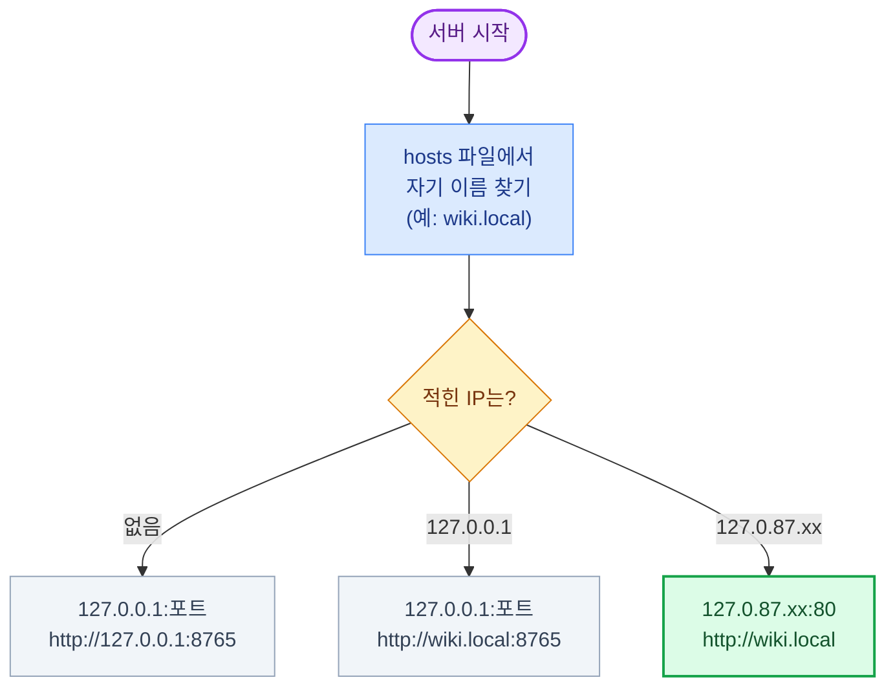

관리자 PowerShell에서 `C:\Windows\System32\drivers\etc\hosts`에 아래를 추가하고 `ipconfig /flushdns`를 실행합니다.

```
# ai-master local web servers
127.0.87.64  ai-master.local      # ai-master hub (ai-master/hub.py)
127.0.87.65  wiki.local           # Wiki viewer (ai-master/wiki_tools/wiki_viewer.py)
127.0.87.66  wiki-search.local    # Wiki search + guide (ai-master/wiki_tools/wiki_search.py)
127.0.87.68  proxy-log.local      # proxy log viewer (ai-master/proxy_tools/proxy_log_viewer.py)
```

hosts의 주석(`#` 뒤)은 영문(ASCII)으로만 씁니다. Windows는 hosts를 UTF-8로 읽지 않아 한글 주석이 있으면 이름 해석이 깨집니다(2026-10-21 확인).
hosts를 바꾼 뒤에는 서버를 다시 시작해야 새 주소로 뜹니다. 127.0.87.67·69·70은 ai-monitor(사용량·비용 모니터와 그 허브)가 같은 규칙으로 씁니다.

### 5.2 허브 (hub.py)

http://ai-master.local 한 화면에서 ai-master 서버 3개(Wiki 뷰어, Wiki 검색, 프록시 로그 뷰어)의 상태를 보고 시작·중지·재시작하고, 로그를 봅니다. 화면은 탭 두 개입니다.

| 탭 | 내용 |
|---|---|
| 로컬 서버 | 서버 표(상태·PID·가동 시간, 시작·중지·재시작·로그·화면)와 로그 창 |
| 시나리오 실행 | **시나리오 1**: 실행하면 Wiki 검색 화면을 새 창으로 엶(질의 입력부터 그 화면에서), 로그는 `wiki-search.log`<br/>**시나리오 2**: "테스트 환경 준비"(`setup_env.py`: 꺼진 Proxy VM만 켜고 표·정답을 다시 만듦) 후 "실행", 실행 상태·PID·종료 코드와 `scenario2.log` 실시간 표시. 실행 중에는 다시 실행할 수 없음 |

`http://ai-master.local/#scenarios`로 열면 시나리오 실행 탭이 바로 열립니다. 서버 화면은 "화면" 버튼으로 새 창에서 엽니다. 사용량·비용 모니터는 ai-monitor의 허브(http://ai-monitor.local)에서 관리합니다.

```powershell
python hub.py                # 허브를 켜고 크롬으로 연다 (이미 떠 있는 허브는 끄고 새로 띄움)
python hub.py --keep         # 이미 떠 있는 허브가 있으면 끄지 않고 종료
python hub.py --start-all    # 꺼져 있는 서버를 모두 시작
python hub.py --restart-all  # 모두 다시 시작 (중복 실행·예전 주소로 뜬 서버 정리)
python hub.py --no-browser   # 크롬을 열지 않음 (다른 옵션과 함께 사용)
```


- 서버는 창 없이 뜨고 출력은 `data/logs/<서버>.log`에 남습니다. 허브를 꺼도(Ctrl+C) 서버는 계속 돕니다.
- 실행 여부는 프로세스 명령줄의 스크립트 이름으로 찾으므로 직접 띄운 서버도 허브에 보이고 끌 수 있습니다(로그는 허브에서 시작한 서버만 남음).
- 허브 콘솔에는 시각과 함께 시작 설정, 시작·중지 요청, 생성·종료한 PID, 상태 변화(직접 끄거나 서버가 죽은 경우 포함), 거부된 요청, 오류가 찍힙니다. 서버가 시작하자마자 죽으면 그 서버 출력의 마지막 줄도 함께 찍힙니다.

허브가 이미 떠 있으면 `python hub.py`가 그 허브 프로세스만 끄고 새로 띄웁니다(허브가 띄운 서버들은 그대로 돕니다). 끄지 않으려면 `--keep`을 붙이며, 이때는 "이미 사용 중"과 함께 PID가 나오고 종료합니다. 허브만 끄려면 다음을 실행합니다.

```powershell
Get-NetTCPConnection -LocalAddress 127.0.87.64 -LocalPort 80 -State Listen | ForEach-Object { taskkill /PID $_.OwningProcess /F }
```

`/T`(프로세스 트리)를 붙이면 허브가 띄운 서버까지 함께 꺼지므로 붙이지 않습니다.

**허브 - 로컬 서버 탭:**

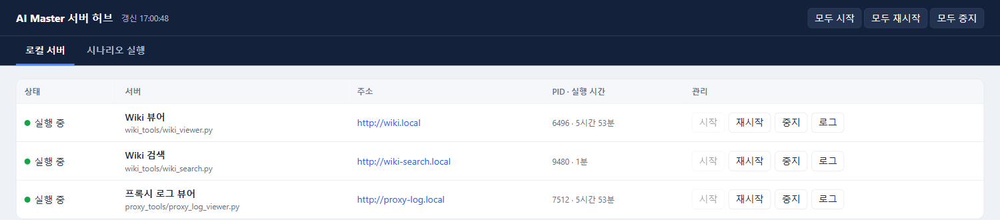

<sub>[↑ 목차로](#목차)</sub>

## 6. 주요 흐름

### 6.1 Wiki 검색·가이드 생성 (wiki_search.py)

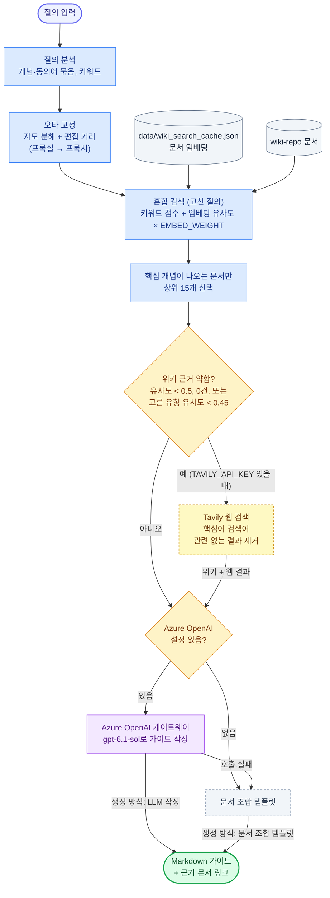

#### 검색어 해석

| 기능 | 방식 | AI 여부 |
|---|---|---|
| 동의어 묶기 (프록시 = proxy = 프락시) | 개념 사전 `CONCEPTS` | 규칙 기반 |
| 오타 교정 (프록실·프롤시 → 프록시, porxy → proxy) | 한글 자모 분해 + 편집 거리(Damerau–Levenshtein) + 개념 사전 매칭 | 규칙 기반 |
| 의미가 비슷한 문서 찾기 | 임베딩 `text-embedding-3-large` 유사도 | AI (머신러닝) |
| 가이드 작성 | LLM `gpt-6.1-sol` (`OPENAI_MODEL`) | AI (LLM) |

- 오타 교정은 한글 3음절 이상·영문 5글자 이상만 고칩니다. 2음절은 `설정`↔`결정`처럼 다른 실제 단어와 거리가 1이라 고치지 않습니다.
- 고친 단어는 화면 해석 칩(`오타 교정: 프록실 → 프록시`)과 트레이스 `analyze` 줄(`typo_fixes=`)에 나옵니다. 검색은 고친 질의로 하므로 결과가 정상 질의와 같습니다.

#### 웹 검색 (TAVILY_API_KEY 있을 때)

- 조건: 위키 최고 유사도 < `WEB_SEARCH_MIN_SIM`(0.5), 핵심 개념이 나오는 위키 문서 0건, 또는 고른 유형(예: 리버스 프록시)의 이름 유사도 < `WEB_SEARCH_MIN_VARIANT_SIM`(0.45). 주제(프록시)는 위키에 많아도 그 유형은 없을 수 있기 때문입니다.
- 검색어는 질의 문장이 아니라 핵심 한글어로 만듭니다(예: `리버스 프록시 설정`). 말투·영문 동의어·`가이드` 같은 일반어를 섞으면 게임·주식·코인 기사가 걸렸습니다.
- 결과에 핵심 개념(유형이면 `리버스 프록시`·`reverse proxy` 같은 붙은 문구)이 없으면 버립니다.
- 가이드는 위키를 우선 근거로 하고, 웹에서 가져온 문장 끝에 `(웹: URL)`을 붙이며, 끝에 "웹 참고 링크"와 "사내 기준이 아님" 주의 문구가 들어갑니다.

#### 화면

- 가이드 위에 생성 방식 배지(`LLM 작성 · gpt-6.1-sol · 소요 N초` 또는 `문서 조합 템플릿`)가 나옵니다.
- 가이드는 스트리밍(`/api/guide/stream`)으로 받도록 되어 있지만, 사내 게이트웨이가 응답을 모았다가 한꺼번에 보내서 실제로는 끝날 때 한 번에 나타납니다(트레이스 `first_line_ms`가 전체 시간과 거의 같음). 게이트웨이 버퍼링이 꺼지면 코드 수정 없이 글이 흘러나옵니다.

#### 트레이스

요청마다 노드별 소요 시간과 결과가 허브 로그(`data/logs/wiki-search.log`)와 `data/traces/`에 남습니다(`common/trace.py`).

```text
01:38:57 [07902dac] ▶ guide/stream  q=프록시 설정 가이드 알려줘 key=proxy variant=forward
01:38:58 [07902dac]     03 embed_query          307ms  model=text-embedding-3-large best_sim=0.601 …
01:38:58 [07902dac]   02 hybrid_search        321ms  docs=1026 results=20 top=6.37 top_doc=…
01:38:58 [07902dac]   04 select_sources         3ms  sources=15 statements=35 top3=…
01:38:58 [07902dac]   05 web_decision         385ms  best_sim=0.601 variant=포워드 프록시 variant_sim=0.499 result=위키만 사용
01:39:55 [07902dac]   07 llm_generate      57,255ms  model=gpt-6.1-sol prompt_tokens=8364 completion_tokens=4957 reasoning_tokens=205 first_line_ms=56911 …
01:39:55 [07902dac] ■ guide/stream ok 58.1s | llm_generate 57.3s · web_decision 0.4s … | mode=llm model=gpt-6.1-sol
```

- 노드: `refresh_index` → `analyze`(오타 교정 포함) → `hybrid_search`(안에 `embed_query`) → `select_sources` → `chunk_select`(조각 수·줄어든 글자 수·중복) → `web_decision` → `web_search`(검색어·결과·버린 수) → `llm_generate`(토큰·첫 줄 시각) 또는 `template`.
- 줄 앞 표시: `✗` 실패(이유는 `error=`), `…` 연결이 끊겨 중단(cancelled). 번호는 시작 순서이고, 안쪽 노드가 먼저 끝나 먼저 찍힌다.
- JSONL에는 같은 내용이 요청당 한 줄(노드별 시작 오프셋·소요 시간·속성)로 들어갑니다. 질의 원문이 들어가므로 `data/`(Git 제외)에만 둡니다.

### 6.2 Squid 정책 변경 → Task·Wiki 반영 (squid_policy_publish.py)

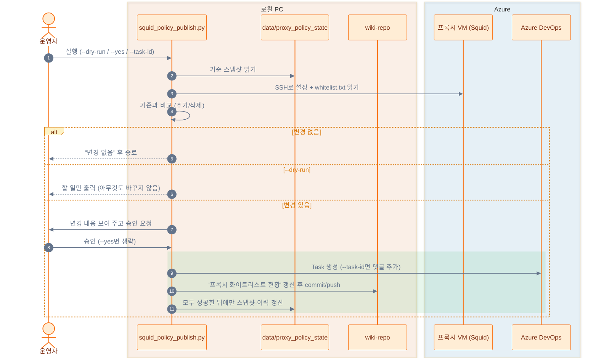

처음 실행(기준 스냅샷 없음)이면 Task 없이 기준만 저장하고 Wiki 현황 문서를 만듭니다. 중간에 실패하면 스냅샷이 그대로라서 다음 실행 때 같은 변경을 다시 처리합니다.

### 6.3 프록시 로그 이상 탐지 (proxy_log_detect.py)


<sub>[↑ 목차로](#목차)</sub>

## 7. 프록시 VM 운영

리소스 그룹 `WJY-PROXY-RG`에 VM 3대가 있고, 모두 podman Quadlet(`/etc/containers/systemd/<이름>.container`)으로 컨테이너를 띄웁니다. 인바운드는 SSH와 프록시 포트를 허용 클라이언트 IP 한 곳에만 엽니다.

| VM | 종류 | 접속 로그 위치 | 재시작·VM 중지 후 |
|---|---|---|---|
| wjy-proxy01, wjy-proxy02 | Squid 포워드 프록시 (3128) | VM 디스크 `/var/log/proxy/access.log` (컨테이너 `/var/log/squid`에 연결) | 남음 |
| wjy-proxy03 | nginx 리버스 프록시 (80) | journald (`journalctl CONTAINER_NAME=nginx`) | 남음 |

- 컨테이너는 `--rm`이라 재시작할 때마다 새로 만들어집니다. 그래서 Squid 로그는 VM 디스크 폴더에 연결하고(2026-10-21 적용, `azure_proxy_vm.py`도 같이 만듦), nginx 로그는 `podman logs`(지금 컨테이너만) 대신 journald에서 읽습니다.
- 매일 01:00(KST)에 자동 종료(`shutdown-computevm-*`)됩니다. 꺼져 있는 동안 보낸 요청은 기록되지 않습니다.
- Squid 로그는 정리(logrotate) 없이 쌓입니다. 디스크 여유는 약 25GB입니다.

시험 요청 보내기 (허용 클라이언트 IP에서):

```powershell
curl.exe -x http://<VM_IP>:3128 https://www.data.go.kr/        # 포워드 프록시: 허용 도메인 → 200
curl.exe -x http://<VM_IP>:3128 https://www.google.com/         # 허용 목록 밖 → 터널 거부(403)
curl.exe -H "Host: law.wjy.test" http://<VM_IP>/LSW/main.html   # 리버스 프록시: Host 머리글로 가상 도메인 선택
```

리버스 프록시의 `data.wjy.test`·`law.wjy.test`는 nginx 설정(`server_name`)에만 있는 이름입니다. 요청은 IP로 보내고 이름은 `Host` 머리글에만 실으므로 hosts·DNS가 필요 없습니다.

로그 뷰어(http://proxy-log.local)는 새로고침하는 동안 상단 진행 막대·회전 아이콘·흐린 표를 보여 주고, 끝나면 `갱신 HH:MM:SS · 새 로그 N건`(또는 `변경 없음`)을 잠깐 강조합니다. 로그 소스가 "실제 로그"면 VM의 진짜 로그이고, "가상 로그"일 때만 만들어 낸 데이터입니다.

<sub>[↑ 목차로](#목차)</sub>

## 8. 시나리오 2 테스트 환경

시나리오 2는 Wiki의 Proxy 현황 문서와 Azure의 실제 VM을 비교해, 차이가 있으면 승인을 받아 Task를 만들고 문서를 현행화합니다. 테스트 환경은 Azure를 바꾸지 않고 Wiki 쪽에 일부러 차이를 넣어 만듭니다.

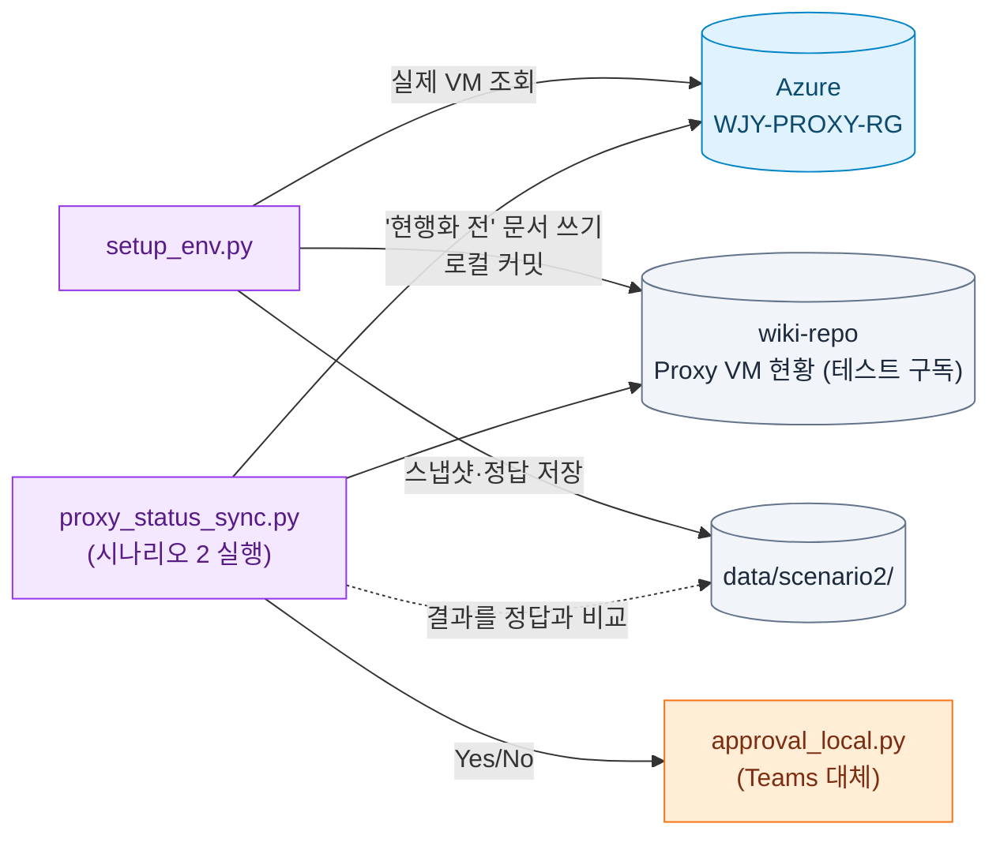

`setup_env.py`는 리소스 그룹 `WJY-PROXY-RG`에서 이름이 proxy·prxy·pxy(+숫자)로 끝나는 VM을 읽어 아래 차이를 넣은 Wiki 문서를 만듭니다. 실제 값과 정답은 `data/scenario2/`에만 저장합니다(저장소 공개).

| VM | Wiki(현행화 전) | 비교 단계가 찾아야 할 차이 |
|---|---|---|
| 1번째 VM | 상태·SIZE를 실제와 다르게 | 상태 변경, 스펙 변경 |
| 2번째 VM | 사설 IP를 실제와 다르게 | IP 변경 |
| 3번째 VM | 표에서 뺌 | 신규 |
| 없는 VM(`*-prxy04`) | 표에 넣음 | 삭제 |

```powershell
python test\scenario2\setup_env.py            # 꺼진 Proxy VM 켜기 + 표·정답 재생성 + 문서를 '현행화 전'으로 (허브 "테스트 환경 준비")
python test\scenario2\setup_env.py --check    # 점검만, 아무것도 바꾸지 않음
python teams_tools\approval_local.py --title "Proxy 현황 변경 감지" "신규: wjy-proxy03"   # 승인 화면만 시험
```

- 점검 항목: az 로그인과 Proxy VM 3대 이상, 스냅샷과 실제 VM 일치, Azure DevOps PAT, 승인 화면 모듈.
- 실제 운영처럼 VM이 모두 켜진 상태로 시험합니다. 테스트 VM은 비용 때문에 매일 01:00 자동 종료되므로, 옵션 없이 실행하면 꺼진 VM부터 켜고 실제 VM 값으로 표와 정답을 다시 만듭니다. `--check`가 "스냅샷과 다름"으로 실패해도 옵션 없이 다시 실행하면 됩니다.
- Wiki 문서는 wiki-repo에 로컬 커밋만 하고 Azure DevOps Wiki로 push하지 않습니다.
- Teams 연동(Workflows 웹후크·승인 카드·Graph API)에는 회사·학교용 Microsoft 365 계정이 필요합니다(무료 개인 Teams 불가, 가장 싼 선택지는 Microsoft 365 Business Basic). Teams 카드의 응답을 이 PC 스크립트로 돌려받으려면 Power Automate 프리미엄(HTTP 액션)이 필요합니다.

### 8.1 시나리오 2 실행 (proxy_status_sync.py)

| 단계 | 하는 일 |
|---|---|
| 1. trigger | 직접 실행(허브 "시나리오 실행" 탭 또는 명령줄) |
| 2. wiki_read | Wiki 문서의 `## VM 목록` 표를 읽음 (머리글 이름으로 칸을 찾음). 문서는 `SCENARIO2_WIKI_PAGE`(비우면 테스트 문서) |
| 3. azure_read | 리소스 그룹에서 이름이 proxy·prxy·pxy(+숫자)로 끝나는 VM의 IP·상태·SIZE·리전 |
| 4. compare | 신규·삭제·변경(사설/공인 IP, 상태, SIZE, LOCATION, RESOURCE GROUP). 차이 없으면 종료. Proxy(용도) 칸은 사람이 관리하므로 비교하지 않음 |
| 4.5 llm_summary (AI) | 차이 전체를 2문장·120자 이내 존댓말로 요약해 LLM(`OPENAI_MODEL`)으로 승인 카드·화면·Task 맨 위에 "AI 요약 · 참고용"으로 넣음(위험도는 기준이 없어 표시하지 않음). 차이 목록은 규칙으로 만든 짧은 줄 그대로. 비교 자체는 규칙으로 하고 AI는 설명만 함. 데이터에 없는 사실은 '확인 필요'로 쓰게 함. 실패하거나 LLM 설정이 없으면 규칙 목록만 표시하고 트레이스에 이유를 남김 |
| 5. approval | Teams 채널에 요약 카드와 **Yes · 현행화 / No · 기록만** 버튼을 보내고 이 PC의 승인 서버에서 답을 기다림(기본 15분, `SCENARIO2_TIMEOUT`). 웹후크가 없으면 승인 화면을 브라우저로 엶. No·시간 초과는 Teams에 알리고 종료 |
| 6. backlog · task_create | 백로그 아래에 Task 생성: Epic `01. 공통`(#1) → Feature `[공통] Proxy 현황 관리` → 그 달 PBI `YYMM) Proxy VM 현황 Wiki 현행화` → Task `NN. [Proxy 현황] …`. Feature·PBI는 있으면 다시 쓰고 없으면 만들며(달이 바뀌면 새 PBI), Task는 PBI 아래 다음 순번. 담당자 = `SCENARIO2_ASSIGNEE` 또는 PAT 소유자, Area·Iteration은 상위 항목을 따름, 태그 `proxy-status; scenario2`. 이름·Epic은 `SCENARIO2_EPIC_ID`·`SCENARIO2_FEATURE`·`SCENARIO2_PBI`로 바꿈 |
| 7. wiki_update | 표를 Azure 값으로 고치고 `## 변경 이력`에 행 추가, 최종 수정일 갱신 → wiki-repo 커밋 (`SCENARIO2_PUSH=1`일 때만 push) |
| 8. report | Task를 완료 상태(프로세스의 Completed 범주, 예: Done)로 바꾸고 댓글, Teams에 결과 카드 |

```powershell
python proxy_tools\proxy_status_sync.py              # Teams 승인 후 Task·Wiki 반영 (허브 "실행" 버튼과 같음)
python proxy_tools\proxy_status_sync.py --dry-run    # 1~4단계만, 아무것도 바꾸지 않음
```

- 옵션은 `--dry-run` 하나입니다. push·승인 대기 시간·비교할 문서는 `.env`의 `SCENARIO2_PUSH`, `SCENARIO2_TIMEOUT`, `SCENARIO2_WIKI_PAGE`로 정합니다. 다른 형식의 문서(예: `Proxy-VM-정리-('26.09.17-기준).md`)를 LLM 파싱으로 시험하려면 `SCENARIO2_WIKI_PAGE`에 그 경로를 넣습니다.
- 버튼을 누르면 열린 브라우저 창이 진행 화면으로 바뀌어 단계(Task 생성 → Wiki 현행화 → 완료 처리)를 실시간으로 보여 주고, 끝나면 "Wiki 문서가 수정되었습니다. 열어 둔 문서 창은 새로고침(F5) 하세요"와 **수정된 Wiki 문서 열기**·**Task 열기** 버튼을 보여 줍니다. 승인 화면·Teams 카드·Task에는 로컬 Wiki 뷰어 링크가 있고, 문서가 Azure DevOps Wiki에 push되어 있을 때만 그 링크도 붙습니다.
- Teams 카드의 버튼은 `http://127.0.0.1:8771/decide?...&token=…`을 엽니다. **알림을 보낸 PC에서** 눌러야 하고, token은 요청마다 새로 만들어 다른 요청의 버튼으로는 결정되지 않습니다. Teams 안에서 응답을 받아 이 PC로 돌려주려면 Power Automate 프리미엄(HTTP 액션)이 필요해서 이 방식을 씁니다.
- 실행 출력은 콘솔과 `data/logs/scenario2.log`(허브의 **시나리오 실행** 탭에서 봄)에, 노드별 상세 기록은 `data/traces/scenario2-YYYYMMDD.jsonl`에 남습니다(승인 결과 `decision=yes|no|timeout` 포함).
- 테스트를 다시 하려면 `python test\scenario2\setup_env.py`로 Wiki 문서를 '현행화 전'으로 되돌립니다.

<sub>[↑ 목차로](#목차)</sub>

## 9. 실행 예시

프로젝트 루트에서 실행합니다. 다른 폴더에서 실행해도 `.env`·`wiki-repo`·`data`는 프로젝트 루트 기준으로 찾습니다.

```powershell
python wiki_tools\wiki_search.py
python wiki_tools\wiki_viewer.py
python wiki_tools\wiki_documents.py list
python proxy_tools\proxy_log_viewer.py
python proxy_tools\proxy_log_detect.py detect --host <VM_IP>
python proxy_tools\squid_policy_publish.py --dry-run
python proxy_tools\azure_proxy_vm.py --proxy squid --install podman --dry-run
```

<sub>[↑ 목차로](#목차)</sub>

## 10. 주의사항

- `AZURE_OPENAI_API_KEY`, `AZURE_DEVOPS_PAT`, `OPENAI_API_KEY`, `TAVILY_API_KEY`를 소스에 직접 작성하지 마세요. `.env.sample`에도 실제 값을 넣지 않습니다(공개 저장소에 올라감).
- 이미 노출된 인증정보는 폐기하고 재발급하세요.
- 이 저장소는 공개입니다. 실제 VM IP, 허용 클라이언트 IP, 구독 ID, 사내 게이트웨이 주소는 소스·README에 쓰지 말고 `.env` 또는 `data/`(Git 제외)에만 둡니다. 예시에는 `<VM_IP>`나 문서용 IP(`203.0.113.x`)를 씁니다.
- `wiki-repo`는 별도 Git 저장소(Azure DevOps Wiki)이며 ai-master의 `.gitignore`에 들어 있습니다. Wiki 변경은 `wiki-repo` 안에서 따로 커밋·push합니다. Wiki 문서를 만들거나 고칠 때는 `WIKI_DOCUMENT_RULES.md`를 먼저 따릅니다.
- 같은 주소로 서버를 두 번 띄우면 두 번째 실행은 "이미 사용 중" 메시지로 끝납니다. 코드를 바꾼 뒤에는 기존 서버를 끄고 다시 실행하세요(허브의 재시작 버튼).

<sub>[↑ 목차로](#목차)</sub>
