# AI Master

**Azure DevOps 기반 AI 운영 자동화 시나리오** (2026. 10)

문서 갱신: **2026-10-30**, 화면 촬영: 2026-10-25. 실행 화면은 로컬 서버에서 다시 촬영했으며, 승인·완료 화면의 예시 데이터는 별도로 표시했습니다.

## 목차

**바로 가기:** [시나리오 1](#11-시나리오-1--프록시-설정-가이드-자동-생성) · [시나리오 2](#12-시나리오-2--프록시-현황-wiki-현행화) · [시나리오 3](#13-시나리오-3--장애-감지-및-자동-조치) · [사전 준비](#3-사전-준비) · [설정 값](#41-주요-설정-값) · [허브 실행](#52-허브-hubpy) · [시나리오 2 실행](#83-시나리오-2--실행-proxy_status_syncpy) · [주의사항](#10-주의사항)

- [1. 목적](#1-목적)
  - [1.1 시나리오 1 · 프록시 설정 가이드 자동 생성](#11-시나리오-1--프록시-설정-가이드-자동-생성)
  - [1.2 시나리오 2 · 프록시 현황 Wiki 현행화](#12-시나리오-2--프록시-현황-wiki-현행화)
  - [1.3 시나리오 3 · 장애 감지 및 자동 조치](#13-시나리오-3--장애-감지-및-자동-조치)
- [2. 구성](#2-구성)
- [3. 사전 준비](#3-사전-준비)
  - [3.1 PC 도구](#31-pc-도구)
  - [3.2 hosts 등록](#32-hosts-등록)
  - [3.3 Azure DevOps](#33-azure-devops)
  - [3.4 LLM 게이트웨이](#34-llm-게이트웨이)
  - [3.5 웹 검색 (Tavily 또는 GPT)](#35-웹-검색-tavily-또는-gpt)
  - [3.6 Azure 구독과 Proxy VM](#36-azure-구독과-proxy-vm)
  - [3.7 Microsoft Teams](#37-microsoft-teams)
- [4. 설정](#4-설정)
  - [4.1 주요 설정 값](#41-주요-설정-값)
  - [4.2 data 폴더](#42-data-폴더)
- [5. 로컬 웹서버](#5-로컬-웹서버)
  - [5.1 포트 없는 주소 (hosts)](#51-포트-없는-주소-hosts)
  - [5.2 허브 (hub.py)](#52-허브-hubpy)
- [6. 주요 흐름](#6-주요-흐름)
  - [6.1 Wiki 검색·가이드 생성 (wiki_search.py)](#61-wiki-검색가이드-생성-wiki_searchpy)
  - [6.2 프록시 정책 변경 → Task·Wiki 반영 (proxy_policy_publish.py)](#62-프록시-정책-변경--taskwiki-반영-proxy_policy_publishpy)
  - [6.3 프록시 로그 이상 탐지 (proxy_log_detect.py)](#63-프록시-로그-이상-탐지-proxy_log_detectpy)
- [7. 프록시 VM 운영](#7-프록시-vm-운영)
- [8. 시나리오 시험·실행](#8-시나리오-시험실행)
  - [8.1 시나리오 1 · 시험](#81-시나리오-1--시험)
  - [8.2 시나리오 2 · 테스트 환경](#82-시나리오-2--테스트-환경)
  - [8.3 시나리오 2 · 실행 (proxy_status_sync.py)](#83-시나리오-2--실행-proxy_status_syncpy)
  - [8.4 시나리오 3 · 시험](#84-시나리오-3--시험)
  - [8.5 README 화면 재촬영](#85-readme-화면-재촬영)
- [9. 실행 예시](#9-실행-예시)
- [10. 주의사항](#10-주의사항)


## 1. 목적

Azure DevOps Wiki에 쌓인 운영 지식과 Azure의 실제 인프라를 LLM으로 연결해, 사람이 반복하던 운영 업무를 자동화합니다. 문서를 찾아 정리하고(시나리오 1), 문서와 실제 상태를 맞추고(시나리오 2), 장애 원인을 찾아 조치합니다(시나리오 3). 사람의 판단이 필요한 변경은 Teams에서 Yes/No 승인을 받은 뒤에만 반영합니다.

| | 시나리오 1 | 시나리오 2 | 시나리오 3 |
|---|---|---|---|
| 이름 | 프록시 설정 가이드 자동 생성 | 프록시 현황 Wiki 현행화 | 장애 감지 및 자동 조치 |
| 내용 | 명령어 한 줄로 기존 Wiki를 검색해 LLM이 통합 가이드 문서를 생성 | Wiki 현황과 애저에서 프록시로 추정되는 VM을 비교하고 승인 후 반영 | LLM이 장애 로그·소스를 분석해 원인·수정안 도출 후 승인 요청 |
| 트리거 | 사용자 명령 | 직접 실행 | 직접 실행 |
| 승인 | 미리보기 확인 후 "Wiki에 등록" 버튼 | Teams Yes/No | Teams Yes/No |
| 결과물 | 가이드 Wiki 문서 (링크 제공) | Wiki 현황 갱신 + DevOps Task | 원인·수정안 + Task + 수정 PR + 장애 대응 이력 Wiki |
| 구현 | `wiki_tools/wiki_search.py` | `proxy_tools/proxy_status_sync.py` | `proxy_tools/incident_response.py` |

시나리오 1~3의 직접 실행 흐름을 구현했습니다(2026-10-25). 시나리오 2·3의 정기 스케줄러는 사용하지 않으며, 시나리오 3의 자동화 범위는 **수정 PR 생성까지**입니다. PR 병합·VM 배포·복구 확인은 사람이 수행합니다. 표의 (확장)은 자료에서 Nice-to-have로 둔 범위입니다.

다이어그램 색: 초록 = 구현 · 노랑 = 일부 · 회색 점선 = 미구현 · 주황 = 사용자 판단

### 1.1 시나리오 1 · 프록시 설정 가이드 자동 생성

명령어 한 줄로 기존 Azure DevOps Wiki를 검색하고, RAG(검색한 Wiki 문서를 근거로 LLM이 작성)로 통합 가이드 문서를 만듭니다. 사용자가 미리보기로 확인한 뒤 Wiki에 등록합니다. 승인 없이 자동 등록하면 LLM이 잘못 쓴 문서가 팀 Wiki에 쌓이므로, 화면의 버튼을 가벼운 승인으로 씁니다. 화면: <http://wiki-search.local>

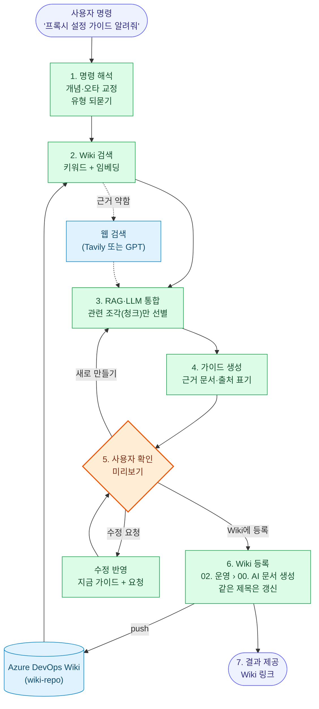

| 단계 | 내용 | 구현 방식 |
|---|---|---|
| 1. 사용자 명령 입력 | "프록시 설정 가이드 알려줘", 주제·유형 인식, 모호하면 되묻기(포워드/리버스), 오타 교정 | 개념 사전, 자모 분해 + 편집 거리 오타 교정, 유형 선택 |
| 2. Azure DevOps Wiki 검색 | 키워드 검색(proxy = 프록시 = 프락시), 의미 기반 검색(임베딩), 근거가 약하면 웹 검색 보완 | BM25 + 문자 bigram + `text-embedding-3-large`, Tavily 또는 GPT 웹 검색. 고정 16문항 hit@3 16/16(임베딩 가중치 8, 0.8이면 15/16, 2026-10-30 측정, [4.1](#41-주요-설정-값) 벤치마크) |
| 3. RAG·LLM 분석·통합 | 관련 문서 선별, 중복·상충 정리, 단계별 구성 | 상위 15개 문서를 제목 단위 조각(청크)으로 나눠 질의와 가까운 조각 24개만 LLM에 전달(코드 블록·다이어그램은 자르지 않음, 같은·거의 같은 조각은 하나만). 입력 8,364 → 4,801토큰, 생성 57 → 34초(2026-10-24 측정). 같은 질의를 다시 하면 근거 지문이 같을 때 LLM을 건너뛰는 가이드 캐시로 22.1 → 0.6초(2026-10-30 측정, [6.1](#61-wiki-검색가이드-생성-wiki_searchpy)). AI가 등록한 문서(00. AI 문서 생성)는 재료에서 제외 |
| 4. 가이드 문서 생성 | 설정 방법·예제·주의사항, 단계마다 근거 문서, 웹 출처 따로 표시, 원문 다이어그램 유지 | `OPENAI_MODEL`(gpt-6.1-sol) |
| 5. 사용자 확인 | 미리보기, "Wiki에 등록" 또는 "새로 만들기", Markdown 복사·다운로드 | "Wiki에 등록"은 확인 창(팀원 공개·같은 제목 갱신 안내) 후 진행 |
| 6. Wiki 문서 등록 | `02. 운영 > 00. AI 문서 생성` 아래 `NN. 제목`으로 등록, 같은 제목이면 갱신(번호 유지, 이력은 git), Wiki 문서 규칙(채번·`.order`·인코딩·프록시 표기) 준수, 머리에 "AI 생성 · 모델 · 생성 일시 · 질의 · 근거 수" | `wiki_tools/wiki_register.py`. 로컬 뷰어 링크를 Wiki 안 링크로 바꾸고 push. push는 원격 최신 위 임시 작업 트리에서 이 문서 커밋만 만들어 올리므로, wiki-repo에 쌓인 로컬 전용 커밋(시나리오 2 테스트)은 올라가지 않음. 올린 뒤 로컬은 원격 위로 rebase |
| 7. 결과 제공 | Azure DevOps Wiki 링크, 추가 질문·수정 요청(확장) | 등록 후 "Wiki에서 열기"·로컬 뷰어 링크. 가이드 아래 "수정 요청" 입력칸: 지금 가이드와 요청을 함께 보내 바뀐 절만 다시 받아 끼워 넣음(약 10초, 요청과 관계없는 부분은 유지, 사용자가 적은 문구는 그대로 반영). 고친 판을 그대로 등록 가능 |

**실행 화면** (2026-10-30 촬영, 설명할 곳은 빨간 테두리)

**① 유형 확인**

`프록시 설정 가이드 알려줘`를 입력하면 포워드인지 리버스인지 먼저 묻습니다.


**② 가이드 생성 (캐시 저장 전)**

- 포워드를 고르면 근거 문서를 다시 찾고 LLM이 가이드를 씁니다(52초).
- 만든 가이드는 캐시에 저장됩니다. 촬영 중 Wiki에는 등록하지 않았습니다.


**③ 같은 질의 다시 하기 (캐시 사용)**

- "다시 선택"으로 같은 유형을 고르면 LLM 없이 저장된 가이드가 바로 나옵니다(약 1초).
- 근거 문서가 바뀌었으면 새로 만듭니다. "새로 만들기"를 누르면 언제든 새로 만듭니다.

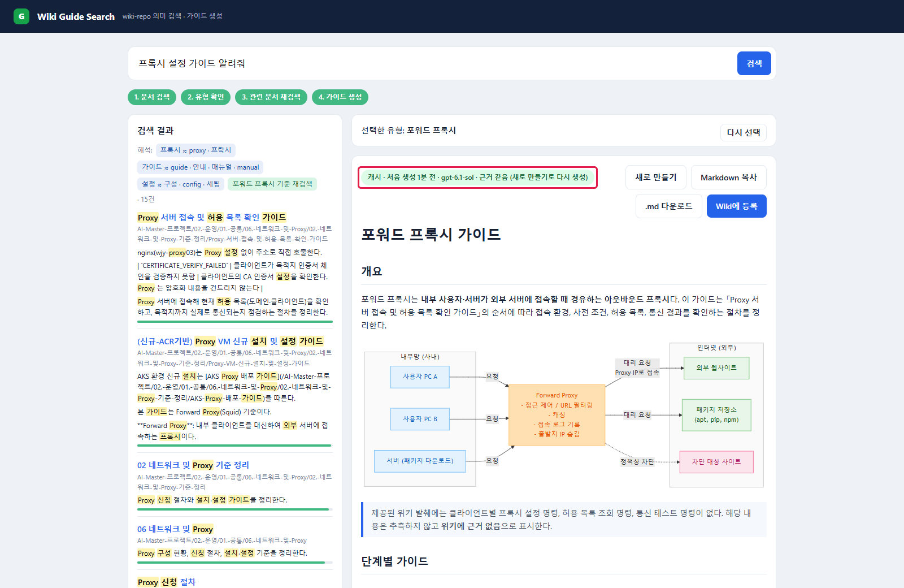

> 가이드의 포트 값(예: `3128`)은 Wiki 원문 기준입니다. 실습 Squid 포트는 `8080`이니, 적용 전에 실제 설정과 대조합니다.

**④ 근거 링크와 수정 요청**

가이드 끝에 근거 문서와 원문 링크가 붙고, 그 아래에서 고칠 내용을 말로 요청합니다.

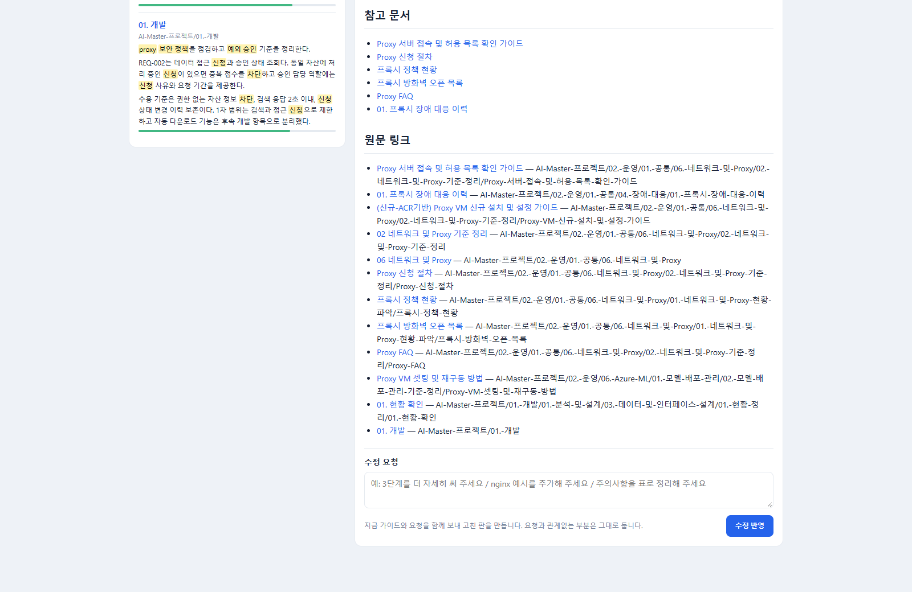

**⑤ 웹 검색으로 보완**

- 리버스를 고르면 Wiki에 그 내용이 적어서 웹 검색 결과를 근거에 더합니다.
- 왼쪽 위에 `웹 검색 N건`이 붙고, 가이드에는 웹 자료로 보완했다고 적힙니다.

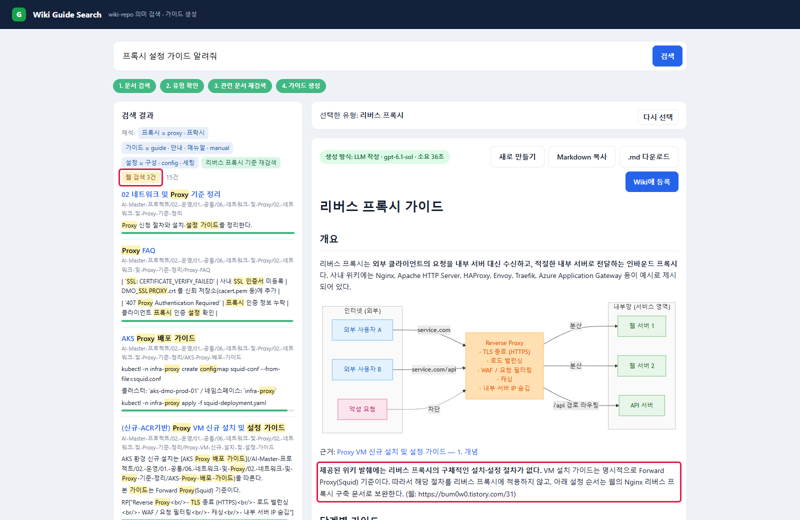

- 왼쪽 "웹 검색 결과"는 찾은 결과 전체, 가이드 끝 "웹 참고 링크"는 본문에서 실제로 인용한 것만입니다.

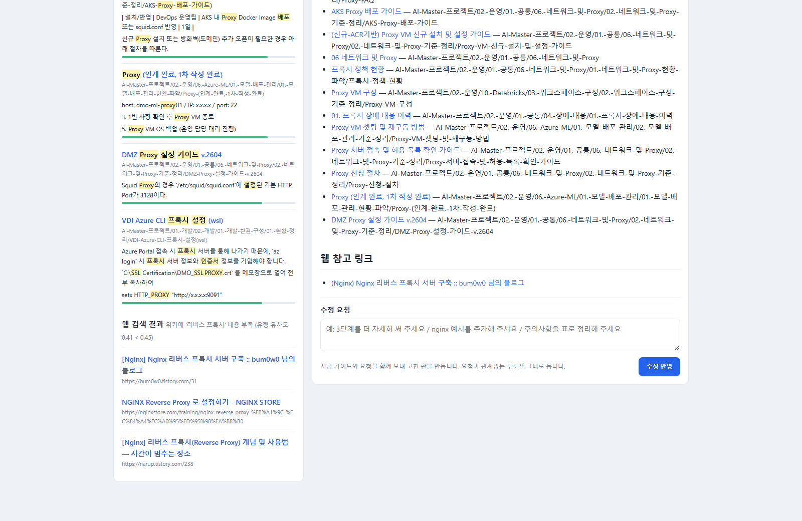

### 1.2 시나리오 2 · 프록시 현황 Wiki 현행화

Wiki의 프록시 현황을 Azure의 실제 VM과 비교하고, 차이가 있으면 Teams 승인을 받아 Task를 만들고 문서를 갱신합니다. 원칙은 **정확해야 하는 일(비교·대상 판별·표 갱신)은 규칙, 읽고 설명하는 일은 LLM**입니다. 실제 운영에서는 Proxy VM이 **항상 켜져 있다고 가정**하므로, 꺼진 VM은 문서 갱신과 별도로 이상 징후로 알립니다. 실행: `python proxy_tools\proxy_status_sync.py` (자세한 내용은 [시나리오 2 실행](#83-시나리오-2--실행-proxy_status_syncpy))


| 단계 | 내용 | 구현 방식 |
|---|---|---|
| 1. 점검 트리거 | 직접 실행 | 직접 실행. 스케줄러는 하지 않기로 함(2026-10-24). 허브 **시나리오 실행** 탭에서 실행하고 `data/logs/scenario2.log`를 봄 |
| 2. Wiki 현황 조회 | 표준 표는 규칙으로 파싱, 형식이 다른 문서는 LLM이 표준 형식으로 바꾸고 원문 대조로 검증 | `wiki_parse_llm`: VM 이름이 원문에 없으면 버리고, IP·SIZE가 원문에 없으면 비움. 실제 문서 `Proxy VM 정리 ('26.09.17 기준)` 11행 확인. LLM으로 읽은 문서는 7단계에서 자동 수정하지 않고 Task에 수동 반영 요청 |
| 3. Azure VM 조회 | 이름 규칙(proxy·prxy·pxy)과 태그로 판별, IP·상태·SIZE·리전 수집 | 태그 `SCENARIO2_TAG`(기본 `role=proxy`)가 있으면 이름과 상관없이 대상, 없으면 이름 규칙으로 **프록시로 추정**. `SCENARIO2_EXCLUDE_TAG`(기본 `role=not-proxy`)는 뺌. 트레이스에 `by_tag`·`by_name` |
| 4. 비교 분석 | 신규·삭제·IP·상태·SIZE 변경 규칙 비교, 중지된 VM은 ⚠ 이상 징후, 차이 없으면 종료(꺼진 VM이 있으면 이상 징후만 알림) | 테스트 문서면 정답(`data/scenario2/expected_diff.json`)과 자동 대조 |
| 5. Teams 알림·승인 요청 | 이상 징후 + AI 요약(참고용) + 변경 목록 + Wiki 문서 링크, "현행화할까요?" Yes/No, No·시간 초과는 기록 후 종료 | Teams 웹후크 카드(판단에 필요한 내용 전부), 버튼은 이 PC의 로컬 승인 서버가 받고 "받았습니다" 확인 화면만 띄움. 프록시로 추정한 VM은 같은 카드에서 한 번만 확인(Yes면 `role=proxy` 태그로 확정, 승인 화면에서 '프록시 아님'으로 고르면 `role=not-proxy` 태그를 붙이고 비교에서 뺌) |
| 6. DevOps Task 생성 | Epic → Feature → 월별 PBI 아래 Task, 변경 내역, 담당자 | Feature·그 달 PBI가 없으면 만들고 `NN. …` Task에 변경 표를 적음. 담당자는 `SCENARIO2_ASSIGNEE`(비우면 PAT 소유자). 예: Task #2505 |
| 7. Wiki 현행화 | 표는 규칙으로 정확히 갱신, 변경 이력 추가, Azure DevOps Wiki 반영 | wiki-repo에 커밋, `.env`의 `SCENARIO2_PUSH=1`이면 Azure DevOps Wiki로 push(기본 0: 로컬만) |
| 8. 완료 보고 | Task 완료 처리, Teams 결과 알림(문서·Task 링크) | Task 상태를 Done으로 바꾸고 Teams 결과 카드 전송(처리 단계 ✓/✗ 목록과 문서·Task 링크). 도중에 실패하면 실패 단계까지 담은 "처리 실패" 카드. No·시간 초과도 결과 카드로 알림 |

**실행 화면** (2026-10-30 17:41 실제 실행, 설명할 곳은 빨간 테두리)

**① 허브에서 실행**

- 카드 아래에 비교 대상 Wiki 문서와 Azure VM 목록 링크가 있습니다.
- 아래 로그는 이 실행의 시작 부분입니다. 줄마다 의미는 다음과 같습니다.

| 로그 | 의미 |
|---|---|
| `▶ proxy_status_sync` | 실행 시작. `[b9272b31]`은 이 실행의 id(같은 실행의 줄은 같은 id) |
| `◆ Planning` | 8단계 계획: Wiki 읽기 → Azure 읽기 → 비교 → AI 요약 → 승인 → Task → Wiki 갱신 → 보고 |
| `◆ Simulation` | 실행 전 점검 4항목과 예상 분기(차이 없으면 종료, No면 알림만) |
| `◆ Step`·`◆ Tool Call` | 단계마다 무엇을 호출했고 결과가 무엇인지 |


**② Teams 승인 요청**

AI 요약과 규칙으로 찾은 변경 5건, Yes·No·자세히 보기 버튼이 있습니다.

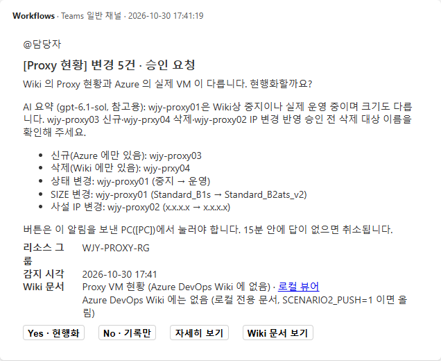

**③ Yes 후 결과 알림**

Task 생성 → Wiki 갱신 → Task 완료를 마치고 결과 카드가 옵니다.

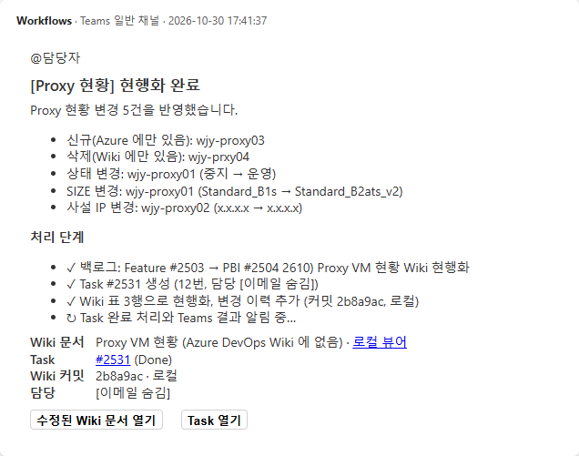

**④ Azure DevOps PBI**

그 달 PBI 아래에 실행할 때마다 Task가 하나씩 붙습니다.

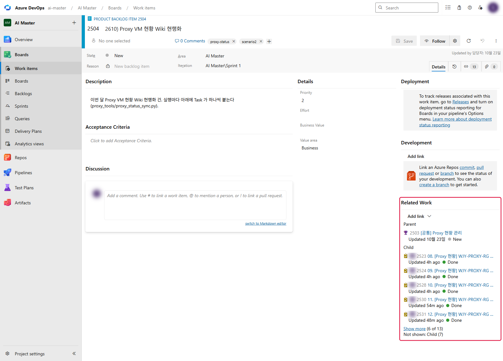

**⑤ Azure DevOps Task**

변경 5건, 문서 링크, AI 요약이 들어가고 Wiki를 고친 뒤 Done이 됩니다.

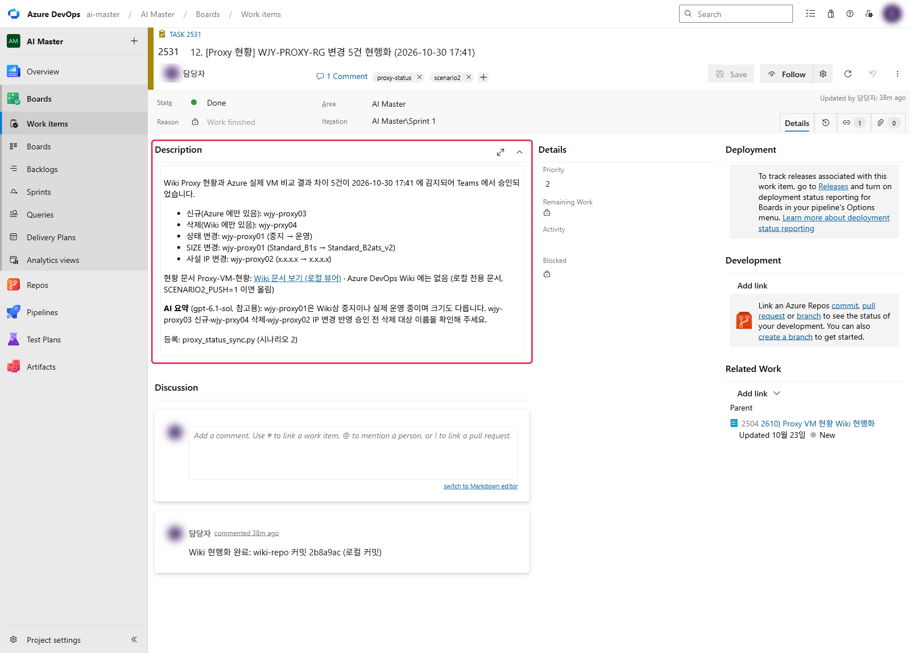

**⑥ Wiki 문서 수정 전/후** (빨간색 = 바뀐 곳)

- 바뀐 값(SIZE·상태·사설 IP), 지워진 VM(취소선), 새 VM, 변경 이력 한 줄이 표시됩니다.

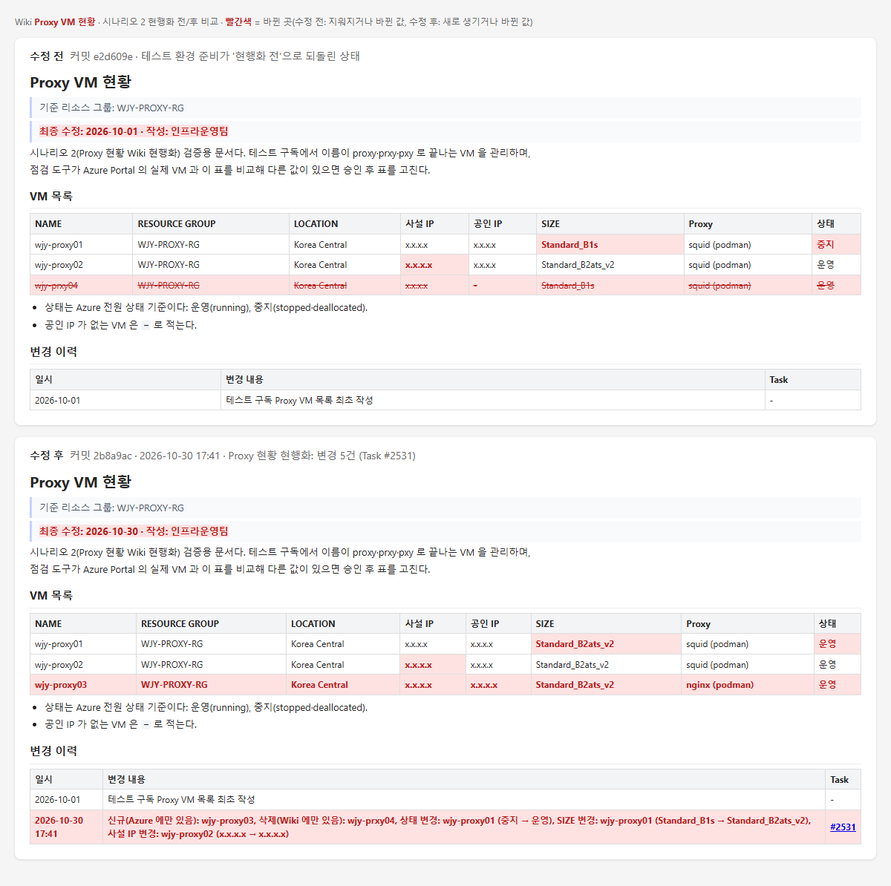

**⑦ 로컬 승인 화면과 처리 결과**

- Teams 카드의 "자세히 보기"를 누르면 열리는 화면입니다.
- 카드에서 바로 Yes를 누르면 "받았습니다"만 뜨고, 결과는 Teams 카드로 옵니다.


### 1.3 시나리오 3 · 장애 감지 및 자동 조치

프록시 로그에서 장애를 감지하면 LLM이 로그·Wiki 사례·설정 저장소(proxy-config) 변경 이력으로 원인과 수정안을 도출하고, Teams 승인 후 Task·수정 PR·장애 대응 이력 Wiki를 만듭니다. 원칙은 시나리오 2와 같이 **감지·검증은 규칙, 읽고 판단하는 일은 LLM**이고, 설정 반영(PR 병합·배포)은 사람이 PR을 검토한 뒤에 합니다. 실행: `python proxy_tools\incident_response.py` (허브 **시나리오 실행** 탭의 시나리오 3 "② 실행", 변경 없이 분석만: `--dry-run`)

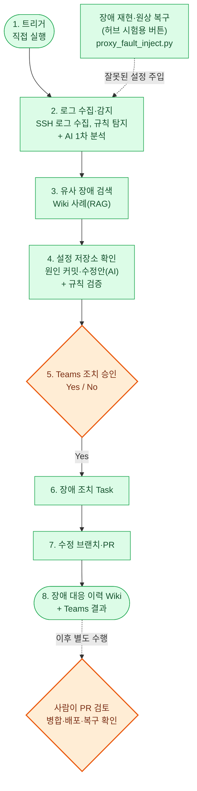

| 단계 | 내용 | 구현 방식 |
|---|---|---|
| 1. 점검 트리거 | 직접 실행 | 허브 "② 실행" 또는 명령줄(분석만은 `--dry-run`). 스케줄러는 두지 않음 |
| 2. 로그 수집·장애 감지 | 서버 로그 수집, 오류 패턴 탐지, 원인 후보 도출(LLM) | 프록시 VM(Squid·NGINX) 접속 로그를 SSH로 읽어 최근 `SCENARIO3_WINDOW_MIN`(기본 60)분만 규칙 탐지(차단 반복·도메인 스캔·업스트림 장애·미허용 클라이언트 등). high·medium이 없으면 "이상 없음"으로 종료. `llm_triage`가 요약·원인 후보·Wiki 검색어를 만듦 |
| 3. 유사 장애 검색 | Wiki 장애 사례(RAG), 해결 방법 조회 | 시나리오 1 검색 엔진(혼합 검색)으로 상위 문서 4개, AI가 만든 문서는 근거에서 제외 |
| 4. DevOps 소스 확인 | 관련 소스 탐색, 원인 코드·설정 특정(LLM), 수정안·영향도(LLM) | proxy-config를 최신으로 받아 최근 커밋 diff·현재 설정을 `llm_fix`에 넘김 → 원인 커밋, 수정안(파일·바꿀 줄·새 줄), 영향. 수정안은 "바꿀 줄이 파일에 정확히 한 번 있는지" 규칙으로 검증하고 아니면 수동 조치로 돌림 |
| 5. Teams 조치 승인 요청 | 원인·수정안 요약(LLM), "조치할까요?" Yes/No | 시나리오 2의 Teams 카드·로컬 승인 서버·진행 화면 재사용. No·시간 초과는 알리고 종료 |
| 6. 장애 조치 Task 생성 | 장애 내용·원인 기록, 담당자 | Epic → Feature `[공통] 프록시 장애 대응` → 그 달 PBI → `NN. [프록시 장애] …` Task, 담당자는 PAT 소유자. PR 병합 때 "연결된 작업 항목 완료"를 고르면 Done |
| 7. 소스 수정 및 PR | 브랜치 생성·AI 수정, Pull Request, Task와 PR 연결 | `fix/incident-…` 브랜치에 수정안 커밋(`tests/validate.py` 통과 필수) → push → main으로 가는 PR(Task 연결). 병합·배포는 사람이 검토 후 |
| 8. 장애 대응 이력 Wiki | 대응 이력 문서, 원인·조치·PR 링크, Teams 결과 알림 | `02. 운영 > 01. 공통 > 04. 장애 대응 > 01. 프록시 장애 대응 이력` 맨 위에 한 건씩 추가(다른 로컬 커밋은 올리지 않음), Teams 결과 카드 |

시험 방법과 결과는 [8.4 시나리오 3 · 시험](#84-시나리오-3--시험)에 있습니다.

**실행 화면** (2026-10-30 실제 실행: 18:08 장애 재현 → 18:24 복구, 설명할 곳은 빨간 테두리)

시험 내용: 허용 목록의 `.data.go.kr`을 `.date.go.kr`로 바꾼 설정을 wjy-proxy01에 배포했습니다. 그러면 data.go.kr 접속만 막힙니다.

**① 프록시 접속 로그**

- 위쪽은 복구 뒤 시험 접속(모두 허용), 아래쪽은 장애 중 차단(`TCP_DENIED/403`)입니다.
- 오른쪽 탐지 결과에는 과거 시험 기록도 섞여 있습니다.


NGINX VM을 고르면 리버스 프록시 로그를 봅니다.

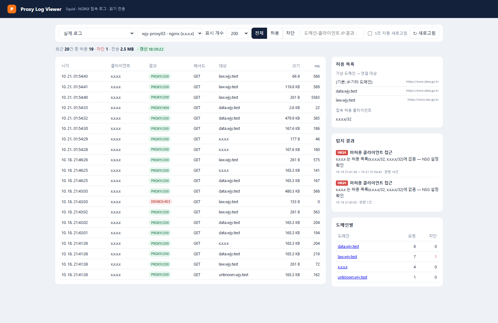

**② 허브에서 실행**

로그의 `◆ Planning`은 9단계 계획(로그 수집 → AI 분석 → 사례 검색 → 설정 확인 → 수정안 → 승인 → Task → PR → 이력 Wiki), `◆ Simulation`은 실행 전 점검과 예상 분기입니다.

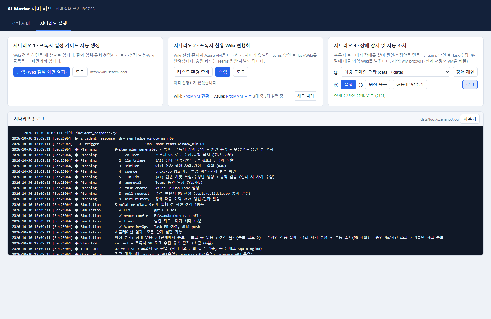

**③ Teams 조치 승인 요청**

AI 분석, 탐지 3건, 원인 커밋, 수정안, 비슷한 장애 사례 링크가 들어갑니다.

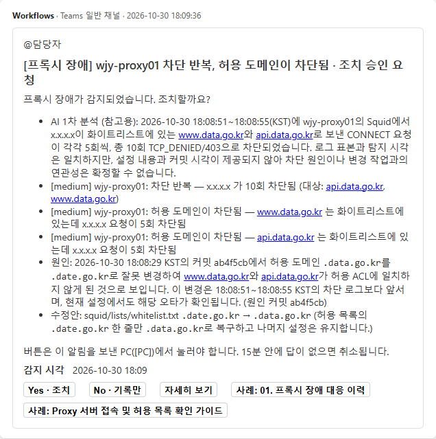

**④ 로컬 승인 화면과 처리 결과**

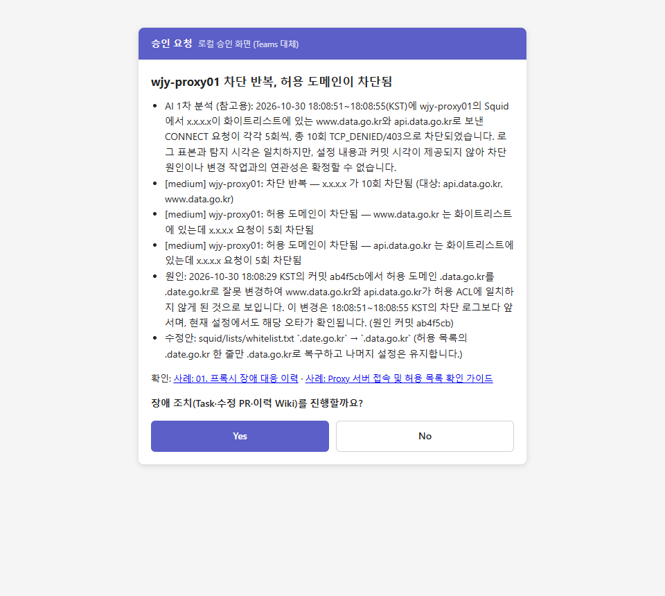

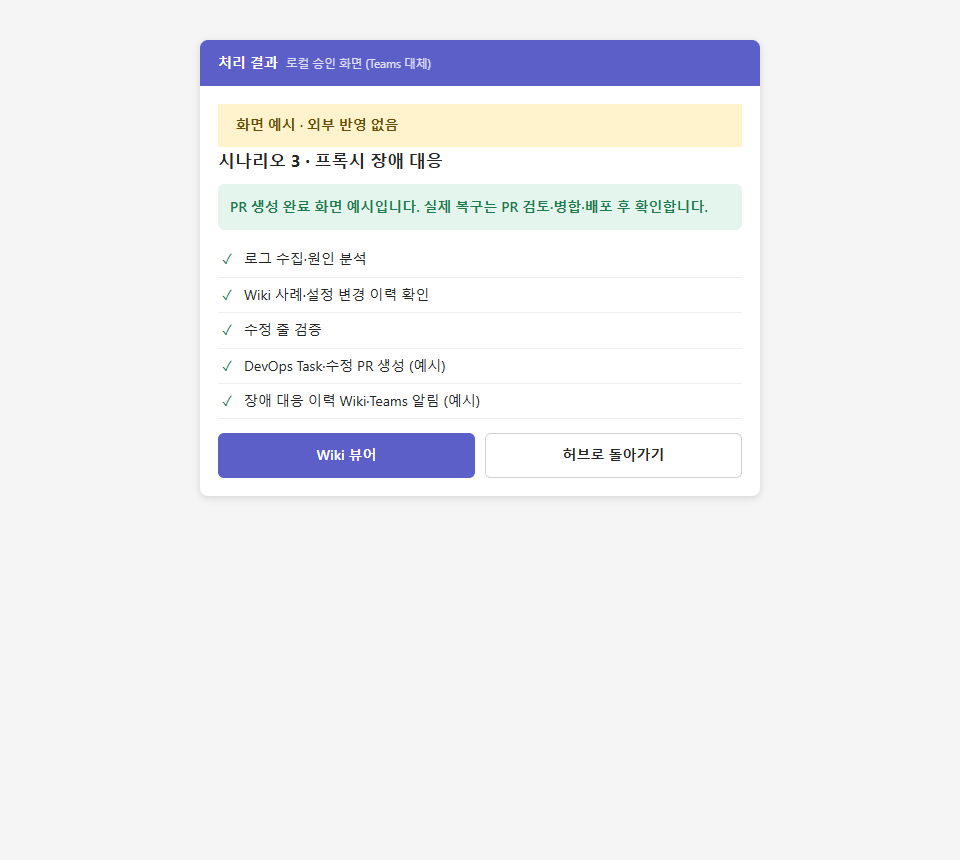

**⑤ Yes 후 결과 알림**

- Task #2532, 수정 PR !14, 장애 대응 이력 Wiki가 만들어집니다.
- **PR 생성은 복구 완료가 아닙니다.** 병합·배포·확인은 사람이 합니다.

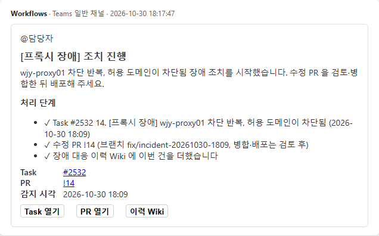

**⑥ Azure DevOps Task**

설명에 탐지 내용·원인·수정안이 들어가고, PR과 커밋이 연결됩니다.

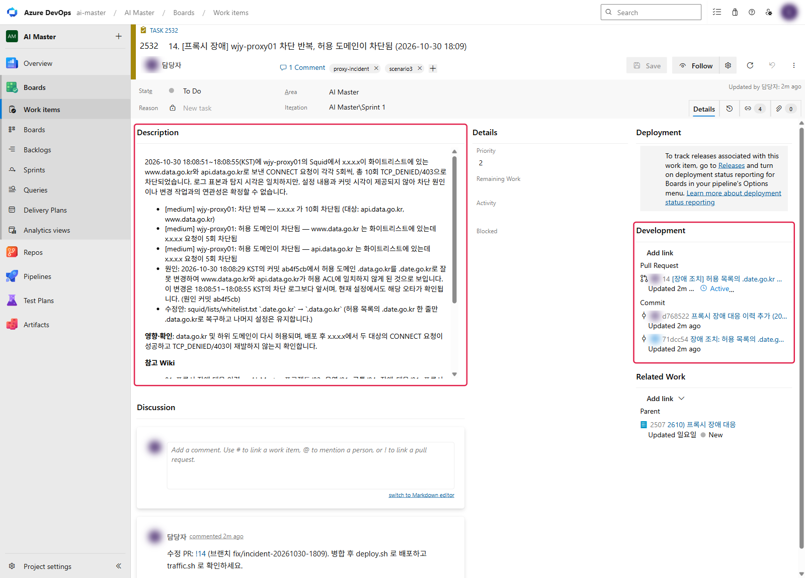

**⑦ 수정 PR (병합 전)**

PR 설명에 원인 커밋, 수정 내용, 확인 방법이 들어가고 Task가 연결됩니다.

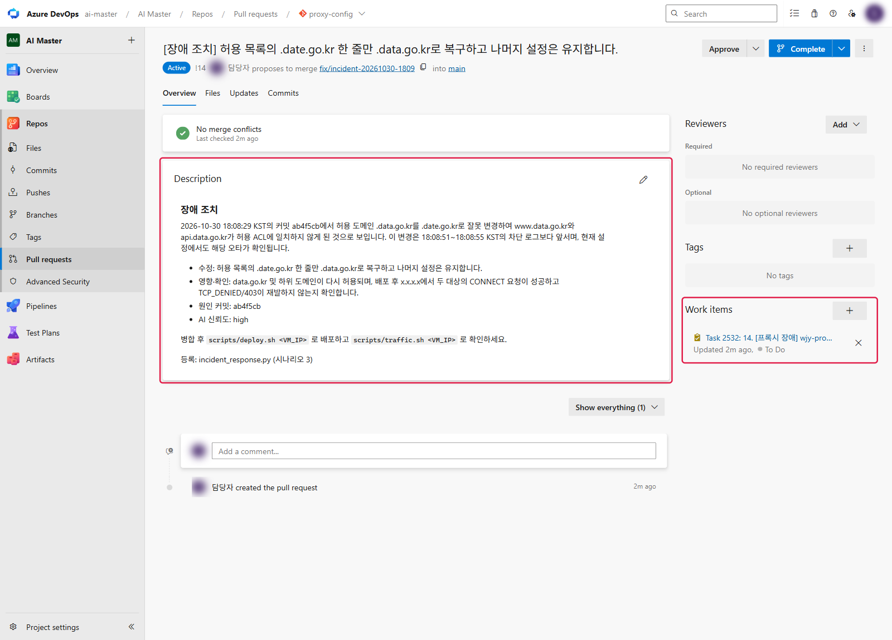

**⑧ 소스 비교 (병합 전/후)**

`whitelist.txt`에서 `.date.go.kr` 한 줄만 `.data.go.kr`로 되돌립니다.

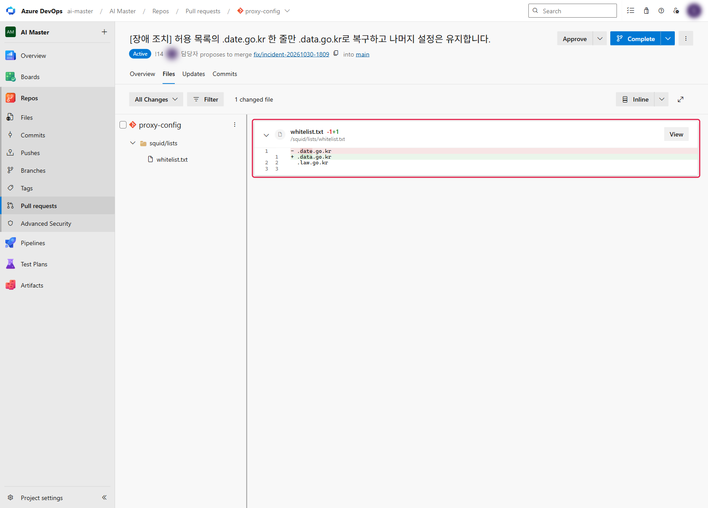

**⑨ 병합 후**

사람이 PR을 검토하고 병합하면 PR은 Completed, Task는 Done이 됩니다.

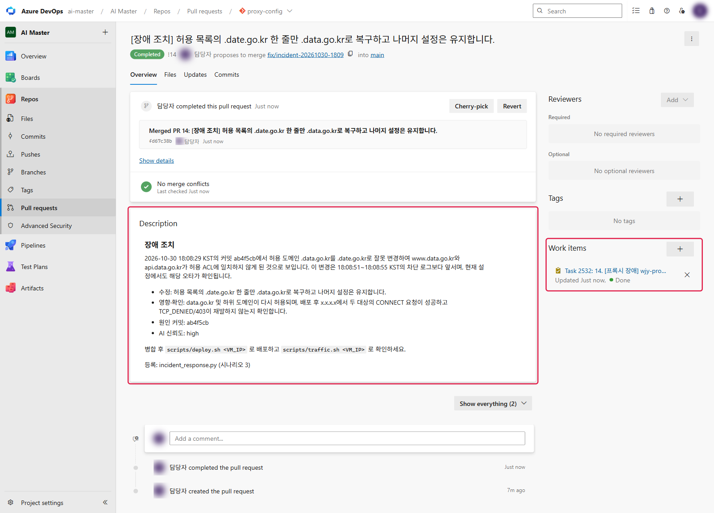

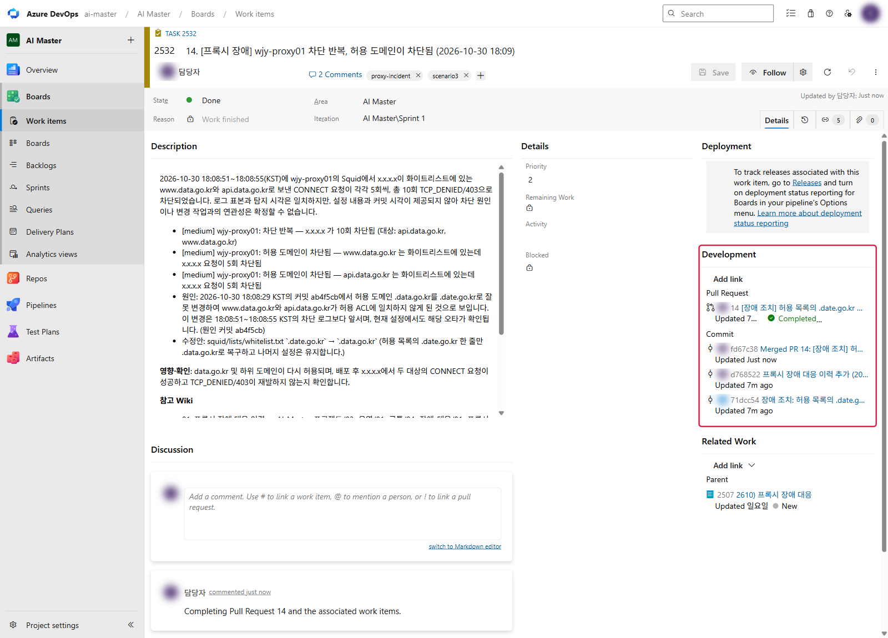

**⑩ 배포와 복구 확인**

wjy-proxy01에 배포한 뒤 시험 접속을 보냈습니다. 장애 중 `ok=10 fail=10`이던 결과가 `ok=20 fail=0`으로 돌아왔습니다.

모든 캡처에서 IP·이메일·구독 ID 등 식별값은 가렸습니다. 재촬영 방법과 외부 반영 범위는 [8.5 README 화면 재촬영](#85-readme-화면-재촬영)에 있습니다.

<sub>[↑ 목차로](#목차)</sub>

## 2. 구성

```
ai-master/
├─ hub.py          로컬 웹서버 허브: 로컬 서버 탭(시작·중지·재시작, 로그) + 시나리오 실행 탭
├─ start.bat       가상환경(.venv)을 켜고 hub.py 실행 (옵션 그대로 전달)
├─ requirements.txt  Python 패키지 목록 (anthropic·msal 은 선택)
├─ common/         공통 모듈: 프로젝트 경로(paths.py), 로컬 웹서버·크롬 열기(server.py), 노드별 트레이싱(trace.py)
├─ wiki_tools/     Wiki 검색·가이드 생성, 로컬 뷰어, Azure DevOps Wiki 문서 관리
├─ proxy_tools/    프록시 VM 생성, 로그 뷰어, 이상 탐지, 프록시 정책(Squid·NGINX) 변경 감지·Task/Wiki 반영
├─ teams_tools/    Microsoft Teams 알림, 로컬 승인 화면(Teams 대체)
├─ docs/images/    README 실행 화면 캡처 (공인 IP 등은 가린 상태)
├─ rules/          AI 작업 규칙: Wiki 문서 작성 규칙(WIKI_DOCUMENT_RULES.md), README 작성 규칙(README_STYLE_RULES.md). 에이전트가 자동으로 읽는 AGENTS.md 는 루트에 있음
├─ pipelines/      Azure Pipelines: Wiki 가 바뀌면 첫 페이지 최근 수정 문서 갱신(wiki-recent.yml)
├─ data/           실행 중 생기는 파일 (Git 제외): 검색 캐시, 트레이스, 가상 로그, 정책 스냅샷, Teams 토큰
├─ test/           API 테스트, 검색 정확도 벤치마크(wiki_search_benchmark.py), 시나리오 2 테스트 환경(scenario2/), README 화면 촬영(capture_readme.py)
└─ wiki-repo/      Azure DevOps Wiki 저장소 (별도 Git, ai-master 에서는 추적하지 않음)

../proxy-config/   형제 폴더: Squid 설정 저장소(Azure Repos, 별도 Git). 시나리오 3·장애 재현용, proxy_tools/setup_proxy_config.py 로 만들거나 받음
```

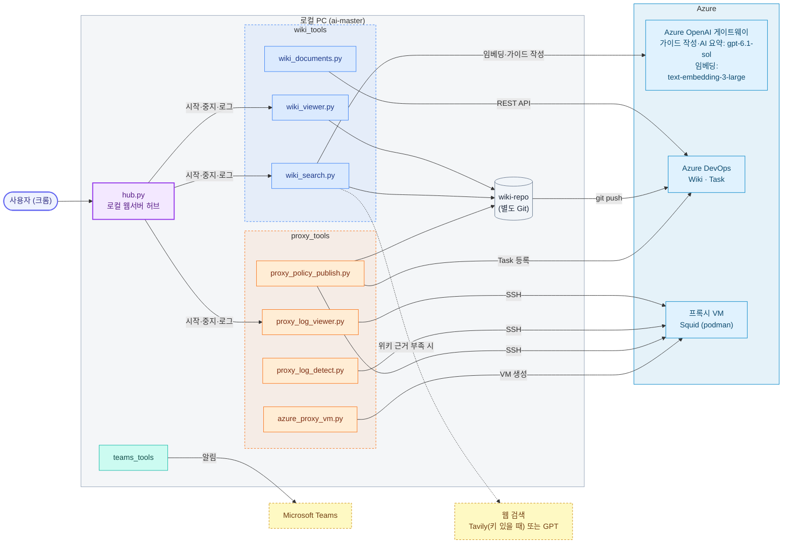

모든 도구는 프로젝트 루트의 `.env` 하나를 함께 읽고, 실행 중 생기는 파일은 `data/`에 남깁니다.

주소는 hosts에 등록했을 때의 주소이고, 괄호 안 숫자는 hosts에 등록하지 않았을 때 쓰는 포트입니다(예: `http://127.0.0.1:8764`). `-`는 웹 화면이 없는 스크립트입니다.

| 폴더 | 파일 | 용도 | 주소 (hosts 미등록 시 포트) |
|---|---|---|---|
| (루트) | `hub.py` | 로컬 웹서버 허브 | <http://ai-master.local> (8764) |
| wiki_tools | `wiki_search.py` | Wiki 의미 검색·가이드 생성 (오타 교정, 웹 검색 보완, 노드별 트레이스) | <http://wiki-search.local> (8766) |
| | `wiki_register.py` | 시나리오 1: 가이드를 `02. 운영 > 00. AI 문서 생성` 아래에 등록(같은 제목 갱신, 문서 규칙 준수, push) | - |
| | `wiki_viewer.py` | Wiki 로컬 읽기 전용 뷰어 (Azure DevOps 문법 렌더링, 코드 구문 강조, 첫 화면은 AI Master 프로젝트 문서) | <http://wiki.local> (8765) |
| | `wiki_documents.py` | Azure DevOps Wiki 문서 목록·생성·삭제 (REST API) | - |
| | `wiki_recent.py` | Wiki 첫 페이지(프로젝트 메인 Overview › Summary 의 About)에 최근 수정 문서 5개(한국 시각). Wiki 에 push 가 생길 때마다 Azure Pipelines(`pipelines/wiki-recent.yml`)가 실행해 갱신하므로 Azure DevOps 화면에서 직접 고친 문서도 1~2분 안에 반영. 바뀐 것 없으면 커밋 안 함 | - |
| proxy_tools | `azure_proxy_vm.py` | 저가 Linux 프록시 VM 생성 (Squid/HAProxy/NGINX, podman·docker). Squid 로그는 VM 디스크 `/var/log/proxy`에 남김 | - |
| | `proxy_log_viewer.py` | 프록시 접속 로그·허용 목록·탐지 결과 화면 (Squid 로그 파일, NGINX는 journald) | <http://proxy-log.local> (8768) |
| | `incident_response.py` | 시나리오 3: 로그 감지 → AI 분석 → Wiki 사례 → proxy-config 원인·수정안 → Teams 승인 → Task → 수정 PR → 장애 대응 이력 Wiki | - |
| | `proxy_log_detect.py` | 가상 에러 로그 생성, 로그 이상 탐지 | - |
| | `setup_proxy_config.py` | 시나리오 3용 proxy-config 저장소 준비: Azure Repos에 있으면 받고, 없으면 `proxy-config-seed/`로 만들어 첫 커밋 push(허용 클라이언트는 `PROXY_ALLOWED_CLIENTS`) | - |
| | `sync_nsg_ip.py` | Proxy VM NSG의 단일 IP 허용 규칙(SSH·프록시 포트)의 출발지를 `PROXY_ALLOWED_CLIENTS`의 IP(유지) + 이 PC의 현재 공인 IP로 맞춤(그 밖의 예전 IP는 삭제). 공인 IP가 바뀌어 SSH가 `Connection timed out`일 때 | - |
| | `proxy_fault_inject.py` | 장애 대응 테스트용: proxy-config 저장소에 잘못된 설정 커밋을 넣고(`apply`) 되돌림(`restore`), 배포·시험 트래픽까지 | - |
| | `proxy_policy_monitor.py` | 프록시 VM 전체(Squid·NGINX) 정책 변경 확인 (읽기 전용, 기준 스냅샷도 바꾸지 않음) | - |
| | `proxy_policy_publish.py` | 정책 변경 → 승인 → Task 등록 + Wiki '프록시 정책 현황' 갱신 | - |
| | `proxy_status_sync.py` | 시나리오 2: Wiki Proxy 현황 ↔ Azure VM 비교 → Teams 승인 → Task → Wiki 현행화 → 완료 보고 | - |
| teams_tools | `teams_notify.py`, `teams_graph.py` | Teams 알림 (Workflows 웹후크 / Graph API). `.env`의 `TEAMS_MENTION`(UPN)을 넣으면 카드마다 그 사람을 @멘션해 Teams 활동 피드에 알림이 뜸 | - |
| | `approval_local.py` | Teams 승인 카드 대체: 로컬 화면에서 Yes/No 승인 | <http://127.0.0.1:8771> (요청 중에만) |
| test | `teams_test.py` | Teams 연동 테스트: 웹후크·Graph 를 차례로 시험하고 실패 원인을 안내 (`.env`의 `TEAMS_*`) | - |
| | `scenario2/setup_env.py` | 시나리오 2(Proxy 현황 Wiki 현행화) 테스트 환경 점검·초기화 | - |

**Wiki 뷰어** (wiki-repo를 Azure DevOps Wiki처럼 읽기 전용으로 보여 줌):


<sub>[↑ 목차로](#목차)</sub>

## 3. 사전 준비

처음 설치할 때 한 번 해 두는 작업입니다. 키·URL·IP 같은 실제 값은 모두 `.env`에만 넣고 커밋하지 않습니다.

| 준비 항목 | 필요한 시나리오 | 없으면 |
|---|---|---|
| PC 도구 (Python·Git·Azure CLI) | 전부 | 실행 불가 |
| hosts 등록 | 전부(허브·화면) | `127.0.0.1:포트` 주소로 뜸 |
| Azure DevOps (Wiki·PAT·백로그·설정 저장소) | 1, 2, 3 | 문서 검색·등록, Task·수정 PR 생성 불가 |
| LLM 게이트웨이 (Azure OpenAI 호환) | 1, 2, 3 | 가이드 생성·검색 임베딩·AI 요약·장애 원인/수정안 분석에 사용(시나리오 2는 AI 요약이 없어도 규칙 비교 가능) |
| 웹 검색 (Tavily API 키 또는 GPT) | 1 | 위키 근거가 약해도 웹 검색 없이 위키만 씀(Tavily 키가 없으면 LLM 게이트웨이의 GPT 웹 검색을 씀) |
| Azure 구독과 Proxy VM | 2, 3 | 비교할 실제 VM이 없음 |
| Microsoft Teams (회사·학교 계정, Workflows 웹후크) | 2, 3 | 승인 요청·결과 알림 카드를 못 보냄 |

### 3.1 PC 도구

- Windows, Python 3.11 이상, Git, [Azure CLI](https://learn.microsoft.com/cli/azure/install-azure-cli-windows), Chrome(없으면 기본 브라우저).
- 프로젝트별 가상환경을 만들고 활성화합니다:

  ```powershell
  python -m venv .venv
  .\.venv\Scripts\Activate.ps1
  python -m pip install --upgrade pip
  python -m pip install -r requirements.txt
  ```

  이후 실행할 때도 먼저 `.\.venv\Scripts\Activate.ps1`를 실행합니다. PowerShell 실행 정책으로 활성화가 막히면 한 번만 `Set-ExecutionPolicy -Scope CurrentUser RemoteSigned`를 적용합니다. `anthropic`와 `msal`은 각각 Claude fallback과 Teams Graph 연동용 선택 패키지입니다. 설치 후에는 프로젝트 폴더의 `start.bat`를 더블클릭해 가상환경에서 허브를 실행할 수 있습니다. 명령줄 옵션도 전달할 수 있습니다(예: `start.bat --no-browser`).

- `.env.sample`을 `.env`로 복사합니다([설정](#4-설정) 참고).

### 3.2 hosts 등록

허브·Wiki 뷰어·Wiki 검색·프록시 로그 뷰어를 포트 없는 주소(`http://ai-master.local` 등)로 열기 위해 관리자 권한으로 `C:\Windows\System32\drivers\etc\hosts`에 줄을 추가합니다. 값은 [포트 없는 주소 (hosts)](#51-포트-없는-주소-hosts)에 있습니다. hosts 주석은 ASCII로만 씁니다(한글 주석이 있으면 이름 풀이가 깨짐).

### 3.3 Azure DevOps

1. 조직·프로젝트를 만들고 프로젝트 Wiki를 켭니다. 프로세스는 Epic → Feature → Product Backlog Item → Task를 쓰는 **Scrum**입니다.
2. **User settings › Personal access tokens**에서 PAT를 만듭니다. 범위: **Wiki (Read & write)**, **Work Items (Read & write)**, **Code (Read & write)**. `.env`의 `AZURE_DEVOPS_ORG`, `AZURE_DEVOPS_PROJECT`, `AZURE_DEVOPS_WIKI`, `AZURE_DEVOPS_PAT`에 넣습니다.
3. Wiki 저장소를 프로젝트 폴더 아래 `wiki-repo`로 받습니다(ai-master Git에서는 추적하지 않음).

   ```powershell
   git clone https://dev.azure.com/<조직>/<프로젝트>/_git/<프로젝트>.wiki wiki-repo
   ```

4. 시나리오 2의 Task가 달릴 Epic을 하나 만들고 번호를 `SCENARIO2_EPIC_ID`에 넣습니다. Feature(`SCENARIO2_FEATURE`)와 그 달 PBI(`SCENARIO2_PBI`)는 없으면 자동으로 만듭니다.
5. 시나리오 3을 쓰려면 Squid 설정 저장소 proxy-config를 준비합니다. ai-master와 별개인 Azure Repos 저장소이고, 기본 위치는 형제 폴더 `../proxy-config`입니다(`PROXY_CONFIG_DIR`로 변경). 먼저 `.env`의 `PROXY_ALLOWED_CLIENTS`에 프록시를 쓸 PC의 공인 IP를 넣습니다.

   ```powershell
   python proxy_tools\setup_proxy_config.py --check   # 상태만 확인
   python proxy_tools\setup_proxy_config.py           # 프로젝트에 있으면 받고, 없으면 만들어 첫 커밋 push
   ```

   새로 만들 때는 `proxy_tools/proxy-config-seed/`(실제 IP를 뺀 설정)를 쓰고 허용 클라이언트를 `PROXY_ALLOWED_CLIENTS`로 채웁니다. 저장소를 만들려면 PAT에 **Code (Read, write, & manage)** 범위가 필요합니다. 시드에는 커밋 이력이 없어서, 원인 분석에 쓰는 변경 이력은 장애 재현(`proxy_fault_inject.py`)을 하면서 쌓입니다.

### 3.4 LLM 게이트웨이

- Azure OpenAI 호환 게이트웨이의 주소와 키를 `AZURE_OPENAI_ENDPOINT`, `AZURE_OPENAI_API_KEY`에 넣습니다.
- 모델 두 개가 필요합니다: 답변용 `OPENAI_MODEL`(기본 `gpt-6.1-sol`), 임베딩용 `OPENAI_EMBED_MODEL`(기본 `text-embedding-3-large`).

### 3.5 웹 검색 (Tavily 또는 GPT)

공급자는 `.env`의 `WEB_SEARCH_PROVIDER`로 고르고, Wiki 검색 서버가 시작할 때 읽습니다(바꾸면 허브에서 재시작).

| 값 | 동작 |
|---|---|
| `auto` (기본) | `TAVILY_API_KEY`가 있으면 Tavily, 없으면 LLM 게이트웨이의 GPT 웹 검색 |
| `tavily` | Tavily만. 키가 없으면 웹 검색 안 함 |
| `gpt` | GPT 내장 `web_search` 도구(Responses API)만. 별도 키 없이 `AZURE_OPENAI_*`(또는 `OPENAI_API_KEY`)를 씀 |
| `off` | 웹 검색 안 함 |

- Tavily: <https://tavily.com> 에 가입해 API 키를 발급받아 `TAVILY_API_KEY`에 넣습니다(무료 플랜으로 시험 가능).
- GPT: Azure 게이트웨이의 Responses API는 api-version `2025-03-01-preview` 이상에서만 열립니다. 가이드 생성용 `OPENAI_API_VERSION`과 따로 `WEB_SEARCH_API_VERSION`(기본 `2025-04-01-preview`)을 씁니다. 검색어와 열어 볼 페이지는 GPT가 정하고, 답 글의 인용(`url_citation`)을 출처별 결과로 바꿔 Tavily 결과와 같은 방식으로 거릅니다. 한 번에 20초에서 40초 걸려 Tavily(1초에서 2초)보다 느립니다.

어느 공급자든 위키 근거가 약할 때만 웹을 검색합니다(기준: `WEB_SEARCH_MIN_SIM`, `WEB_SEARCH_MIN_VARIANT_SIM`).

가이드의 **수정 요청**도 따로 봅니다. 원 질의는 위키에 있어도 수정 요청이 위키 밖 사실을 물을 수 있기 때문입니다(예: "신규 인력 가이드"에 "SK이노베이션에 출근하려면?"). 수정 요청의 위키 유사도가 `WEB_SEARCH_MIN_SIM` 미만이면 LLM에 공개된 사실을 찾아야 하는지 묻습니다. 필요하다고 답하면 LLM이 준 검색어(예: `SK이노베이션 본사 주소`)로 검색하고, 필수어가 없는 결과는 버립니다. "3단계를 더 자세히"처럼 서식만 바꾸는 요청은 유사도가 낮아도 웹을 쓰지 않습니다. 가이드 끝의 '웹 참고 링크'에는 본문에서 실제로 인용한 결과만 붙습니다.

### 3.6 Azure 구독과 Proxy VM

1. Azure 구독에 로그인합니다. 브라우저 로그인이 안 되면 `az login --use-device-code`를 씁니다.

   ```powershell
   az login
   az account set --subscription <구독 이름>
   ```

2. Proxy VM을 만듭니다. `azure_proxy_vm.py`가 가장 싼 B 시리즈 VM에 Squid(포워드)나 HAProxy를 podman으로 올리고, NSG는 이 PC의 공인 IP에만 열고, 매일 01:00 자동 종료를 겁니다. NGINX 리버스 프록시(wjy-proxy03)는 같은 리소스 그룹에 따로 둡니다([프록시 VM 운영](#7-프록시-vm-운영)).

   ```powershell
   python proxy_tools\azure_proxy_vm.py --proxy squid --install podman --count 2
   ```

3. 시나리오 2가 VM을 찾는 기준: 리소스 그룹 `SCENARIO2_RESOURCE_GROUP`(기본 `WJY-PROXY-RG`) 안에서 태그 `SCENARIO2_TAG`(기본 `role=proxy`)가 있거나 이름이 `proxy`·`prxy`·`pxy`(+숫자)로 끝나는 VM.
4. 권한: 조회만 하려면 리소스 그룹 **Reader**, 승인 때 추정 VM에 태그를 붙이려면 **Tag Contributor**, "테스트 환경 준비"에서 꺼진 VM을 켜려면 **Virtual Machine Contributor**가 필요합니다.
5. 시나리오 3: 프록시 로그 뷰어는 이 PC의 기본 SSH 키로 `azureuser@<VM 공용 IP>`에 접속해 로그를 읽습니다(VM을 만들 때 넣은 키, NSG에서 이 PC IP 허용). 허용 클라이언트 대역은 `PROXY_ALLOWED_CLIENTS`에 넣습니다. 정책 변경 감지(`proxy_policy_*.py`)도 같은 SSH 접속을 씁니다(기본 사용자 azureuser, 다른 키를 쓰면 `PROXY_SSH_USER`·`PROXY_SSH_KEY`).

### 3.7 Microsoft Teams

1. **회사·학교용 Microsoft 365 계정**이 필요합니다. 무료 개인 Teams에는 Workflows가 없습니다. Teams Essentials나 Microsoft 365 Business Basic이면 됩니다.
2. 알림을 받을 팀과 채널을 만듭니다(예: 기본 채널 `일반`).
3. 채널 이름 옆 **…** > **워크플로**에서 **채널에 웹후크 경고 보내기**(Send webhook alerts to a channel) 템플릿으로 흐름을 만들고, 발급된 URL 전체를 `.env`의 `TEAMS_WEBHOOK_URL`에 넣습니다. **이 URL은 비밀번호와 같으므로 공개하지 않습니다.**
4. 카드가 Teams **활동**(종 모양)에도 뜨게 하려면 받을 사람의 계정을 `TEAMS_MENTION`(UPN), `TEAMS_MENTION_NAME`(표시 이름)에 넣습니다. 카드마다 그 사람을 @멘션합니다.
5. 시험: `python teams_tools\teams_notify.py --title 테스트 "연동 확인"` → 채널에 카드가 오면 성공(HTTP 202).

- Teams 카드의 Yes/No 응답을 이 PC로 돌려받으려면 Power Automate 프리미엄(HTTP 액션)이 필요합니다. 그래서 승인 버튼은 이 PC의 로컬 승인 서버(`approval_local.py`, <http://127.0.0.1:8771>)로 가고, 화면에는 "받았습니다" 확인만 뜹니다. 판단할 내용은 승인 카드에, 처리 단계와 결과는 Teams 결과 카드에 모두 담아 Teams만 보면 되게 했습니다.
- 카드가 채널에 안 올라오면 Teams 로그인이나 흐름의 연결이 만료된 경우가 많습니다. <https://make.powerautomate.com> 의 **연결**에서 오류 난 Microsoft Teams 연결을 다시 맺고, **내 흐름** › 해당 흐름 › **28일 실행 기록**에서 성공했는지 봅니다. 흐름의 게시 주체는 **흐름 봇**(Flow bot)이어야 합니다(기본값).

<sub>[↑ 목차로](#목차)</sub>

## 4. 설정

`.env.sample`을 복사해 `.env`를 만들고 실제 인증정보를 입력합니다. `.env`는 프로젝트 루트에 하나만 두고 모든 도구가 함께 씁니다.

```powershell
Copy-Item .env.sample .env
```

`.env`에는 API 키와 PAT가 포함될 수 있으므로 Git에 커밋하지 않습니다. `.env.sample`에는 민감한 값 대신 placeholder를 사용합니다.

### 4.1 주요 설정 값

| 변수 | 기본값 | 설명 |
|---|---|---|
| `OPENAI_MODEL` | `gpt-6.1-sol` | 시나리오 1 가이드 작성, 시나리오 2 AI 요약·비표준 Wiki 파싱, 시나리오 3 장애 원인·수정안 분석에 쓰는 LLM. 사내 게이트웨이 배포 이름이며, 사용 가능한 이름은 해당 게이트웨이에서 확인 |
| `OPENAI_EMBED_MODEL` | `text-embedding-3-large` | 검색 임베딩. `test/wiki_search_benchmark.py`로 16개 고정 질의로 정확도를 재현합니다 |
| `EMBED_WEIGHT` | `8` | 혼합 검색에서 임베딩 유사도 가중치. 낮으면 키워드 점수가 의미 점수를 덮습니다 |
| `WEB_SEARCH_PROVIDER` | `auto` | 웹 검색 공급자: `auto`(Tavily 키가 있으면 Tavily, 없으면 GPT), `tavily`, `gpt`, `off` |
| `TAVILY_API_KEY` | (비움) | 넣으면 위키 근거가 약할 때 Tavily 웹 검색 결과를 가이드 근거에 보탭니다 |
| `WEB_SEARCH_API_VERSION` | `2025-04-01-preview` | GPT 웹 검색(Responses API)에 쓰는 Azure api-version. `2025-03-01-preview` 이상 |
| `WEB_SEARCH_MIN_SIM` | `0.5` | 위키 최고 임베딩 유사도가 이보다 낮으면 웹 검색. 2026-10-20 측정에서 위키에 있는 질의는 0.59 이상, 없는 질의는 0.46 이하였습니다 |
| `WEB_SEARCH_MIN_VARIANT_SIM` | `0.45` | 유형(포워드/리버스 등)을 골랐을 때 유형 이름의 위키 최고 유사도가 이보다 낮으면 웹 검색. 2026-10-23 측정: 포워드 프록시 0.499, 리버스 프록시 0.41 |
| `WEB_SEARCH_MAX` | `5` | 웹 검색 결과를 몇 건까지 가져올지 |
| `TRACE_KEEP_DAYS` | `14` | `data/traces/`의 요청별 트레이스 보관 일수 |
| `SCENARIO2_TAG` | `role=proxy` | 시나리오 2에서 이 태그가 있는 VM은 이름과 상관없이 Proxy로 봄(`key=value` 또는 `key`). 승인 때 확인한 추정 VM에 이 태그를 붙임 |
| `SCENARIO2_EXCLUDE_TAG` | `role=not-proxy` | 승인 화면에서 '프록시 아님'으로 고른 VM에 붙이는 태그. 이 태그가 있으면 이름 규칙에 맞아도 비교에서 뺌 |
| `SCENARIO2_PUSH` | `0` | 시나리오 2 승인 후 Wiki 커밋을 Azure DevOps Wiki로 push할지(`1`). 기본은 wiki-repo 로컬 커밋만(테스트 문서가 올라가지 않게) |
| `SCENARIO3_WINDOW_MIN` / `SCENARIO3_TIMEOUT` | `60` / `900` | 시나리오 3: 최근 몇 분의 로그로 장애를 볼지, 승인 대기 초 |
| `SCENARIO3_EPIC_ID` / `SCENARIO3_FEATURE` / `SCENARIO3_PBI` | `1` / `[공통] 프록시 장애 대응` / `프록시 장애 대응` | 시나리오 3 Task가 달릴 백로그 |
| `PROXY_CONFIG_DIR` | `../proxy-config` | 시나리오 3이 원인을 찾고 PR을 만드는 Squid 설정 저장소(Azure Repos) 로컬 경로 |
| `SCENARIO2_TIMEOUT` / `SCENARIO2_WIKI_PAGE` | `900` / (비움) | 승인 대기 초, 비교할 Wiki 문서(wiki-repo 기준 경로, 비우면 테스트 문서) |
| `GUIDE_LLM_TIMEOUT` | `300` | 가이드 작성·수정 LLM 호출을 기다리는 시간(초). 게이트웨이가 응답을 모아 보내서 긴 수정 요청은 120초를 넘깁니다 |
| `GUIDE_CACHE_WEB_DAYS` | `7` | 웹 근거를 쓴 가이드를 캐시에서 쓰는 기간(일). 위키 근거만 쓴 가이드는 근거가 바뀔 때까지 씀 |
| `GUIDE_CHUNKS` / `GUIDE_CHUNK_CHARS` / `GUIDE_CONTEXT_CHARS` | `24` / `1500` / `16000` | 시나리오 1 RAG: LLM에 넘길 조각 수, 조각 하나의 대략 길이, 전체 글자 수 상한. 조각 임베딩은 `data/wiki_search_chunks.json`에 캐시 |
| `test/wiki_search_benchmark_cases.json` | 16개 | 검색 질의와 기대 정답 문서가 고정된 hit@3 벤치마크 케이스 |

검색 랭킹의 `hit@3` 수치는 다음 명령으로 재현합니다. 임베딩 API 키가 필요하며, 결과에는 사용한 모델·Wiki 문서 수·각 질의의 정답 순위가 함께 기록됩니다.

```powershell
.\.venv\Scripts\python.exe test\wiki_search_benchmark.py --output data\wiki-search-benchmark.json
```

2026-10-30 현재 Wiki 1,031개 문서와 고정 16개 케이스로 실행한 결과는 `EMBED_WEIGHT=0.8`에서 15/16(93.8%), `EMBED_WEIGHT=8`(기본값)에서 16/16(100%)입니다(가장 낮은 정답 순위 2위). 2026-10-26 실행(1,032개 문서)은 각각 14/16(87.5%), 15/16(93.8%)였고, 그 뒤 케이스 1개의 정답 경로를 실제 위치(`01.-현황-정리/` 아래)로 고쳤습니다. 과거 코드 주석의 68.8%·87.5%는 당시 테스트셋이 저장되어 있지 않아 이 벤치마크로 재현되는 수치로 표기하지 않습니다.
| `WIKI_REGISTER_PUSH` | `1` | 시나리오 1 "Wiki에 등록" 때 Azure DevOps Wiki로 push(`0`이면 로컬 커밋만) |
| `PROXY_ALLOWED_CLIENTS` | `203.0.113.10/32` | 프록시를 쓸 수 있는 클라이언트 CIDR(쉼표 구분). 로그 탐지·장애 주입이 이 값을 씁니다. 실제 IP는 `.env`에만 둡니다 |
| `PROXY_SSH_USER` / `PROXY_SSH_KEY` | `azureuser` / (비움: 기본 키) | 프록시 VM SSH 접속(정책 변경 감지) |
| `SQUID_RUNTIME` | `podman` | VM에서 Squid 컨테이너를 띄운 런타임(로그 뷰어) |
| `TEAMS_*` | (비움) | 회사·학교 Microsoft 365 계정이 있을 때만 사용 |
| `TEAMS_CARD_ARCHIVE` | `1` | 보낸 Teams 카드를 `data/teams_cards/`에 JSON으로 남김(README 카드 화면용). `0`이면 끔 |
| `TEAMS_WINDOW_ARRANGE` | `1` | 카드를 보낸 뒤 Teams 데스크톱 창을 화면 가로 전체 × 위쪽 절반으로 옮기고 앞으로 가져옴. `0`이면 끔 |
| `WINDOW_ARRANGE` | `1` | 창 옮기기 전체 스위치(`common/winlayout.py`). 처리 결과 브라우저 창(제목 `처리 결과`·`승인 접수`)도 같은 크기로 옮김. `0`이면 모두 끔 |
| `FAULT_TRAFFIC_ROUNDS` | `3` | 장애 재현·원상 복구 뒤 보내는 시험 접속 횟수(도메인 4개 × N회, `proxy_fault_inject.py`). 허용 도메인 차단은 1건, DNS 장애는 도메인당 3회부터 잡힘 |
| `SCENARIO3_DEPLOY_PIPELINE` | `proxy-config VM 배포` | 시나리오 3 조치 카드의 "② 병합 후 VM 배포" 버튼이 여는 파이프라인 이름(실행 목록 화면, 못 찾으면 Pipelines 첫 화면) |

임베딩 모델을 바꾸면 처음 실행할 때 문서 전체 임베딩을 다시 계산합니다(약 2분). 결과는 `data/wiki_search_cache.json`에 캐시됩니다.

서버는 시작할 때만 `.env`를 읽습니다. 값을 바꾸면 허브에서 해당 서버를 재시작해야 적용됩니다.

### 4.2 data 폴더

| 파일 | 만드는 도구 |
|---|---|
| `wiki_search_cache.json` | wiki_search.py (문서 임베딩 캐시) |
| `sim_access.log` | proxy_log_detect.py simulate (가상 프록시 로그) |
| `proxy_policy_state/` | proxy_policy_publish.py (VM별 정책 기준 스냅샷 `<VM>.json`, 변경 이력) |
| `teams_token_cache.json` | teams_graph.py (Graph 로그인 토큰, 공유 금지) |
| `teams_cards/` | teams_notify.py (보낸 Teams 카드 JSON, README 카드 화면 재촬영용) |
| `approvals/` | approval_local.py (로컬 승인 화면 내용·최종 진행 상태, README 승인 화면 재촬영용) |
| `logs/<서버>.log` | hub.py (허브에서 시작한 서버의 출력, 2MB 넘으면 `.old.log`로 교체) |
| `logs/scenario2.log` | proxy_status_sync.py (시나리오 2 실행 출력과 테스트 환경 준비 출력. 허브 "시나리오 실행" 탭에서 봄, 2MB 넘으면 `.old.log`) |
| `traces/<서비스>-YYYYMMDD.jsonl` | wiki_search.py·proxy_status_sync.py·proxy_log_viewer.py (요청·실행별 노드 트레이스, `TRACE_KEEP_DAYS`(기본 14)일 지나면 삭제) |
| `logs/scenario3.log` | incident_response.py (시나리오 3 실행 출력. 허브 "시나리오 실행" 탭에서 봄) |
| `scenario2/` | test/scenario2/setup_env.py (Azure VM 스냅샷, '현행화 전' Wiki 표, 정답 차이 목록) |

<sub>[↑ 목차로](#목차)</sub>

## 5. 로컬 웹서버

### 5.1 포트 없는 주소 (hosts)

**루프백 IP 나누기** 방식을 씁니다. 서버마다 서로 다른 루프백 IP(`127.0.87.64`, `127.0.87.65` …)를 하나씩 주고, 각자 그 IP의 80 포트에 띄워 `http://wiki.local`처럼 포트 없는 주소로 접속합니다.

| 방식 | 주소 예 | 특징 |
|---|---|---|
| 포트 여러 개 (가장 흔함) | `localhost:8765`, `localhost:8766` | 설정이 없지만 포트 번호를 외워야 함 |
| 리버스 프록시 (실무에서 흔함) | `wiki.local` | nginx·Caddy 등이 80 포트를 받아 이름별로 각 서버 포트로 넘김. 프록시 설치·관리 필요 |
| **루프백 IP 나누기 (이 프로젝트)** | `wiki.local` | hosts 몇 줄만으로 해결, 추가 프로그램 없음. `127.0.0.0/8` 전체가 자기 PC를 가리키는 Windows에서 바로 동작(macOS·Linux는 IP 별칭 등록 필요) |

hosts 파일은 포트를 정할 수 없으므로 서버마다 다른 루프백 IP의 80 포트를 씁니다. 서버는 시작할 때 hosts를 읽어 자기 이름에 적힌 IP로 뜹니다(`common/server.py`).

`127.0.87.65`를 코드에서 새로 생성하는 것은 아닙니다. `127.0.0.0/8`은 자기 PC로 돌아오는 루프백 대역이고, `common/server.py`의 `hosts_entries()` → `site_url()` → `local_server()`가 hosts의 값을 읽어 해당 **IP와 포트에 바인딩**합니다. IP가 다르면 같은 80 포트도 함께 사용할 수 있습니다.

hosts에 IP가 없거나 `127.0.0.1`이면 서버마다 정해진 자기 포트를 씁니다. 같은 IP에서는 80 포트를 한 서버만 쓸 수 있기 때문입니다.

| 서버 | hosts 이름 | 전용 IP (80 포트) | 자기 포트 |
|---|---|---|---|
| 허브 (`hub.py`) | ai-master.local | 127.0.87.64 | 8764 |
| Wiki 뷰어 (`wiki_viewer.py`) | wiki.local | 127.0.87.65 | 8765 |
| Wiki 검색 (`wiki_search.py`) | wiki-search.local | 127.0.87.66 | 8766 |
| 프록시 로그 뷰어 (`proxy_log_viewer.py`) | proxy-log.local | 127.0.87.68 | 8768 |

Wiki 뷰어를 예로 들면 hosts 값에 따라 다음처럼 뜹니다.

| hosts에 적힌 값 | 서버가 뜨는 곳 | 브라우저 주소 |
|---|---|---|
| 없음 | 127.0.0.1:8765 | `http://127.0.0.1:8765` |
| `127.0.0.1 wiki.local` | 127.0.0.1:8765 | `http://wiki.local:8765` |
| `127.0.87.65 wiki.local` | 127.0.87.65:80 | `http://wiki.local` |

전용 IP가 적혀 있으면 자기 포트(8765 등)는 쓰지 않습니다. `127.0.0.1:포트`를 거쳐 가는 것이 아니라, 서버가 처음부터 전용 IP의 80 포트에 뜹니다. 허브(`127.0.87.64 ai-master.local`)를 예로 들면:

1. 서버 시작: `hub.py`가 hosts에서 `ai-master.local`을 찾아 `127.0.87.64:80`에서 기다립니다.
2. 브라우저 접속: `http://ai-master.local` → Windows가 hosts를 보고 `127.0.87.64`로 바꿈 → 포트를 안 적었으므로 80번으로 접속 → 허브가 응답합니다.

규칙은 [`common/server.py`](common/server.py)에 있습니다.

| 함수 | 하는 일 |
|---|---|
| `hosts_entries()` | hosts 파일을 읽어 이름 → IP 목록을 만듦 |
| `site_url()` | 위 표의 판단: `127.0.0.1`이 아닌 루프백 IP면 그 IP의 80, `127.0.0.1`이거나 없으면 `127.0.0.1:자기 포트` |
| `local_server()` | 정해진 IP·포트로 서버를 띄움 |

서버마다 자기 포트는 각 파일에 있습니다(예: `hub.py`의 `HUB_PORT = 8764`).


관리자 PowerShell에서 `C:\Windows\System32\drivers\etc\hosts`에 아래를 추가하고 `ipconfig /flushdns`를 실행합니다.

```
# ai-master local web servers
127.0.87.64  ai-master.local      # ai-master hub (ai-master/hub.py)
127.0.87.65  wiki.local           # Wiki viewer (ai-master/wiki_tools/wiki_viewer.py)
127.0.87.66  wiki-search.local    # Wiki search + guide (ai-master/wiki_tools/wiki_search.py)
127.0.87.68  proxy-log.local      # proxy log viewer (ai-master/proxy_tools/proxy_log_viewer.py)
```

hosts의 주석(`#` 뒤)은 영문(ASCII)으로만 씁니다. Windows는 hosts를 UTF-8로 읽지 않아 한글 주석이 있으면 이름 해석이 깨집니다(2026-10-21 확인).
hosts를 바꾼 뒤에는 서버를 다시 시작해야 새 주소로 뜹니다. 127.0.87.67·69·70은 ai-monitor(사용량·비용 모니터와 그 허브)가 같은 규칙으로 씁니다.

### 5.2 허브 (hub.py)

<http://ai-master.local> 한 화면에서 ai-master 서버 3개(Wiki 뷰어, Wiki 검색, 프록시 로그 뷰어)의 상태를 보고 시작·중지·재시작하고, 로그를 봅니다. 화면은 탭 두 개입니다.

Teams 승인 카드의 Yes·No·자세히 보기 버튼은 허브(`/approval/decide`, `/approval/open`)를 거칩니다. 승인 서버(8771)가 떠 있으면 그리로 넘기고, 이미 끝나 닫혔으면 "연결 거부" 대신 그 요청의 기록(`data/approvals/`)으로 결정·처리 단계·결과 링크를 보여 줍니다(다시 처리하지 않음). 허브가 꺼져 있거나 옛 버전이면 지금처럼 승인 서버로 바로 연결합니다.

머리글 오른쪽의 `서버 상태 확인 HH:MM:SS`는 서버 상태를 마지막으로 받은 시각입니다(3초마다 갱신). 10초 넘게 받지 못하면 빨간색 `허브 응답 없음 (마지막 확인 …)`으로 바뀝니다. 허브가 죽었거나 멈춘 것이므로, 그동안 표의 상태는 옛 정보입니다. `start.bat`으로 다시 띄웁니다.

| 탭 | 내용 |
|---|---|
| 로컬 서버 | 서버 표(상태·주소·PID·가동 시간, 시작·중지·재시작·로그)와 로그 창(**지우기**: 지금까지의 로그를 화면에서만 숨김, 파일은 그대로. **전체 보기**로 되돌림. 시나리오 실행 탭 로그 창도 같음). 주소를 누르면 서버 화면이 새 창으로 열림 |
| 시나리오 실행 | **시나리오 1**: 실행하면 Wiki 검색 화면을 새 창(화면 가로 전체 × 위쪽 절반)으로 엶(질의 입력부터 그 화면에서), 로그는 `scenario1.log`<br/>**시나리오 2**: "테스트 환경 준비"(`setup_env.py`: 꺼진 Proxy VM만 켜고 표·정답을 다시 만듦) 후 "실행", "원상 복구"(`setup_env.py --restore`: 테스트 문서를 실제 Azure VM과 같은 정상 표로 되돌림, VM 시작 없음), 실행 상태·PID·종료 코드와 `scenario2.log` 실시간 표시. 실행 중에는 다시 실행할 수 없음. 카드 아래 한 줄에 Wiki 현황 문서(비교 대상, 로컬 뷰어 · 올라가 있으면 Azure DevOps) 링크와 Azure Portal VM 목록 링크(`3대 중 N대 실행 중`)를 보여 줌(`/api/s2links`, az·DevOps 조회라 5분 캐시, "새로 읽기"로 즉시)<br/>**시나리오 3**: 한 줄 흐름 ① 장애 종류 선택·"장애 재현" → ② "실행"(최근 60분 로그 점검 → Teams 승인 → Task·수정 PR·이력 Wiki) → ③ "원상 복구", "허용 IP 맞추기"(`sync_nsg_ip.py`), "프록시 로그 뷰어"(`proxy-log.local`을 화면 가로 전체 × 위쪽 절반 새 창으로 엶), "로그". 설명은 버튼 툴팁. 실행 중 승인 서버가 뜨면 승인 화면을 같은 크기의 새 창으로 한 번 자동으로 띄우고, "승인 화면 열기" 버튼도 보여 줌(크롬이 팝업을 막으면 버튼으로 열거나 주소창에서 `ai-master.local` 팝업 허용). "현재 심어진 장애"(원격 main 기준, 30초마다 fetch)와 최근 실행 1건 표시, `scenario3.log` 실시간 표시. Azure DevOps의 **proxy-config VM 배포** 파이프라인 실행도 10초마다 읽어 카드에 상태를 보이고, 배포 로그를 `scenario3.log`에 `[pipeline]` 줄로 이어 붙임(허브를 켜기 전에 끝난 실행은 제외) |

`http://ai-master.local/#scenarios`로 열면 시나리오 실행 탭이 바로 열립니다. 서버 화면은 표의 주소를 눌러 새 창에서 엽니다. 지금 보고 있는 로그의 "로그" 버튼은 연한 파랑으로 표시됩니다(로컬 서버 탭·시나리오 실행 탭 모두). 사용량·비용 모니터는 ai-monitor의 허브(<http://ai-monitor.local>)에서 관리합니다.

가상환경(`.\.venv\Scripts\Activate.ps1`)을 켠 뒤 실행합니다. `start.bat`은 가상환경 활성화와 `python hub.py`를 한 번에 하며 아래 옵션도 그대로 받습니다(예: `start.bat --no-restart`).

허브는 전용 크롬 프로필(`data/hub-chrome-profile`, 개발자 도구 포트 127.0.0.1:9222)로 열립니다. 다시 실행하면 그 포트로 예전 허브 탭(`ai-master.local`)을 닫고 새로 열어 탭이 쌓이지 않습니다. 평소 쓰는 크롬과 다른 창이라 로그인·확장 프로그램이 없으므로, Azure DevOps 링크를 처음 열 때는 다시 로그인합니다.

```powershell
python hub.py                # 허브를 켜고 서버를 모두 다시 시작한 뒤 크롬으로 연다 (이미 떠 있는 허브는 끄고 새로 띄움)
python hub.py --keep         # 이미 떠 있는 허브가 있으면 끄지 않고 종료
python hub.py --start-all    # 서버를 다시 시작하지 않고, 꺼져 있는 서버만 시작
python hub.py --no-restart   # 서버를 건드리지 않음 (떠 있는 그대로)
python hub.py --no-browser   # 크롬을 열지 않음 (다른 옵션과 함께 사용)
```


- 서버는 창 없이 뜨고 출력은 `data/logs/<서버>.log`에 남습니다. 허브를 꺼도(Ctrl+C) 서버는 계속 돕니다.
- 실행 여부는 프로세스 명령줄의 스크립트 이름으로 찾으므로 직접 띄운 서버도 허브에 보이고 끌 수 있습니다(로그는 허브에서 시작한 서버만 남음).
- 허브 콘솔에는 시각과 함께 시작 설정, 시작·중지 요청, 생성·종료한 PID, 상태 변화(직접 끄거나 서버가 죽은 경우 포함), 거부된 요청, 오류가 찍힙니다. 서버가 시작하자마자 죽으면 그 서버 출력의 마지막 줄도 함께 찍힙니다.

허브를 켜면 Wiki 뷰어, Wiki 검색, 프록시 로그 뷰어를 모두 다시 시작합니다. 코드를 고친 뒤 허브만 다시 켜면 서버에도 반영됩니다. 허브가 이미 떠 있으면 `python hub.py`가 그 허브 프로세스를 끄고 새로 띄웁니다. 끄지 않으려면 `--keep`을 붙이며, 이때는 "이미 사용 중"과 함께 PID가 나오고 종료합니다. 허브만 끄려면 다음을 실행합니다.

```powershell
Get-NetTCPConnection -LocalAddress 127.0.87.64 -LocalPort 80 -State Listen | ForEach-Object { taskkill /PID $_.OwningProcess /F }
```

`/T`(프로세스 트리)를 붙이면 허브가 띄운 서버까지 함께 꺼지므로 붙이지 않습니다.

**허브 - 로컬 서버 탭:**


<sub>[↑ 목차로](#목차)</sub>

## 6. 주요 흐름

### 6.1 Wiki 검색·가이드 생성 (wiki_search.py)

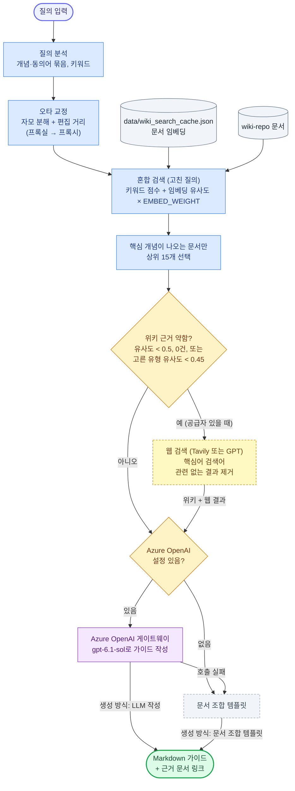

#### 검색어 해석

| 기능 | 방식 | AI 여부 |
|---|---|---|
| 동의어 묶기 (프록시 = proxy = 프락시) | 개념 사전 `CONCEPTS` | 규칙 기반 |
| 오타 교정 (프록실·프롤시 → 프록시, porxy → proxy) | 한글 자모 분해 + 편집 거리(Damerau–Levenshtein) + 개념 사전 매칭 | 규칙 기반 |
| 의미가 비슷한 문서 찾기 | 임베딩 `text-embedding-3-large` 유사도 | AI (머신러닝) |
| 가이드 작성 | LLM `gpt-6.1-sol` (`OPENAI_MODEL`) | AI (LLM) |

- 오타 교정은 한글 3음절 이상·영문 5글자 이상만 고칩니다. 2음절은 `설정`↔`결정`처럼 다른 실제 단어와 거리가 1이라 고치지 않습니다.
- 고친 단어는 화면 해석 칩(`오타 교정: 프록실 → 프록시`)과 트레이스 `analyze` 줄(`typo_fixes=`)에 나옵니다. 검색은 고친 질의로 하므로 결과가 정상 질의와 같습니다.
- 유형(포워드/리버스 등)을 고르면 그 유형의 단어(포워드: 허용·차단·설치·로그 등)가 나오는 문서에 점수를 더합니다. 단어마다 **3번까지만** 셉니다. 그대로 세면 긴 기록 문서가 이겼습니다(2026-10-30: 포워드에서 `01. 프록시 장애 대응 이력`(18,547자, 허용 69·차단 95번)이 2위, `Proxy VM 신규 설치 및 설정 가이드`가 4위 → 상한 3이면 8위·3위, 리버스 순위는 그대로).

#### 웹 검색 (WEB_SEARCH_PROVIDER, 3.5 참고)

- 조건: 위키 최고 유사도 < `WEB_SEARCH_MIN_SIM`(0.5), 핵심 개념이 나오는 위키 문서 0건, 또는 고른 유형(예: 리버스 프록시)의 이름 유사도 < `WEB_SEARCH_MIN_VARIANT_SIM`(0.45). 주제(프록시)는 위키에 많아도 그 유형은 없을 수 있기 때문입니다.
- 검색어는 질의 문장이 아니라 핵심 한글어로 만듭니다(예: `리버스 프록시 설정`). 말투·영문 동의어·`가이드` 같은 일반어를 섞으면 게임·주식·코인 기사가 걸렸습니다.
- 결과에 핵심 개념(유형이면 `리버스 프록시`·`reverse proxy` 같은 붙은 문구)이 없으면 버립니다.
- 가이드는 위키를 우선 근거로 하고, 웹에서 가져온 문장 끝에 `(웹: URL)`을 붙이며, 끝에 "웹 참고 링크"와 "사내 기준이 아님" 주의 문구가 들어갑니다.

#### 가이드 캐시

같은 질의를 다시 하면 LLM을 건너뛰고 저장된 가이드를 바로 보여 줍니다(약 37초 → 1초 안). 검색·근거 선택까지는 매번 다시 하고, 아래가 **모두** 같을 때만 씁니다.

- 질의(앞뒤·연속 공백, 대소문자만 정리)와 고른 유형. 표현이 다른 질의는 따로 만듭니다.
- 근거 지문: LLM에 넘길 근거 조각의 원문·경로와 근거 문장, 모델 이름, 프롬프트 버전(`GUIDE_PROMPT_VERSION`), 웹 검색을 할지 판단한 결과. 근거 문서가 고쳐지면 지문이 달라져 새로 만들고, 관계없는 위키 문서가 바뀐 것은 영향이 없습니다. 조각 순서는 지문에 넣지 않습니다. 관계없는 문서가 바뀌어도 점수 기준(단어 희소도·평균 길이)이 조금 변해 비슷한 조각의 순서가 뒤바뀌기 때문입니다. 시나리오 2 테스트 문서(`Proxy VM 현황`)는 시험할 때마다 일부러 틀린 값으로 되돌리므로 가이드 근거에서 뺍니다(`GUIDE_EXCLUDE`).
- 웹 근거를 쓴 가이드는 `GUIDE_CACHE_WEB_DAYS`(기본 7일)가 지나면 새로 만듭니다. 웹 내용은 다시 검색해야 알 수 있어 지문에 넣지 않습니다.
- 수정 요청 결과와 템플릿 가이드는 저장하지 않습니다. "새로 만들기"를 누르면 캐시를 보지 않고 새로 만들어 덮어씁니다.
- 저장 위치: `data/guide_cache.json`(최근 300개). 트레이스 `guide_cache` 노드에 사용 여부와 이유(`없음`, `근거 바뀜`, `웹 근거 7일 지남`)가 남습니다.
- 모두 지우려면 허브 시나리오 1 카드의 "캐시 초기화"를 누릅니다. 서버를 재시작할 필요는 없고, 직전 내용은 `guide_cache.json.bak`으로 남습니다.

#### 수정 요청: 바뀐 절만 다시 쓰기와 프롬프트 캐시

수정 요청은 가이드 전체가 아니라 바뀐 절만 LLM이 출력하고, 코드가 그 절을 지금 가이드에 끼워 넣습니다(`merge_sections`).

- LLM은 고친 절을 원래 제목 줄(`##`·`###`) 그대로 내보냅니다. 새 절은 `<!-- after: 앞 절 제목 -->`으로 위치를, 지울 절은 `(삭제)`로 표시합니다.
- 제목·도입부를 바꾸거나 구성을 크게 바꿔야 하면 LLM이 첫 줄에 `FULL`을 적고 전체를 씁니다.
- 형식이 맞지 않으면(없는 제목, 위치 없는 새 절 등) 예전처럼 전체를 다시 쓰게 한 번 더 부릅니다. 트레이스에 `Self-Correction` 줄이 남습니다.
- 응답이 가이드 조각이라 화면에 흘려보내지 않고, 끼워 넣은 전체 가이드를 끝날 때 보여 줍니다.

같은 근거를 다시 보내므로 모델 쪽 프롬프트 캐시도 씁니다.

- 근거(문서 발췌·작성 규칙)와 수정 부분(지금 가이드·요청)을 서로 다른 메시지로 보냅니다. 사내 게이트웨이는 메시지 단위로 캐시하기 때문입니다.
- 처음 생성 때 고른 근거 조각은 순서까지 그대로 두고, 요청으로 새로 찾은 조각(최대 6개)만 수정 부분에 붙입니다.
- Claude를 쓸 때는 근거 블록에 `cache_control`을 답니다.
- 트레이스 `llm_generate`에 `cached_tokens`(캐시에서 읽은 토큰), `edit`(`sections` 또는 `full`), `edit_sections`(바꾼 절 수)가 남습니다.

2026-10-31 측정(포워드 프록시 가이드, 수정 요청 2회: 주의사항 문구 추가, 확인 명령어 추가)은 다음과 같습니다.

| 구분 | 새로 읽은 입력 토큰 | 캐시 적중 | 출력 토큰 | LLM 시간 |
|---|---|---|---|---|
| 처음(전체 다시 쓰기) | 10,003 / 10,033 | 0 | 5,064 / 5,260 | 48초 / 51초 |
| 프롬프트 캐시만 | 6,248 / 5,970 | 5,270 | 4,583 / 4,706 | 41초 / 44초 |
| 바뀐 절만 + 캐시 | 5,402 / 5,124 | 5,270 | 376 / 268 | 5초 / 6초 |

- 시간과 비용은 출력이 대부분을 차지해서, 출력을 줄인 "바뀐 절만"의 효과가 큽니다. 요청 전체 소요는 약 10초입니다(검색·근거 선택 포함).
- 두 번 모두 요청한 곳만 바뀌었습니다(앞뒤 가이드 비교로 확인).

#### 화면

- 가이드 위에 생성 방식 배지(`LLM 작성 · gpt-6.1-sol · 소요 N초`, `문서 조합 템플릿`, 또는 `캐시 · 처음 생성 N일 전`)가 나옵니다.
- 가이드 본문의 Wiki 안 링크(`/AI-Master-프로젝트/…`)를 이 화면에서 누르면 로컬 뷰어(`wiki.local`)의 같은 문서로 넘어갑니다.
- LLM이 본문에 글자로 적은 근거는 링크로 바꿉니다(`linkify_sources`): 위키 문서 경로(`AI-Master-프로젝트/…`) → `[문서 제목](로컬 뷰어)`, 맨 웹 주소(`(웹: https://…)`) → `[웹 결과 제목](주소)`. 이미 링크인 부분·코드 블록·다이어그램·원문 링크 절은 그대로이고, 캐시에서 꺼낸 예전 가이드에도 적용합니다.
- 링크 제목의 대괄호(예: 웹 결과 `[Nginx] 리버스 프록시 구축`)는 Markdown 링크를 끊으므로 소괄호로 바꿔 씁니다(`md_link`).
- 다이어그램 라벨의 주소(`https://…`)는 mermaid가 링크로 읽어 `Unsupported markdown: link`로 그리므로, 화면에 그릴 때만 `https://`를 뺍니다. 가이드 원문은 그대로입니다.
- **수정 요청**은 바뀐 절만 다시 써서 약 10초 걸립니다. 전체를 다시 써야 하는 요청은 약 1분입니다. 가이드 작성 호출은 `GUIDE_LLM_TIMEOUT`(300초)까지 기다리고, 실패하면 "수정 요청을 반영하지 못해 이전 가이드를 그대로 보여 줍니다"가 나오며 이유는 트레이스 `llm_generate` 줄(`error=`)에 남습니다.
- 가이드는 스트리밍(`/api/guide/stream`)으로 받도록 되어 있지만, 사내 게이트웨이가 응답을 모았다가 한꺼번에 보내서 실제로는 끝날 때 한 번에 나타납니다(트레이스 `first_line_ms`가 전체 시간과 거의 같음). 게이트웨이 버퍼링이 꺼지면 코드 수정 없이 글이 흘러나옵니다.

#### 트레이스

요청마다 노드별 소요 시간과 결과가 허브 로그(`data/logs/scenario1.log`)와 `data/traces/`에 남습니다(`common/trace.py`).

```text
2026-10-23 01:38:57 [07902dac] ▶ guide/stream  q=프록시 설정 가이드 알려줘 key=proxy variant=forward
2026-10-23 01:38:58 [07902dac] ▸ 02 hybrid_search                      시작 (하위 단계는 아래)
2026-10-23 01:38:58 [07902dac]     03 embed_query                307ms  model=text-embedding-3-large best_sim=0.601 …
2026-10-23 01:38:58 [07902dac]   02 hybrid_search                321ms  docs=1026 results=20 top=6.37 top_doc=…
2026-10-23 01:38:58 [07902dac]   04 select_sources                 3ms  sources=15 statements=35 top3=…
2026-10-23 01:38:58 [07902dac]   05 web_decision                 385ms  best_sim=0.601 variant=포워드 프록시 variant_sim=0.499 result=위키만 사용
2026-10-23 01:39:03 [07902dac] ↻ 07 llm_generate                   5s  진행 중 · LLM 응답 기다리는 중
2026-10-23 01:39:08 [07902dac] ↻ 07 llm_generate                  10s  진행 중 · LLM 응답 기다리는 중
…
2026-10-23 01:39:55 [07902dac]   07 llm_generate              57,255ms  model=gpt-6.1-sol prompt_tokens=8364 completion_tokens=4957 reasoning_tokens=205 first_line_ms=56911 …
2026-10-23 01:39:55 [07902dac] ■ guide/stream ok 58.1s | llm_generate 57.3s · web_decision 0.4s … | mode=llm model=gpt-6.1-sol
```

- 노드: `refresh_index` → `analyze`(오타 교정 포함) → `hybrid_search`(안에 `embed_query`) → `select_sources` → `chunk_select`(조각 수·줄어든 글자 수·중복) → `web_decision` → `web_search`(검색어·결과·버린 수) → `llm_generate`(토큰·첫 줄 시각) 또는 `template`.
- 줄은 단계가 끝날 때 찍히고 번호는 시작 순서입니다. 하위 단계가 있는 단계는 시작할 때 `▸ … 시작` 줄을 먼저 찍으므로, 들여 쓴 하위 줄은 항상 바로 위 `▸` 줄의 하위입니다.
- 줄 앞 표시: `▸` 하위 단계가 있는 단계의 시작, `↻` 진행 중(LLM 응답을 기다리는 동안 5초마다, 게이트웨이가 응답을 모아 한 번에 보내므로 그사이 로그가 멈춘 것처럼 보이지 않게), `✗` 실패(이유는 `error=`), `…` 연결이 끊겨 중단(cancelled). 번호는 시작 순서이고, 안쪽 노드가 먼저 끝나서 먼저 찍힙니다.
- 줄 앞은 날짜·시각입니다(서버가 며칠씩 돌아도 어느 날 기록인지 알 수 있게 모든 줄에 날짜를 씀). 그 옆 8자리 16진수(예: `07902dac`)는 **트레이스 ID**로, 요청마다 새로 만듭니다. 요청 두 개가 동시에 돌아 줄이 섞여도 ID가 같은 줄만 보면 한 요청의 흐름을 따라갈 수 있고, `data/traces/*.jsonl`에서 `"trace_id"`로 같은 요청의 상세 기록을 찾습니다(예: `Select-String -Path data	races\wiki-search-*.jsonl -Pattern 07902dac`). 시나리오 2 로그도 같습니다.
- JSONL에는 같은 내용이 요청당 한 줄(노드별 시작 오프셋·소요 시간·속성)로 들어갑니다. 질의 원문이 들어가므로 `data/`(Git 제외)에만 둡니다.

#### 에이전트 추론 로그

노드 줄이 '무엇을 얼마나 걸려 했나'라면, `◆`로 시작하는 줄은 '왜 그렇게 했나'를 보여 줍니다. 시나리오 1(가이드 생성)·2·3 모두 같은 형식이고, JSONL에는 `plan`(단계별 실행 여부)과 `reasoning`으로 남습니다. 실제 출력(2026-10-25):

```text
[178a9c68] ◆ Planning         6-step plan generated · 목표: '리버스 프록시 설정 가이드' 통합 가이드 작성 (유형: 리버스 프록시)
[178a9c68] ◆ Simulation       Simulating plan… 6단계 실행 전 사전 점검 4항목
[178a9c68] ◆ Simulation         ✓ 임베딩            의미 검색 사용
[178a9c68] ◆ Simulation       시뮬레이션 결과: 모든 단계 실행 가능
[178a9c68] ◆ Step 5/6         web_decision — 근거 충분성 판단 → 부족하면 웹 검색 추가
[178a9c68] ◆ Replan           Wiki 근거 부족(위키에 '리버스 프록시' 내용 부족 (유형 유사도 0.41 < 0.45)) → 남은 단계 2개: web_search → llm_generate
[178a9c68] ◆ Tool Call        tavily.search(query="리버스 프록시 설정")
[178a9c68] ◆ Observation      웹 근거 5건
[178a9c68] ◆ Reflection       가이드 11,218자 · 근거 문서 13건 + 웹 5건 출처 표기 …
[1e2004ec] ◆ Self-Correction  수정안 검증 실패(바꿀 줄이 파일에 0번 있음(정확히 1번이어야 함)) → 실패 이유를 LLM 에 돌려주고 다시 생성 (재시도 1/1)
[1e2004ec] ◆ Observation      수정안 검증 통과: squid/lists/whitelist.txt 의 한 줄을 바꿈 (시도 2/2)
```

| 종류 | 언제 찍나 |
|---|---|
| Planning | 시작할 때 실행 조건(dry-run, 유형 선택, 수정 요청)에 맞춰 N단계 계획 |
| Simulation | 실행 전에 각 단계의 전제(LLM·저장소·Teams·임베딩·웹 검색 키)를 점검하고, 대체 경로와 예상 분기를 미리 밝힘 |
| Step i/N | 계획한 단계 시작 |
| Tool Call / Observation | SSH·az·git·Wiki 검색·웹 검색(Tavily·GPT)·LLM 호출과 그 결과 요약 |
| Self-Correction | 검증 실패를 스스로 고침: 시나리오 3 수정안이 규칙 검증에 실패하면 이유를 LLM에 돌려주고 1회 재생성(`incident_response.py`의 `FIX_ATTEMPTS`), AI 검색어로 근거 0건이면 규칙 검색어로 재검색, 시나리오 2 표 파서 실패 → LLM 파싱·원문 대조, 시나리오 1 질의 오타 교정 |
| Replan | 관찰 결과로 계획 변경: 장애·차이 없음 → 종료, 근거 부족 → 웹 검색 단계 추가, 자동 수정안 없음 → PR 단계 제외, 승인 거절 → 조치 단계 생략 |
| Decision / Reflection | 분기 판단과, 결과물의 근거·신뢰도 점검 |

### 6.2 프록시 정책 변경 → Task·Wiki 반영 (proxy_policy_publish.py)

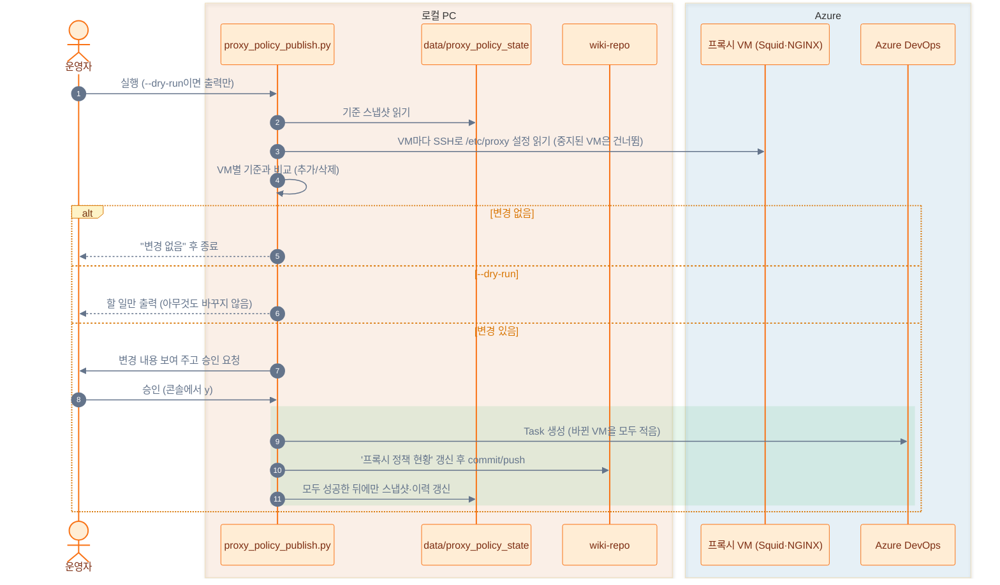

대상은 시나리오 2와 같은 기준으로 찾은 프록시 VM 중 Azure 태그 `proxy=squid|nginx`가 있는 VM 전체입니다. VM마다 `/etc/proxy/proxy.conf`와 `/etc/proxy/lists/*`(컨테이너에 연결된 설정 원본)를 읽어 정책 항목으로 나눠 비교합니다.

| 종류 | 비교하는 정책 항목 |
|---|---|
| Squid (wjy-proxy01·02) | 허용 도메인(`lists/whitelist.txt`), 허용 클라이언트(`acl … src`), `http_access`·`http_port` 규칙 |
| NGINX (wjy-proxy03) | 가상 도메인 라우팅(`server_name` → `set $upstream`/`proxy_pass`), 허용 클라이언트(`allow`), `deny`·`listen` 규칙 |

- 기준 스냅샷이 없는 VM(처음 보는 VM)은 Task 없이 지금 정책을 기준으로 저장하고 문서에 올립니다. 중간에 실패하면 스냅샷이 그대로라서 다음 실행 때 같은 변경을 다시 처리합니다.
- 중지된 VM은 읽지 못하므로 건너뛰고 기준도 그대로 둡니다. 문서에는 마지막으로 확인한 정책을 "읽지 못함" 표시와 함께 남깁니다.
- Wiki 문서는 `02. 운영 > 01. 공통 > 06. 네트워크 및 Proxy > 01. 네트워크 및 Proxy 현황 파악 > 프록시 정책 현황` 하나에 VM별 절로 씁니다.
- `proxy_policy_monitor.py`는 변경을 보여 주기만 하고 기준 스냅샷을 바꾸지 않으므로, 먼저 확인용으로 돌려도 이 단계의 변경 감지에 영향이 없습니다. 실행 기록은 `data/traces/proxy-policy-YYYYMMDD.jsonl`에도 남습니다.

### 6.3 프록시 로그 이상 탐지 (proxy_log_detect.py)


<sub>[↑ 목차로](#목차)</sub>

## 7. 프록시 VM 운영

리소스 그룹 `WJY-PROXY-RG`에 VM 3대가 있고, 모두 podman Quadlet(`/etc/containers/systemd/<이름>.container`)으로 컨테이너를 띄웁니다. 인바운드는 SSH와 프록시 포트(Squid 8080, NGINX 80)를 허용 클라이언트 IP에만 엽니다(NSG `Allow-SSH`, `Allow-squid-8080`, `Allow-nginx`). 이 PC의 공인 IP가 바뀌면 `sync_nsg_ip.py`(허브 "허용 IP 맞추기")로 출발지를 `PROXY_ALLOWED_CLIENTS`의 IP + 현재 IP로 맞춥니다(NSG 규칙 하나에 출발지 여러 개). Squid는 원래 3128이었는데, 2026-10-23 집 인터넷을 SK브로드밴드로 바꾼 뒤 3128로 나가는 연결이 막혀 2026-10-25에 8080으로 옮겼습니다.

| VM | 종류 | 접속 로그 위치 | 재시작·VM 중지 후 |
|---|---|---|---|
| wjy-proxy01, wjy-proxy02 | Squid 포워드 프록시 (8080) | VM 디스크 `/var/log/proxy/access.log` (컨테이너 `/var/log/squid`에 연결) | 남음 |
| wjy-proxy03 | NGINX 리버스 프록시 (80) | journald (`journalctl CONTAINER_NAME=nginx`) | 남음 |

- 컨테이너는 `--rm`이라 재시작할 때마다 새로 만들어집니다. 그래서 Squid 로그는 VM 디스크 폴더에 연결하고(2026-10-21 적용, `azure_proxy_vm.py`도 같이 만듦), NGINX 로그는 `podman logs`(지금 컨테이너만) 대신 journald에서 읽습니다.
- 여기서 VM 디스크 폴더는 **각 VM의 로컬 파일시스템**입니다. VM 3대가 공유하는 스토리지나 Azure Storage Account를 연결한 것이 아닙니다. 컨테이너 재생성과 VM·디스크 삭제는 다르므로, 장기 보관·중앙 수집·백업은 별도 구성이 필요합니다.
- 매일 01:00(KST)에 자동 종료(`shutdown-computevm-*`)됩니다. 꺼져 있는 동안 보낸 요청은 기록되지 않습니다.
- Squid 로그는 정리(logrotate) 없이 쌓입니다. 디스크 여유는 약 25GB입니다.

시험 요청 보내기 (허용 클라이언트 IP에서):

```powershell
curl.exe -x http://<VM_IP>:8080 https://www.data.go.kr/        # 포워드 프록시: 허용 도메인 → 200 (Squid 는 8080 만 엶)
curl.exe -x http://<VM_IP>:8080 https://www.google.com/         # 허용 목록 밖 → 터널 거부(403)
curl.exe -H "Host: law.wjy.test" http://<VM_IP>/LSW/main.html   # 리버스 프록시: Host 머리글로 가상 도메인 선택
```

리버스 프록시의 `data.wjy.test`·`law.wjy.test`는 NGINX 설정(`server_name`)에만 있는 이름입니다. 요청은 IP로 보내고 이름은 `Host` 머리글에만 실으므로 hosts·DNS가 필요 없습니다.

로그 뷰어(<http://proxy-log.local>)는 새로고침하는 동안 상단 진행 막대·회전 아이콘·흐린 표를 보여 주고, 끝나면 `갱신 HH:MM:SS · 새 로그 N건`(또는 `변경 없음`)을 잠깐 강조합니다. 로그 소스가 "실제 로그"면 VM의 진짜 로그이고, "가상 로그"일 때만 만들어 낸 데이터입니다.

로그 뷰어 서버는 요청마다 단계별 기록을 허브 로그(`data/logs/proxy-log.log`)와 `data/traces/proxy-log-YYYYMMDD.jsonl`에 남깁니다.

```text
2026-10-24 17:16:53 [a8ad86b7] ▶ logs  vm=wjy-proxy02 kind=squid source=real lines=200
2026-10-24 17:16:56 [a8ad86b7]   01 ssh_read                  2,838ms  what=podman squid access.log exit=0 bytes=3132
2026-10-24 17:16:56 [a8ad86b7]   02 parse                         0ms  format=squid lines=29 rows=29 skipped=0 allowed=9 denied=20 clients=1 domains=16 newest=2026-10-20T16:50:56
2026-10-24 17:16:56 [a8ad86b7]   03 detect                        0ms  findings=3 hits=high:…
2026-10-24 17:16:56 [a8ad86b7] ■ logs ok 2.8s | ssh_read 2.8s · detect 0.0s · parse 0.0s | vm=wjy-proxy02 … rows=29 denied=20 findings=3
```

- `logs`: 접속 로그 조회. `ssh_read`(SSH 소요 시간·받은 바이트) → `parse`(읽은 줄·해석한 줄·건너뛴 줄, 허용·차단 건수, 클라이언트·도메인 수, 가장 최근 기록) → `detect`(탐지 건수와 규칙). 가상 로그 파일은 `ssh_read` 대신 `file_read`.
- `policy`: 허용 목록 조회. 허용 클라이언트 수, 허용 도메인(NGINX는 가상 도메인) 수.
- 실패하면 `✗ 01 ssh_read … error=…`로 이유(SSH 시간 초과, 파일 없음 등)가 남습니다. 로그에는 IP 대신 VM 이름을 씁니다.

<sub>[↑ 목차로](#목차)</sub>

## 8. 시나리오 시험·실행

| 시나리오 | 시험 준비 | 실제로 바뀌는 것 | 정상으로 되돌리기 |
|---|---|---|---|
| 1 | 없음(wiki-repo 문서 그대로) | Wiki 등록 시 `00. AI 문서 생성` 아래 문서 | 등록한 문서 삭제 |
| 2 | 허브 "테스트 환경 준비"(`setup_env.py`) | wiki-repo 테스트 문서(로컬 커밋), 승인 시 Task | "원상 복구"(실제 VM과 같은 정상 표) 또는 다시 "테스트 환경 준비" |
| 3 | 허브 "장애 재현"(`proxy_fault_inject.py`) | proxy-config 커밋·VM 설정, 승인 시 Task·PR·이력 Wiki | PR 병합·배포 또는 "원상 복구" |

### 8.1 시나리오 1 · 시험

허브 **로컬 서버** 탭에서 Wiki 검색 서버를 켜고, **시나리오 실행** 탭의 시나리오 1 "실행"으로 Wiki 검색 화면을 엽니다. 따로 준비할 테스트 데이터는 없고 wiki-repo 문서를 그대로 씁니다.

| 시험 | 질의 예 | 확인할 것 |
|---|---|---|
| 기본 흐름 | `프록시 설정 가이드 알려줘` | 유형 선택(포워드/리버스) → 근거 문서 재검색 → 가이드 생성, 원문 링크 |
| 오타 교정 | `프록실 설정 가이드` | 화면의 "해석" 칩에 `프록시`로 교정되어 표시 |
| 웹 검색 보완 | `리버스 프록시 설정 가이드` (위키 근거가 약함) | "웹 참고 링크"가 붙음(웹 검색 공급자 필요, 3.5 참고) |
| 수정 요청 | 가이드 생성 후 "3단계를 표로 정리해 주세요" | 요청한 부분만 바뀐 새 판 |
| Wiki 등록 | "Wiki에 등록" | `02. 운영 > 00. AI 문서 생성` 아래 `NN. 제목` 문서. 시험만 할 때는 `.env`의 `WIKI_REGISTER_PUSH=0`(로컬 커밋만) |

- 단계별 소요 시간과 결과는 허브의 Wiki 검색 로그(`data/logs/scenario1.log`)와 `data/traces/wiki-search-*.jsonl`에 남습니다([트레이스](#트레이스)).
- LLM 게이트웨이·임베딩 연결만 따로 확인하려면 `python test\openai_test.py`, `python test\embedding_test.py`, `python test\streaming_test.py`를 실행합니다.
- 시험으로 등록한 문서는 Wiki의 `00. AI 문서 생성` 아래에서 지우고 `.order`에서도 뺍니다([`rules/WIKI_DOCUMENT_RULES.md`](rules/WIKI_DOCUMENT_RULES.md)).

### 8.2 시나리오 2 · 테스트 환경

시나리오 2는 Wiki의 Proxy 현황 문서와 Azure의 실제 VM을 비교해, 차이가 있으면 승인을 받아 Task를 만들고 문서를 현행화합니다. 테스트 환경은 Azure를 바꾸지 않고 Wiki 쪽에 일부러 차이를 넣어 만듭니다.

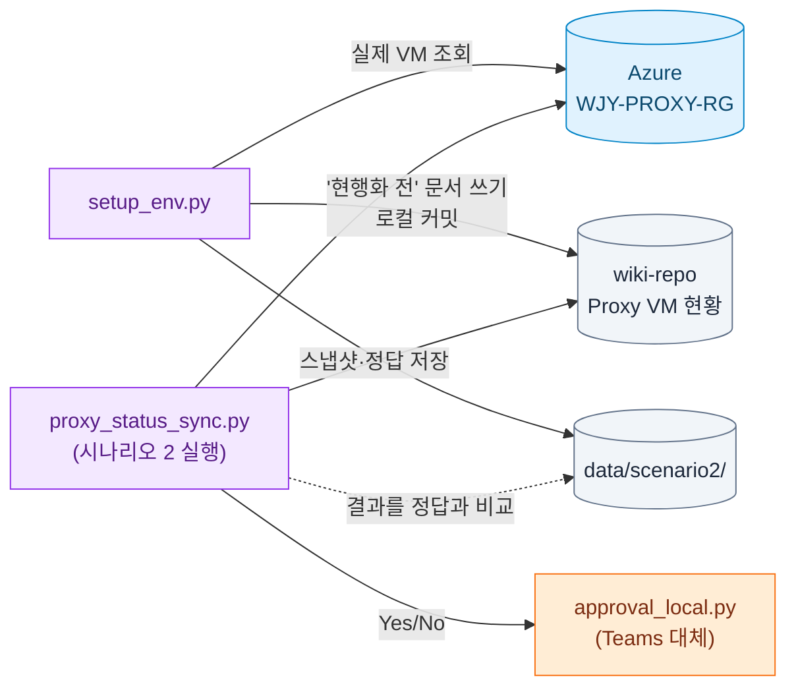

`setup_env.py`는 리소스 그룹 `WJY-PROXY-RG`에서 이름이 proxy·prxy·pxy(+숫자)로 끝나는 VM을 읽어 아래 차이를 넣은 Wiki 문서를 만듭니다. 실제 값과 정답은 `data/scenario2/`에만 저장합니다(저장소 공개).

| VM | Wiki(현행화 전) | 비교 단계가 찾아야 할 차이 |
|---|---|---|
| 1번째 VM | 상태·SIZE를 실제와 다르게 | 상태 변경, 스펙 변경 |
| 2번째 VM | 사설 IP를 실제와 다르게 | IP 변경 |
| 3번째 VM | 표에서 뺌 | 신규 |
| 없는 VM(`*-prxy04`) | 표에 넣음 | 삭제 |

```powershell
python test\scenario2\setup_env.py            # 꺼진 Proxy VM 켜기 + 표·정답 재생성 + 문서를 '현행화 전'으로 (허브 "테스트 환경 준비")
python test\scenario2\setup_env.py --check    # 점검만, 아무것도 바꾸지 않음
python teams_tools\approval_local.py --title "Proxy 현황 변경 감지" "신규: wjy-proxy03"   # 승인 화면만 시험
```

- 점검 항목: az 로그인과 Proxy VM 3대 이상, 스냅샷과 실제 VM 일치, Azure DevOps PAT, 승인 화면 모듈.
- 실제 운영처럼 VM이 모두 켜진 상태로 시험합니다. 테스트 VM은 비용 때문에 매일 01:00 자동 종료되므로, 옵션 없이 실행하면 꺼진 VM부터 켜고 실제 VM 값으로 표와 정답을 다시 만듭니다. `--check`가 "스냅샷과 다름"으로 실패해도 옵션 없이 다시 실행하면 됩니다.
- Wiki 문서는 wiki-repo에 로컬 커밋만 하고 Azure DevOps Wiki로 push하지 않습니다.
- Teams 연동(Workflows 웹후크·승인 카드·Graph API)에는 회사·학교용 Microsoft 365 계정이 필요합니다(무료 개인 Teams 불가, 가장 싼 선택지는 Microsoft 365 Business Basic). Teams 카드의 응답을 이 PC 스크립트로 돌려받으려면 Power Automate 프리미엄(HTTP 액션)이 필요합니다.

### 8.3 시나리오 2 · 실행 (proxy_status_sync.py)

| 단계 | 하는 일 |
|---|---|
| 1. trigger | 직접 실행(허브 "시나리오 실행" 탭 또는 명령줄) |
| 2. wiki_read | Wiki 문서의 `## VM 목록` 표를 읽음 (머리글 이름으로 칸을 찾음). 문서는 `SCENARIO2_WIKI_PAGE`(비우면 테스트 문서) |
| 3. azure_read | 리소스 그룹에서 `SCENARIO2_TAG` 태그가 있거나, 이름이 proxy·prxy·pxy(+숫자)로 끝나는 VM(프록시로 추정)의 IP·상태·SIZE·리전. `SCENARIO2_EXCLUDE_TAG` 태그가 있는 VM은 뺌 |
| 4. compare | 신규·삭제·변경(사설/공인 IP, 상태, SIZE, LOCATION, RESOURCE GROUP). 차이 없으면 종료. Proxy(용도) 칸은 사람이 관리하므로 비교하지 않음 |
| 4.5 llm_summary (AI) | 차이 전체를 2문장·120자 이내 존댓말로 요약해 LLM(`OPENAI_MODEL`)으로 승인 카드·화면·Task 맨 위에 "AI 요약 · 참고용"으로 넣음(위험도는 기준이 없어 표시하지 않음). 차이 목록은 규칙으로 만든 짧은 줄 그대로. 비교 자체는 규칙으로 하고 AI는 설명만 함. 데이터에 없는 사실은 '확인 필요'로 쓰게 함. 실패하거나 LLM 설정이 없으면 규칙 목록만 표시하고 트레이스에 이유를 남김 |
| 5. approval | Teams 채널에 요약 카드와 **Yes · 현행화 / No · 기록만** 버튼을 보내고 이 PC의 승인 서버에서 답을 기다림(기본 15분, `SCENARIO2_TIMEOUT`). 웹후크가 없으면 승인 화면을 브라우저로 엶. No·시간 초과는 Teams에 알리고 종료. 이름 규칙으로만 찾은 VM이 있으면 카드에 "프록시로 추정한 VM(한 번만 확인)"을 붙임 |
| 5.5 proxy_confirm | 승인(Yes) 직후 추정 VM에 태그를 붙여 확정(다음 실행부터 묻지 않음). Teams 카드의 Yes는 모두 프록시로 확정하고, 승인 화면(자세히 보기)에서 '프록시 아님'을 체크하면 그 VM은 `role=not-proxy` 태그를 붙이고 다시 비교해 반영에서 뺌. 태그 실패는 다음 실행 때 다시 물음 |
| 6. backlog · task_create | 백로그 아래에 Task 생성: Epic `01. 공통`(#1) → Feature `[공통] Proxy 현황 관리` → 그 달 PBI `YYMM) Proxy VM 현황 Wiki 현행화` → Task `NN. [Proxy 현황] …`. Feature·PBI는 있으면 다시 쓰고 없으면 만들며(달이 바뀌면 새 PBI), Task는 PBI 아래 다음 순번. 담당자 = `SCENARIO2_ASSIGNEE` 또는 PAT 소유자, Area·Iteration은 상위 항목을 따름, 태그 `proxy-status; scenario2`. 이름·Epic은 `SCENARIO2_EPIC_ID`·`SCENARIO2_FEATURE`·`SCENARIO2_PBI`로 바꿈 |
| 7. wiki_update | 표를 Azure 값으로 고치고 `## 변경 이력`에 행 추가, 최종 수정일 갱신 → wiki-repo 커밋 (`SCENARIO2_PUSH=1`일 때만 push) |
| 8. report | Task를 완료 상태(프로세스의 Completed 범주, 예: Done)로 바꾸고 댓글, Teams에 결과 카드 |

```powershell
python proxy_tools\proxy_status_sync.py              # Teams 승인 후 Task·Wiki 반영 (허브 "실행" 버튼과 같음)
python proxy_tools\proxy_status_sync.py --dry-run    # 1~4단계만, 아무것도 바꾸지 않음
```

- 옵션은 `--dry-run` 하나입니다. push·승인 대기 시간·비교할 문서는 `.env`의 `SCENARIO2_PUSH`, `SCENARIO2_TIMEOUT`, `SCENARIO2_WIKI_PAGE`로 정합니다. 다른 형식의 문서(예: `Proxy-VM-정리-('26.09.17-기준).md`)를 LLM 파싱으로 시험하려면 `SCENARIO2_WIKI_PAGE`에 그 경로를 넣습니다.
- Teams의 Yes/No 버튼을 누르면 "받았습니다. 결과는 Teams 결과 카드로 알려 드립니다" 확인만 뜨고, 처리 단계(✓ Task 생성 → ✓ Wiki 현행화 → ✓ 완료 처리)와 링크는 Teams 결과 카드로 옵니다. 확인 화면의 "진행 상황 보기"나 카드의 "자세히 보기"로 연 브라우저 화면은 단계를 실시간으로 보여 주고, 끝나면 "Wiki 문서가 수정되었습니다. 열어 둔 문서 창은 새로고침(F5) 하세요"와 **수정된 Wiki 문서 열기**·**Task 열기** 버튼을 보여 줍니다. 승인 화면·Teams 카드·Task에는 로컬 Wiki 뷰어 링크가 있고, 문서가 Azure DevOps Wiki에 push되어 있을 때만 그 링크도 붙습니다.
- Teams 카드의 버튼은 `http://127.0.0.1:8771/decide?...&token=…`을 엽니다. **알림을 보낸 PC에서** 눌러야 하고, token은 요청마다 새로 만들어 다른 요청의 버튼으로는 결정되지 않습니다. Teams 안에서 응답을 받아 이 PC로 돌려주려면 Power Automate 프리미엄(HTTP 액션)이 필요해서 이 방식을 씁니다.
- 실행 출력은 콘솔과 `data/logs/scenario2.log`(허브의 **시나리오 실행** 탭에서 봄)에, 노드별 상세 기록은 `data/traces/scenario2-YYYYMMDD.jsonl`에 남습니다(승인 결과 `decision=yes|no|timeout` 포함).
- 테스트를 다시 하려면 `python test\scenario2\setup_env.py`로 Wiki 문서를 '현행화 전'으로 되돌립니다.

### 8.4 시나리오 3 · 시험

허브 **시나리오 실행** 탭의 시나리오 3 칸에서 ①→②→③ 순서로 합니다. 세 버튼 모두 실제 저장소·VM·Azure DevOps를 바꿉니다. 아무것도 바꾸지 않고 원인·수정안만 보려면 `python proxy_tools\incident_response.py --dry-run`을 씁니다.

**전 과정 시험 절차**:
  1. 장애 종류를 고르고 **장애 재현**: proxy-config에 잘못된 설정을 커밋·push하고 wjy-proxy01에 배포한 뒤 시험 트래픽을 보냄(`proxy_fault_inject.py apply <종류> --push --deploy wjy-proxy01`). 종류는 허용 도메인 오타(`whitelist-typo`), 허용 클라이언트 IP 오타(`client-acl-typo`), 잘못된 DNS 서버(`bad-dns`).
  2. 60분 안에 **② 실행** → Teams 승인 → 원인 커밋을 되돌리는 수정 PR까지 생김.
  3. 끝나면 PR을 병합하고 VM에 배포합니다. PR 병합만으로는 VM에 반영되지 않습니다(소스 병합과 VM 배포를 따로 함).
     - Azure DevOps **Pipelines** › **proxy-config VM 배포** › **Run pipeline**: 실행 중인 squid VM 모두에 main을 배포합니다(proxy-config `azure-pipelines.yml`, `az vm run-command`라 SSH 키·NSG 변경 없음, 서비스 연결 `proxy-vm-deploy`). 실행할 때 "문법 확인만"을 켜면 설치하지 않습니다.
     - 또는 허브 **원상 복구**(`proxy_fault_inject.py restore --push --deploy wjy-proxy01`): 심어진 장애가 있으면 되돌리는 커밋을 push하고, 없어도 지금 main을 wjy-proxy01에 배포한 뒤 시험 트래픽으로 확인합니다.
  - **② 실행**은 시작할 때와 끝날 때 운영 중인 squid VM의 배포된 설정(`/etc/proxy/proxy.conf`, `lists/*`)을 저장소 `origin/main`의 `squid/`와 비교합니다(`config_drift`). 다르면 로그에 `⚠ 경고`와 다른 파일 이름을 남깁니다. 병합한 수정이 배포되지 않은 경우를 잡으려고 넣었습니다(2026-10-31).
  - 장애 커밋·push는 됐는데 배포(SSH)가 실패했다면 같은 종류로 **장애 재현**을 다시 누릅니다. 같은 장애가 이미 심어져 있으면 커밋 없이 배포·시험 트래픽만 다시 합니다(다른 종류가 심어져 있으면 거절).
  - 두 버튼 모두 실제 저장소와 VM을 바꾸므로 누르면 한 번 더 확인합니다. 배포 직전 VM 설정은 `/etc/proxy/backup/<시각>/`에 남습니다(proxy-config `deploy.sh`).
  - 세 VM 모두 SSH가 `connect to host … port 22: Connection timed out`으로 실패하면 VM이 켜져 있어도 이 PC의 공인 IP가 NSG 허용 IP와 다른 경우입니다(회선 변경·테더링). 이때 시나리오 3은 "점검 불가"(종료 코드 2)로 끝나고 현재 공인 IP와 NSG 허용 IP를 비교한 원인 추정을 로그에 남깁니다(일부 VM만 못 읽어도 장애가 없으면 점검 불가). **허용 IP 맞추기**(`python proxy_tools\sync_nsg_ip.py`, 비교만: `--check`)로 NSG에 현재 IP를 넣은 뒤 다시 실행합니다(`PROXY_ALLOWED_CLIENTS`의 IP는 유지). Squid의 허용 클라이언트(`acl allowed_clients`)는 바꾸지 않습니다.
  - 시험 트래픽은 이 PC에서 프록시 **8080** 포트로 보냅니다(`traffic.sh` 기본값, `PROXY_PORT`로 변경). 이 PC의 네트워크(집, SK브로드밴드)에서 3128로 나가는 연결이 막혀 Squid를 8080으로 옮겼습니다(2026-10-25).

실행 출력은 `data/logs/scenario3.log`(허브에서 봄), 단계별 기록은 `data/traces/scenario3-*.jsonl`에 남습니다.

**시험 기록**

- 2026-10-24 (분석만): 최근 60분 로그가 없어 "이상 없음", 범위를 넓히면 wjy-proxy02의 도메인 스캔·차단 반복, wjy-proxy03의 미허용 클라이언트를 감지했고 LLM은 "설정 정책대로 막힌 것이라 고칠 설정 없음"으로 판단해 수동 조치로 돌렸습니다(`--dry-run`).
- 2026-10-25 (전 과정): 허용 도메인 오타(`.data.go.kr` → `.date.go.kr`)를 wjy-proxy01에 배포 → 감지(허용 도메인이 차단됨·차단 반복) → AI가 원인 커밋 `f7e50de`와 한 줄 수정안을 찾음 → Teams 승인 → Task #2508(PBI #2507) → proxy-config PR !1 → 장애 대응 이력 Wiki·Teams 결과 카드. PR을 병합(Task Done)하고 배포해 `traffic.sh` ok=20 fail=0으로 정상화했습니다. 이때 나온 문제(Wiki push 경고 섞임, CRLF 비교, Teams 링크에 조사 포함)는 고쳤습니다.

### 8.5 README 화면 재촬영

촬영 스크립트는 [`test/capture_readme.py`](test/capture_readme.py)입니다. 실제 로컬 서버 화면을 headless Chrome으로 열어 `docs/images/`의 PNG를 갱신합니다. 캡처 전 허브에서 Wiki 검색·Wiki 뷰어·프록시 로그 뷰어를 시작하고, 이 문서의 hosts 설정과 VM SSH 연결을 확인합니다.

```powershell
python -m venv data/readme-capture-venv
& .\data\readme-capture-venv\Scripts\python.exe -m pip install playwright python-dotenv
& .\data\readme-capture-venv\Scripts\python.exe test\capture_readme.py --inspect
& .\data\readme-capture-venv\Scripts\python.exe test\capture_readme.py
```

Google Chrome이 설치되어 있어야 합니다. `--only wiki|viewer|hub|proxy|approval|teams|wikidiff|devops`로 특정 화면 묶음만 다시 찍을 수 있습니다(`--only wiki`처럼 하나를 지정).

| 화면 | 캡처 시 수행하는 동작 | 외부 반영 |
|---|---|---|
| 시나리오 1 | 실제 Wiki 검색 → 포워드 가이드 생성(캐시가 있으면 "새로 만들기"로 새로 생성) → "다시 선택"으로 같은 질의 재요청(캐시 사용) → 리버스 가이드 생성(웹 검색 보완)·수정 입력 영역 확인 | LLM·임베딩, 조건에 따라 웹 검색 API 호출. Wiki 등록·수정 반영 버튼은 누르지 않음 |
| 시나리오 2 | 허브에서 저장된 점검 로그 조회 | 새 점검·Teams 요청·Task 생성·Wiki 갱신 없음 |
| 시나리오 3 | Squid·NGINX 실제 로그·정책 조회, 허브의 기존 실행 로그 조회 | SSH 읽기만 수행. 장애 주입·복구·PR 생성·배포 없음 |
| 승인·완료 화면 | 실제 실행 때 `data/approvals/`에 남긴 승인 화면 내용·최종 진행 상태(시나리오별 Yes로 끝난 최신 1건)를 같은 화면 코드로 읽기 전용 서버에 띄워 촬영. 기록이 없으면 예시 데이터 | 없음. 예시 데이터일 때만 **화면 예시 · 외부 반영 없음** 표시 |
| Wiki 수정 전/후 (`--only wikidiff`) | wiki-repo에서 시나리오 2의 마지막 현행화 커밋과 그 직전 파일을 꺼내 위아래로 그리고, 표는 첫 칸(이름)으로 행을 맞춰 바뀐 칸·추가 행·삭제 행을 빨갛게 표시 → `wiki-scenario2-diff.png` | 없음 |
| Azure DevOps (`--only devops`) | 허브가 띄운 Chrome(전용 프로필, 포트 9222)에 붙어 시나리오별 승인 기록의 처리 단계 링크로 화면을 찍음 → 시나리오 2 `devops-scenario2-pbi.png`·`devops-scenario2-task.png`, 시나리오 3 `devops-scenario3-task.png`·`devops-scenario3-pr.png`·`devops-scenario3-pr-files.png`. 그 Chrome 창에서 Azure DevOps에 한 번 로그인해 두어야 함 | 없음(조회만). 이름·이메일·IP는 가리고 프로필 사진은 흐리게 |
| Teams 카드 (`--only teams`) | `data/teams_cards/`에 남은 **실제 전송 카드** 중 종류별 최신 1장(시나리오 2·3의 승인 요청·결과)을 Adaptive Cards 공식 렌더러(`adaptivecards@3.0.5`)로 그림 → `teams-scenario2-approval.png`, `teams-scenario2-result.png`, `teams-scenario3-approval.png`, `teams-scenario3-result.png` | 없음. Teams에 다시 보내지 않음. 멘션 이름·계정·PC 이름은 그리기 전에, IP·이메일은 화면에서 가림 |

로컬 승인 화면은 승인을 기다리는 동안에만 떠 있으므로, `approval_local.Approval`이 화면 내용과 끝난 뒤 진행 상태를 `data/approvals/`(Git 제외)에 남깁니다(`APPROVAL_ARCHIVE=0`이면 끔). Teams 카드는 `teams_notify.send`가 보낼 때마다 `data/teams_cards/`(Git 제외)에 JSON으로 남깁니다(`TEAMS_CARD_ARCHIVE=0`이면 끔). Teams 채널 이력을 Graph로 읽으려면 관리자 동의 권한(`ChannelMessage.Read.All`)이 필요해서 보내는 쪽에서 남깁니다. 그래서 카드 화면을 새로 찍으려면 먼저 시나리오 2(테스트 환경 준비 → 실행 → Yes)와 시나리오 3(장애 재현 → 실행 → Yes)을 실제로 한 번씩 실행합니다. 스크립트는 표시되는 IP·이메일·ID를 가리고 촬영하며, 확인용 화면 텍스트는 Git에서 제외한 `data/readme-capture/`에 남깁니다. 공유 전에는 이미지도 직접 확인합니다. 시나리오 2 로그를 새로 만들려면 촬영 전에 `python proxy_tools/proxy_status_sync.py --dry-run`을 실행합니다(비교·AI 요약만 수행, 로컬 로그·트레이스 기록).

<sub>[↑ 목차로](#목차)</sub>

## 9. 실행 예시

프로젝트 루트에서 실행합니다. 다른 폴더에서 실행해도 `.env`·`wiki-repo`·`data`는 프로젝트 루트 기준으로 찾습니다.

명령줄 옵션은 최소로 두고, 접속 정보·동작 방식은 `.env`로 정합니다. 화면이 있는 기능은 허브(<http://ai-master.local>)에서 실행하는 것이 기본입니다.

| 도구 | 옵션 | 나머지는 `.env` |
|---|---|---|
| `hub.py` | `--start-all`, `--no-restart`, `--no-browser`, `--keep` | - |
| `proxy_status_sync.py` (시나리오 2) | `--dry-run` | `SCENARIO2_*` (push, 승인 대기, 비교 문서 등) |
| `test\scenario2\setup_env.py` | `--check` | 옵션 없이 실행하면 VM 켜기 + 표·정답 재생성 + 문서 초기화 |
| `wiki_register.py` (시나리오 1 명령줄 등록) | `--query`, `--model` | `WIKI_REGISTER_PUSH` |
| `incident_response.py` (시나리오 3) | `--dry-run` | `SCENARIO3_*`, `PROXY_CONFIG_DIR` |
| `proxy_policy_publish.py` | `--dry-run` | `PROXY_SSH_*` |
| `proxy_policy_monitor.py` | 없음 | `PROXY_SSH_*` |
| `proxy_log_detect.py` | `simulate` / `detect` 하위 명령 | `PROXY_ALLOWED_CLIENTS` |
| `setup_proxy_config.py` | `--check` | `AZURE_DEVOPS_*`, `PROXY_ALLOWED_CLIENTS`, `PROXY_CONFIG_DIR` |
| `sync_nsg_ip.py` | `--check`, `--resource-group` | `PROXY_ALLOWED_CLIENTS`(유지할 IP), `SCENARIO2_RESOURCE_GROUP`(기본 WJY-PROXY-RG) |
| `proxy_fault_inject.py` (장애 재현) | `list` / `status` / `apply` / `restore`, `--push`·`--deploy <VM 이름 또는 IP>` | 외부(저장소·VM)를 바꾸는 동작이라 옵션으로 명시할 때만 함 |

```powershell
python wiki_tools\wiki_search.py
python wiki_tools\wiki_viewer.py
python wiki_tools\wiki_documents.py list
python proxy_tools\proxy_log_viewer.py
python proxy_tools\proxy_log_detect.py detect --host <VM_IP>
python proxy_tools\proxy_policy_publish.py --dry-run
python proxy_tools\azure_proxy_vm.py --proxy squid --install podman --dry-run
```

<sub>[↑ 목차로](#목차)</sub>

## 10. 주의사항

- `AZURE_OPENAI_API_KEY`, `AZURE_DEVOPS_PAT`, `OPENAI_API_KEY`, `TAVILY_API_KEY`를 소스에 직접 작성하지 마세요. `.env.sample`에도 실제 값을 넣지 않습니다(공개 저장소에 올라감).
- 이미 노출된 인증정보는 폐기하고 재발급하세요.
- 이 저장소는 공개입니다. 실제 VM IP, 허용 클라이언트 IP, 구독 ID, 사내 게이트웨이 주소는 소스·README에 쓰지 말고 `.env` 또는 `data/`(Git 제외)에만 둡니다. 예시에는 `<VM_IP>`나 문서용 IP(`203.0.113.x`)를 씁니다.
- `wiki-repo`는 별도 Git 저장소(Azure DevOps Wiki)이며 ai-master의 `.gitignore`에 들어 있습니다. Wiki 변경은 `wiki-repo` 안에서 따로 커밋·push합니다. Wiki 문서를 만들거나 고칠 때는 [`rules/WIKI_DOCUMENT_RULES.md`](rules/WIKI_DOCUMENT_RULES.md)를 먼저 따릅니다.
- 같은 주소로 서버를 두 번 띄우면 두 번째 실행은 "이미 사용 중" 메시지로 끝납니다. 코드를 바꾼 뒤에는 기존 서버를 끄고 다시 실행하세요(허브의 재시작 버튼).

<sub>[↑ 목차로](#목차)</sub>
