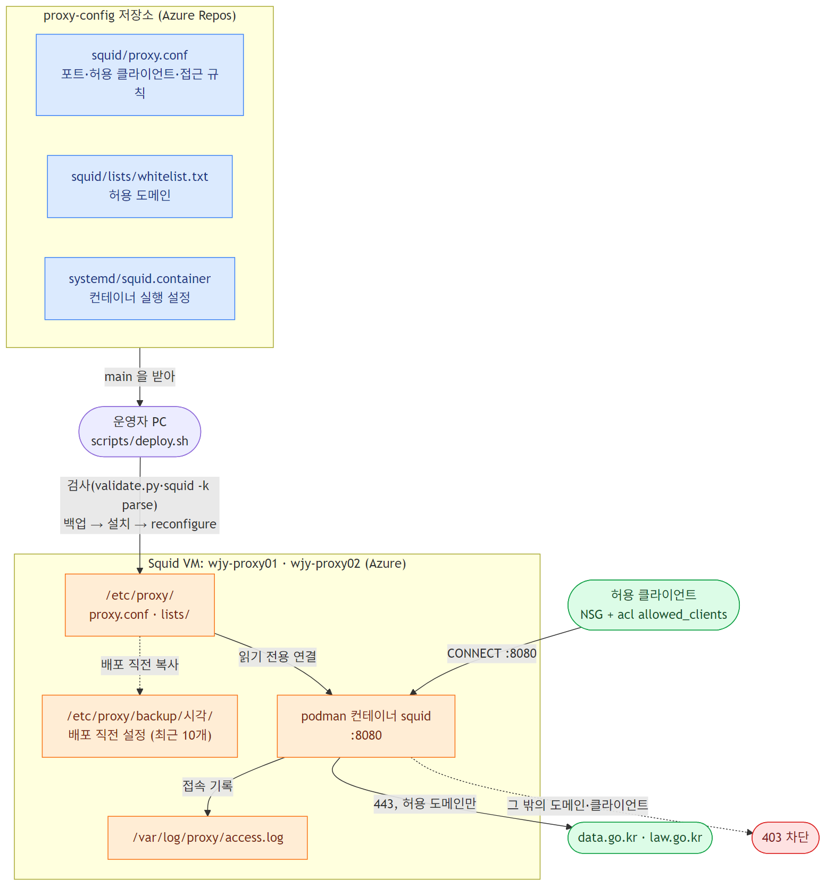
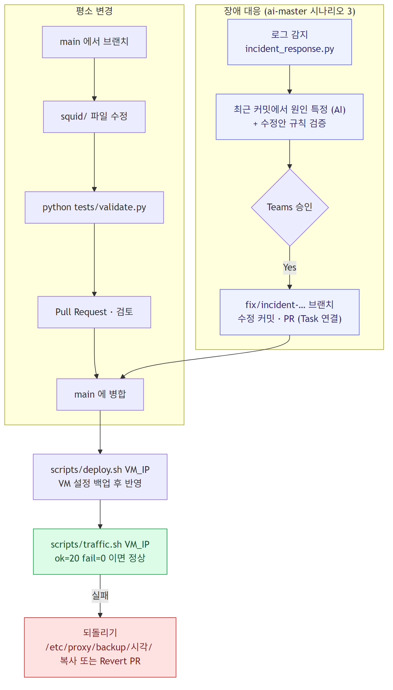

# proxy-config

`wjy-proxy01`·`wjy-proxy02`(Azure VM, podman + Squid)에 배포하는 프록시 설정의 원본 저장소입니다.
VM의 `/etc/proxy`를 직접 고치지 않고 이 저장소에서 바꾼 뒤 배포합니다. 장애가 나면 이 저장소의 변경 이력을 보고 원인을 찾고, 수정은 Pull Request로 반영합니다.

처음 만드는 방법: ai-master 에서 `python proxy_tools/setup_proxy_config.py` 를 실행하면 ai-master 의 `proxy_tools/proxy-config-seed/` 로 이 저장소를 Azure Repos 에 만들고 로컬에 받습니다.

## 구성도



## 구성

| 저장소 경로 | VM 경로 | 컨테이너 안 경로 | 설명 |
|---|---|---|---|
| `squid/proxy.conf` | `/etc/proxy/proxy.conf` | `/etc/squid/squid.conf` | Squid 설정 (ASCII만 사용) |
| `squid/lists/whitelist.txt` | `/etc/proxy/lists/whitelist.txt` | `/etc/squid/lists/whitelist.txt` | 접속 허용 도메인. 한 줄에 하나, 앞에 `.`을 붙이면 하위 도메인 포함 |
| `systemd/squid.container` | `/etc/containers/systemd/squid.container` | - | podman Quadlet 유닛 (`squid.service`) |
| `scripts/deploy.sh` | - | - | 검사 → 업로드 → `squid -k parse` → 지금 설정 백업(`/etc/proxy/backup/<시각>/`, 최근 10개) → 설치 → reconfigure |
| `scripts/traffic.sh` | - | - | 프록시를 거쳐 허용 도메인에 테스트 요청을 보냄 |
| `tests/validate.py` | - | - | 배포·머지 전 형식 검사 |

현재 정책은 다음과 같습니다.

- 허용 클라이언트: `squid/proxy.conf` 의 `acl allowed_clients` (처음 만들 때 ai-master `.env` 의 `PROXY_ALLOWED_CLIENTS` 값으로 채움)
- 허용 도메인: `data.go.kr`, `law.go.kr` (하위 도메인 포함)
- 포트: 8080 수신(3128 은 일부 네트워크에서 막혀 2026-10-25 에 8080 으로 바꿈), 목적지는 80·443만, CONNECT는 443만

## 변경 절차



1. `main`에서 브랜치를 만들고 `squid/` 아래 파일을 고칩니다.
2. `python tests/validate.py`로 검사합니다.
3. Pull Request를 만들고 검토 후 `main`에 머지합니다.
4. `main`을 VM에 배포하고 테스트 트래픽으로 확인합니다.

```bash
scripts/deploy.sh <VM_IP>            # 설정만 바꾼 경우 (reconfigure)
scripts/deploy.sh <VM_IP> --restart  # DNS 설정처럼 재시작이 확실한 경우
scripts/traffic.sh <VM_IP>           # ok=20 fail=0 이면 정상
```

배포 직전 VM 의 설정은 `/etc/proxy/backup/<시각>/` 에 남습니다. 되돌리려면 VM 에서 `sudo cp -a /etc/proxy/backup/<시각>/* /etc/proxy/` 후 `sudo podman exec squid squid -k reconfigure` 를 실행합니다.

Windows에서는 Git Bash에서 실행합니다. SSH 키(`~/.ssh/id_rsa`)로 `azureuser`에 접속할 수 있어야 하고, VM이 켜져 있어야 합니다.

## 장애 대응

- 접속 로그 이상 탐지는 ai-master의 `proxy_tools/proxy_log_detect.py detect --host <IP>`로 합니다.
- `squid -k parse`와 `validate.py`는 문법·형식만 봅니다. 도메인 철자, 허용 IP, DNS 서버가 틀려도 통과하므로 배포 후에는 반드시 `traffic.sh`로 확인합니다.
- 원인이 이 저장소의 변경이면 `fix/<Task 번호>-<요약>` 브랜치에서 고치고, PR 설명에 Task 번호와 원인 커밋을 적습니다.

그림 원본은 `docs/*.mmd`(Mermaid)입니다. 고친 뒤 `npx -p @mermaid-js/mermaid-cli mmdc -i docs/architecture.mmd -o docs/architecture.png -b white -s 2` 로 다시 그립니다(Azure Repos 는 README 안의 Mermaid 를 그리지 않아 그림 파일로 넣음).
